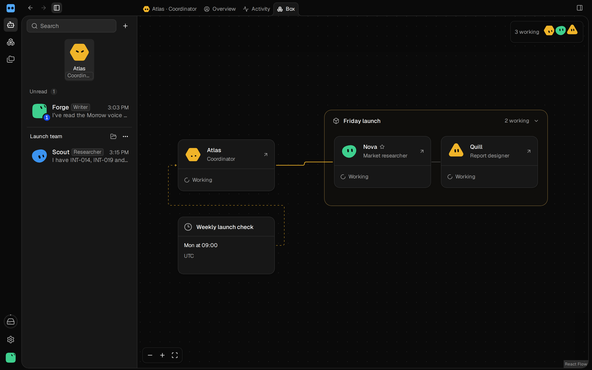
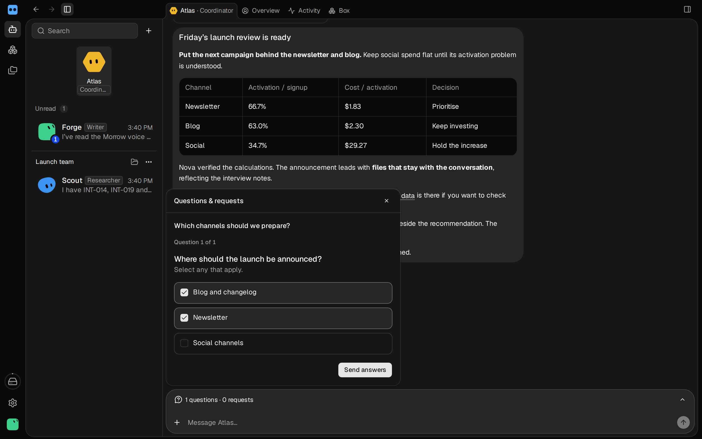
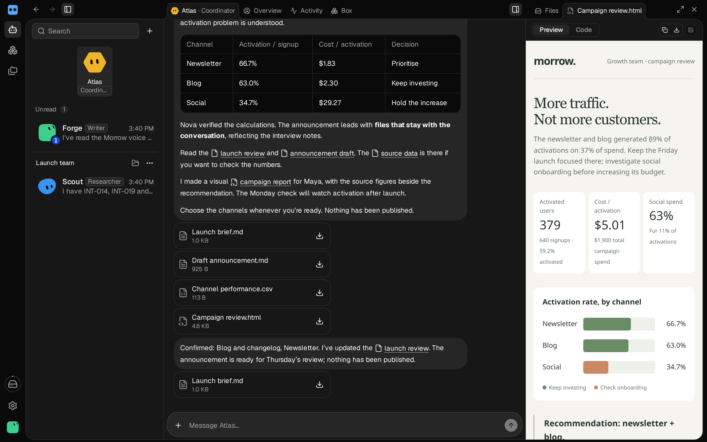

<div align="center">
  
  <h1>Openlet</h1>
  <p><strong>Always-on AI teams</strong></p>
  <p>Give your agents a project. They'll share the work and bring you the decisions that need you.</p>
  <p>
    <a href="https://openlet.qninhdt.com/app-preview"><strong>Try the demo</strong></a> ·
    <a href="#quickstart">Run locally</a> ·
    <a href="#architecture">Architecture</a>
  </p>
</div>



## Quickstart

Run the sample workspace with Node.js and pnpm. CI uses Node.js `26.13.0` and the repo pins pnpm `12.18.0`.

```sh
git clone https://github.com/qninhdt/openlet.git
cd openlet
pnpm install --frozen-lockfile
pnpm dev
```

Open [localhost:5173/app-preview](http://localhost:5173/app-preview). This demo uses sample data and runs without accounts or provider credentials.

<details>
<summary>Run a full workspace with your own account and models</summary>

Install Docker with Compose v2 (`!reset` support), Go `1.27.4`, Python `3.14`, uv `0.13.7`, and Make. From the repository root, create local copies of the configuration templates.

```sh
install -d -m 700 .local
test -e .env || install -m 600 .env.example .env
test -e .local/openlet.yaml || install -m 600 infra/config/openlet.example.yaml .local/openlet.yaml
```

| Configure | What to set |
| --- | --- |
| Clerk | Set the issuer, JWKS URL, and audience in `auth.clerk`. Configure the Clerk `openlet` JWT template for the matching audience and include `user.public_metadata`. Set `CLERK_SECRET_KEY` and add `CLERK_PUBLISHABLE_KEY` to the root `.env` for the web app. |
| Object storage | Supply an S3-compatible endpoint, bucket, region, and credentials. Allow the web origin and expose `ETag` in the bucket's CORS policy for signed browser transfers. |
| Service secrets | Fill the database passwords, SpiceDB and Qdrant keys, and the other environment variables referenced by the enabled services. Keep secret values in the private `.env`. |
| Model gateway | Set `OPENAI_BASE_URL`, `OPENAI_API_KEY`, and an independent `LITELLM_MASTER_KEY`. Match the model aliases and embedding dimensions to the deployments in [LiteLLM config](infra/config/litellm.yaml). |
| Document conversion | Set `DATALAB_API_KEY` to process PDF and DOCX. Set `dependencies.s3.processing_download_endpoint` if Datalab should fetch via an externally reachable signed HTTPS URL. |
| Agent web tools | Set `TINYFISH_API_KEY` and enable `services.leta.web_search` in the shared YAML. |
| Prompt registry | Configure Langfuse credentials and publish `leta/leta`, `leta/leti`, `leta/compaction`, and `letfs/enrichment` under the configured label. See the [managed prompt sources](apps/leta/prompts/README.md). |

The sample S3 address belongs to the isolated test stack. For the normal stack, use a bucket reachable from the application and its intended clients. Base Compose starts Platform, LetFS, and the ingest workers. Enable the `leta` profile before startup to add Redis, the Leta API and worker, and the Leta migrations. Set `telemetry.otlp_endpoint: null` for local operation without an OTLP collector. [Secret template](.env.example) · [Shared YAML](infra/config/openlet.example.yaml) · [Compose](infra/compose.yaml)

```sh
# Omit this export if you only need the core services.
export COMPOSE_PROFILES=leta
make up
docker compose -f infra/compose.yaml -f .local/generated/compose.runtime.yaml ps -a
```

`make up` renders private runtime configuration, builds the images, and starts the stack with health checks. Startup takes a PostgreSQL backup before initialization and migrations. Use fresh databases for the current schema baselines. The default Envoy listener on the host is `127.0.0.1:8080`. Vite proxies `/v1` there.

Run `pnpm dev` in another terminal. Sign in, open the workspace created during onboarding, and use the **+** menu to create an agent when the Leta profile is enabled. Use `make logs` to inspect startup and `make down` to stop the stack while retaining its volumes. [Local app](http://localhost:5173/app) · [Web configuration](apps/web/README.md)

</details>

## Work with an agent team

Assign a launch review to one agent and let it pass the research and writing to others. They can run scripts to analyze the files you share and save the report alongside the sources. Set up a recurring review once and it can run while everyone is away. You can talk privately with an agent your team shares.

<details>
<summary>Walk through the Morrow launch demo</summary>

Atlas reviews the launch plan, Nova checks the campaign numbers, and Quill prepares the report. The Box tab shows who's working and what's scheduled.

When Atlas asks which channels to prepare, open **Questions & requests** and select **Blog and changelog** and **Newsletter**.



Send your answers, then open **campaign report** from the conversation to see the recommendation and the figures behind it.



</details>

## Architecture

[](.github/assets/readme/architecture.png)

[Excalidraw source](.github/assets/readme/architecture.excalidraw)

| Component | Responsibility |
| --- | --- |
| Web | React and Vite client for chat, activity, Box graphs, storage, and workspace settings. [Web app](apps/web/) |
| Envoy | Checks Clerk JWTs against the configured JWKS, sets trusted identity headers, transcodes public Platform and LetFS gRPC APIs, and routes Leta HTTP and SSE. [Gateway template](infra/config/envoy.template.yaml) |
| Platform | Owns accounts, invitations, membership operations, and workspace provisioning and deletion. [Platform](apps/platform/) |
| LetFS | Owns storage roots, nodes, text, quota, upload receipts, trash, artifact publication, and search. [LetFS](apps/letfs/) |
| Leta | Owns root agents, Letis, boxes, inbox work, chat and activity history, human requests, and schedules. [Leta](apps/leta/) |
| Ingest workers | The CPU role parses supported documents. The IO role enriches and indexes content. Both run as Temporal activity workers. [Ingest](apps/letfs-ingest/) |

A workspace is the tenant. Platform manages its lifecycle and coordinates resource provisioning and cleanup through Temporal. Leta and LetFS are peer services that own the workspace's agents and files. Platform and LetFS also run workers in their service processes. [Workspace workflows](apps/platform/internal/platform/provisioning.go) · [LetFS workflows](apps/letfs/internal/storage/jobs.go)

Platform, Leta, and LetFS each own a database on the same PostgreSQL instance. They use SpiceDB to check and update membership and resource grants. Storage reads depend on workspace eligibility and the storage's visibility or grants. Writes require an owner or editor grant. [Compose](infra/compose.yaml) · [Authorization schema](packages/contracts/authz/schema.zed)

With the `observability` profile enabled, Grafana Alloy collects OpenTelemetry signals and sends operational telemetry to Grafana Cloud. Alloy also forwards selected LetFS retrieval traces to Langfuse. The Leta worker and ingest IO worker use Langfuse directly for versioned prompts and AI traces. [Alloy configuration](infra/config/observability/alloy.alloy)

### Leta

Leta owns agent identity, inboxes, schedules, and conversation state. A Leta is a persistent root agent. It can delegate work to Letis in a Box and ask a person for information or a decision. [Agent runtime](apps/leta/src/leta/runtime/)

[](.github/assets/readme/leta-agent-runtime.png)

[Excalidraw source](.github/assets/readme/leta-agent-runtime.excalidraw)

**Run lifecycle.** A Temporal workflow per agent admits inbox work and dispatches runs on the server, so the browser can close while work continues. Messages, scheduled work, and delegation use the same intake path. The worker runs LangGraph inside a Temporal activity, gets versioned prompts from Langfuse, and makes model calls through LiteLLM. A person's reply can arrive as a later inbox input. [Agent workflow](apps/leta/src/leta/jobs/agent.py) · [Worker](apps/leta/src/leta/worker.py)

**Shell and Python runtime.** The worker's `execute` tool runs supported commands in a Mirage virtual shell and runs Python through Monty. LetFS backs the agent's `/home` and mounts other accessible storage under `/mnt`. Agents can analyze input files and save results where they have write access. LetFS applies the agent's storage permissions to file operations. [Execution tool](apps/leta/src/leta/runtime/tools.py) · [Workspace mounts](apps/leta/src/leta/filesystem/workspace.py)

**State and live updates.** PostgreSQL holds canonical history and LangGraph checkpoints, with one checkpoint thread per agent. The API reads live events from Redis and streams them over SSE. Redis provides bounded replay for reconnecting clients and backs the virtual filesystem caches. [Event replay](apps/leta/src/leta/events.py) · [Agent UI](apps/web/AGENT-UI.md)

### LetFS

LetFS owns the workspace file tree, storage quotas, and access to files. Storage roots can belong to a person, a team, an agent, or a conversation. PostgreSQL holds the tree, file versions, and UTF-8 file contents. S3-compatible storage holds binary objects, and Qdrant holds the derived search index. [Storage service](apps/letfs/internal/storage/) · [File contracts](packages/contracts/)

[](.github/assets/readme/letfs-file-lifecycle.png)

[Excalidraw source](.github/assets/readme/letfs-file-lifecycle.excalidraw)

**Upload and ingest.** LetFS issues signed upload URLs so the browser can transfer bytes directly to S3. On completion, LetFS verifies the object, records its version, and starts the `ProcessBlob` workflow for supported formats. The CPU worker parses PDF and DOCX with Datalab Convert and XLSX and PPTX with Docling. It uploads binary artifacts such as extracted images back to S3 using signed URLs from LetFS. LetFS publishes parsed artifacts below the source as read-only nodes. The IO worker enriches and indexes the content in Qdrant. LetFS marks that file version ready after indexing succeeds. [Upload handling](apps/letfs/internal/storage/uploads.go) · [Ingest workflow](apps/letfs/internal/storage/jobs.go) · [Artifact upload](apps/letfs-ingest/src/letfs_ingest/artifacts.py)

**Search and authorization.** LetFS checks storage access through SpiceDB, then queries Qdrant with a workspace filter. It merges dense and BM25 results using reciprocal rank fusion. Before returning matches, LetFS uses PostgreSQL to verify that each candidate is from the current, ready file version and falls under the requested root. Reranking is configurable. [Search implementation](apps/letfs/internal/storage/search.go) · [Authorization schema](packages/contracts/authz/schema.zed)

### Platform

Platform owns accounts, workspace lifecycle, invitations, and membership. Leta and LetFS own the resources inside a workspace and apply access checks at their service boundaries. [Platform service](apps/platform/) · [Authorization schema](packages/contracts/authz/schema.zed)

[](.github/assets/readme/platform-workspace.png)

[Excalidraw source](.github/assets/readme/platform-workspace.excalidraw)

**Provisioning.** Platform starts a Temporal workflow that records the workspace in PostgreSQL and writes its initial grants in SpiceDB. The workflow sends storage setup to the LetFS task queue. Platform marks the workspace active once LetFS creates the shared and private roots. New agents are created separately through Leta, which checks that the workspace is active. [Provisioning workflow](apps/platform/internal/platform/provisioning.go) · [Agent worker](apps/leta/src/leta/worker.py)

**Cleanup.** Platform revokes workspace access before dispatching storage and agent cleanup to the services that own those resources. Temporal coordinates the activities and their retries across service boundaries. [Workspace cleanup workflow](apps/platform/internal/platform/provisioning.go)

## Development

| Directory | Contents |
| --- | --- |
| [`apps/web`](apps/web/) | Web client, public demo, and Cloudflare Worker |
| [`apps/platform`](apps/platform/) and [`apps/letfs`](apps/letfs/) | Go gRPC services and database migrations |
| [`apps/leta`](apps/leta/) and [`apps/letfs-ingest`](apps/letfs-ingest/) | Python agent service and document workers |
| [`packages/contracts`](packages/contracts/) | Protobuf contracts, Buf configuration, and authorization schema |
| [`packages/sdk-go`](packages/sdk-go/) and [`packages/sdk-python`](packages/sdk-python/) | Shared runtime integrations and generated clients |
| [`infra`](infra/), [`scripts`](scripts/), and [`e2e`](e2e/) | Runtime configuration, operations, and Playwright suites |

```sh
pnpm install --frozen-lockfile
make tools
export PATH="$(go env GOPATH)/bin:$PATH"
make generate
pnpm --dir e2e exec playwright install chromium
make check test
pnpm test:web
scripts/e2e.sh api
```

`make generate` rebuilds Go and Python contract artifacts and the Envoy descriptor. `make check` covers formatting, static checks, contract lint, and the web build and unit tests. `make test` runs Go and Python tests. `pnpm test:web` exercises browser journeys with fixtures. The API E2E script owns a separate Compose stack with ephemeral credentials, real infrastructure, and HTTP fixtures for upstream providers. Reports and logs land in `.local/e2e/results`. [Makefile](Makefile) · [API E2E runner](scripts/e2e.sh) · [CI](.github/workflows/ci.yaml)

## Deployment and operations

- CI runs on pull requests and pushes to `main` and `dev`. Release compares backend and frontend changes with each target's previous successful rollout. It deploys verified backend images by digest to the VPS and publishes the SPA through a Cloudflare Worker. The Worker forwards same-origin `/v1` requests and preserves streaming responses. [Release workflow](.github/workflows/release.yaml) · [Worker](apps/web/worker.js)
- The base Compose file runs the core services. `leta` adds the agent API and worker. `observability` adds Alloy for OTLP export. The VPS overlay sets production container policies and the tunnel. Keep the same profile list when configuring, deploying, backing up, and restoring a given stack. [Compose base](infra/compose.yaml) · [VPS overlay](infra/compose.vps.yaml) · [Observability configuration](infra/config/observability/)
- Deployment backs up PostgreSQL before moving an existing stack to a new release. The backup script stops writers, so plan for downtime when taking a manual backup. Restore into an initialized, empty target with compatible roles and schema. Coordinate database recovery with S3 object retention and Qdrant snapshot or reindex procedures. [Deploy](scripts/deploy.sh) · [Backup](scripts/backup.sh) · [Restore](scripts/restore.sh)

Support for connecting a dedicated computer is planned. [Leta implementation record](plans/261111-2010-leta-rewrite/execution.md)

## Credits

The web app adapts parts of Nightly Labs' OpenBot interface and app mark. Agent avatars use the vendored Bloub engine. [OpenBot notices](apps/web/src/vendor/openbot/) · [Bloub notices](apps/web/src/vendor/bloub/)

Architecture marks come from project assets and icon collections. [CNCF Artwork](https://github.com/cncf/artwork) · [Simple Icons](https://simpleicons.org/) · [Devicon](https://devicon.dev/) · [AWS Architecture Icons](https://aws.amazon.com/architecture/icons/) · [SpiceDB](https://github.com/authzed/spicedb) · [LiteLLM](https://github.com/BerriAI/litellm) · [Grafana Alloy](https://github.com/grafana/alloy) · [Lobe Icons](https://github.com/lobehub/lobe-icons)

Diagram pictograms and file type icons come from Lucide and VSCode Icons. [Lucide](https://lucide.dev/) · [VSCode Icons](https://github.com/vscode-icons/vscode-icons)

## License

Openlet is licensed under the MIT License. Third-party components retain their respective licenses. [MIT License](LICENSE)
