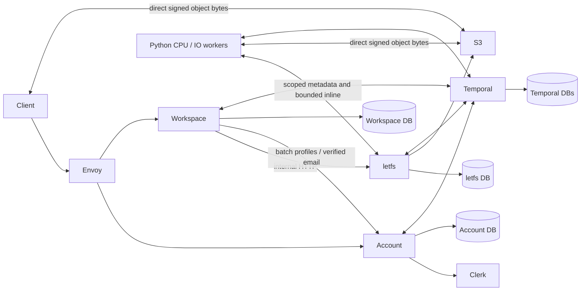

# Openlet backend architecture

Current architecture and implementation contract. The [research](../plans/reports/research-261029-1220-production-patterns.md) distinguishes upstream evidence from Openlet adaptations; the [refactor plan](../plans/261031-1758-simplify-backend-refactor/plan.md) records delivery evidence.

## Outcome and scope

Deliver a backend cloud drive with onboarding, profiles, collaborative workspaces, generic filesystems, ID/path access, editable text, object uploads/downloads, copy/move, trash/restore/purge and workspace storage quota. Preserve data and accounting across concurrent requests, retries and worker restarts.

Use Go/Gin for Account and Workspace, Rust/Axum for letfs, Clerk, Envoy, PostgreSQL, Temporal and Docker Compose. UUIDv7 is the default entity ID; copy destinations derive stable UUIDs from copy/source identity. Invitation/service secrets use cryptographic randomness, independently of entity IDs.

Excluded: frontend, billing/Stripe, agent runtime, public sharing, user-visible revision history, cross-filesystem copy/move, automatic invitation email and automatic age-based trash purge. Document processing belongs to letfs and uses one Python application with separate CPU and I/O Activity workers. No Redis or profile cache is required.

## Ownership

| Component | Owns |
|---|---|
| Envoy, configuration only | Native JWT verification/JWKS caching, trusted identity forwarding, routing, request limits and basic configurable local rate limiting (per Envoy instance, not a global distributed quota) |
| Account, Go/Gin | Internal account, Clerk mapping, profile, onboarding and backend-owned Clerk user-ID publication |
| Workspace, Go/Gin | Workspace lifecycle, memberships, manual invitations, authorization, public file facade and workspace-to-storage mapping |
| letfs, Rust/Axum | Generic quota buckets, filesystems, tree/path/mount semantics, file data, accounting, trash and storage lifecycle |
| Temporal | Durable execution of service-owned workflows; not data authority or a distributed transaction |

One PostgreSQL instance hosts separate Account, Workspace, letfs and Temporal persistence/visibility databases, with separate credentials. No cross-service SQL/FKs. An opaque letfs quota bucket is an accounting record, not a physical S3 bucket. Many filesystems can share it. Workspace maps its storage to one bucket and initially one drive filesystem.



## Authentication and service trust

First login uses a verified Clerk subject to onboard. Account ensures an internal UUID and initial workspace/storage, publishes `openlet_user_id` through backend-controlled Clerk metadata, then instructs the client to obtain a fresh session token. Keep Clerk `sub` unchanged. Configure the Clerk session-token claim from the backend metadata field as described in [setup](setup.md#clerk-onboarding); metadata publication alone is insufficient. Never use user-writable metadata as identity authority.

Envoy uses its native JWT filter with Clerk JWKS. Verify signature, issuer, expiry and configured audience/authorized-party constraints. Strip incoming trusted identity and internal credential headers before setting authenticated values. Tokens without an internal ID may access only caller-scoped onboarding routes; ordinary routes require the internal claim. Services validate required identity shape but do not repeat JWT cryptography or query Clerk-to-UUID mapping per request.

Only Envoy exposes the public API. Public routing must never expose `/internal/*`. Protect internal HTTP with per-caller random service credentials and route allowlists; do not treat network placement or a user-ID header alone as authentication. Mount credentials as secrets, exclude them from logs and use encrypted transport when crossing an untrusted network. Restrict Temporal/admin endpoints to the trusted backend control plane; queues are not authorization boundaries.

Workspace checks current membership, role and active state for every public workspace request. letfs validates caller identity, allowed filesystem scope, lifecycle and revisions, but has no Clerk/workspace/role logic. Revocation blocks subsequent admissions; a previously authorized request can complete while membership changes. This is not instantaneous revocation of an in-flight request.

## Workspaces and collaboration

One workspace model; no personal/team enum. Users may have multiple workspaces. Limits are configurable Workspace policy, with future subscription scope at workspace level. Roles are Owner, Editor and Viewer, with exactly one Owner. Owner manages membership/invites, transfers ownership, purges trash and deletes the workspace. Editor writes and can trash/restore. Viewer reads live files and trash-entry metadata; detached file contents remain hidden by both ID and path.

Invitation links are email-bound, expiring, manually shared and stored as hashes. Acceptance requires a matching trusted verified email and an onboarded account. Do not send automatic email, grant ownership by invitation, log tokens or recreate removed memberships through token replay.

## Storage and consistency

The canonical tree is an adjacency list with stable node IDs and indexed parent/name lookup. Resolve a path with one recursive SQL statement. Mount context exposes authorized filesystem roots only; the public client cannot choose arbitrary filesystem IDs or mount tables. Materialized paths, hardlinks, symlinks and FUSE are unnecessary now.

Each file owns exactly one data row: caller-selected bounded inline bytes or an independent immutable S3-compatible object. Inline may be binary; text editing separately validates strings. Object upload/download bytes travel directly between caller and storage. Copy creates independent bytes/objects. S3 provider/endpoints are configurable; external endpoints require TLS verification, private objects and least-privilege credentials; plaintext is limited to explicit local development/test profiles.

A file may also contain generated read-only children through the same parent edges: `/drive/report.pdf/artifacts/1-intro.md`. The source retains its original payload and own byte size. Batched resolution derives strict file-ancestor provenance for both paths and IDs. Root-relative `@<uuid>` aliases remain filesystem-scoped. Replacing source bytes detaches old children for existing maintenance; their usage remains charged until removal. A Rust workflow schedules parsing, enrichment and indexing on separate CPU/I/O queues. Shared uploads prove byte transfer before atomic artifact publication. README files own directory semantics; generation fences guard publication and index readiness. Python uses scoped letfs APIs and direct storage URLs, without database or S3 credentials.

Quota is a commit-time hard logical byte limit. Metadata publication and byte delta commit together in letfs PostgreSQL. Trash counts; purge frees usage. No reservations, soft cap or grace allowance. Transfer can finish before quota rejection. Physical staging/cleanup bytes are separate from logical usage.

Use short filesystem-row locks for mutations and bucket-before-filesystem order where accounting is involved. Never hold DB locks across S3/Clerk/Temporal calls. This intentionally limits hot-filesystem write concurrency; measure lock waits before introducing finer-grained locking. Conditional edits use revisions. See [data invariants](data-model.md) for copy, upload and deletion details.

## Repository layout

```text
apps/
  account/           # Go module, Dockerfile, native tests and migrations
  workspace/         # Go module, Dockerfile, native tests and migrations
  letfs/             # Rust workspace member, Dockerfile and migrations
  letfs-processing/  # uv workspace member, parser/worker and Dockerfile
e2e/                 # Fresh Playwright API suite and owned fixtures
infra/
  compose/           # dev.yaml, e2e.yaml
  config/            # Native Envoy/Temporal templates
  bootstrap/         # Pinned native Goose image
scripts/
  bootstrap/         # Private configuration generation
  operations/        # Coordinated backup, isolated restore, explicit resume
contracts/  docs/  plans/
go.work  Cargo.toml  Cargo.lock  pyproject.toml  uv.lock
package.json  pnpm-workspace.yaml  pnpm-lock.yaml  turbo.json
```

Keep ecosystem filename conventions in Go/Rust. HTTP handlers and activity adapters reuse application functions. Use explicit HTTP DTOs; no shared database models, generic repository framework, schema registry, custom gateway, sidecar or cross-language Temporal bridge.

## Infrastructure, configuration and operation

Compose starts PostgreSQL, Temporal Server, Envoy and the three services, with initialization/migration jobs. Each service initially runs its HTTP listener and its own native SDK worker in one process. Temporal uses PostgreSQL persistence and SQL visibility; no Elasticsearch or Redis. UI and a local S3-compatible test/development provider are optional profiles.

Dependencies and images are pinned. Configure inline/file/body limits, path depth/length, pages, quota defaults, member/workspace limits, upload expiry, stream deadlines, batch sizes and worker concurrency, node count, copy node/byte/runtime ceilings and per-bucket outstanding upload/copy/cleanup bounds. Enforce these through natural resources, admission receipts and cleanup intent; no byte reservation ledger or generic operations table. Validate positive bounds and timeout/cleanup relationships on startup. These values are operational defaults, not billing entitlements.

Object bytes transfer directly between the caller and private S3/R2 using signed URLs; Workspace/letfs carry authorization, metadata and bounded inline bytes. Safe attachment headers are the default. Use liveness/readiness checks, graceful shutdown and logs containing request/operation/resource IDs, with secrets/file bodies excluded. Expose lock waits, quota failures, workflow errors and cleanup backlog through ordinary logs/metrics; do not add an observability platform dependency.

Go HTTP uses Gin with native OpenTelemetry middleware; Rust keeps Axum and Python
keeps Activity workers. Each app owns its providers and bounded shutdown. SDK-native
Temporal tracing carries W3C trace context across languages without baggage or
business-payload trace fields. JSON stdout logs correlate active spans; optional
OTLP configuration and supported sampler settings are documented in [setup](setup.md#opentelemetry).

Backups must retain a consistent metadata/object recovery point. For MVP use a documented maintenance window: reject ALL mutating public/internal HTTP (including direct text/move/finalize/trash/purge, not only workflow starts), pause schedules, drain requests/transactions/activities and storage writes, then stop service workers and Temporal Server writers. Verify no writers remain, dump application/Temporal DBs and preserve matching immutable objects before resuming. Test a restore to an isolated stack. Before phase-6 acceptance select and document the deployment provider's exact versioned-copy/snapshot or guarded-copy procedure and restore commands. A DB dump or generic untested shell script is insufficient. No routine `down -v` rollback or destructive production tests.

## Query policy

Lists use keyset pagination and explicit metadata columns; never load inline bodies just to list nodes. Member enrichment uses one bounded User batch call. Batch stat and storage cleanup are set-based per bounded batch. Query/RPC count must not grow with list page size. Recursive path resolution remains depth-dependent DB work despite one round trip. No profile, authorization, quota, node or path cache is introduced in MVP.
