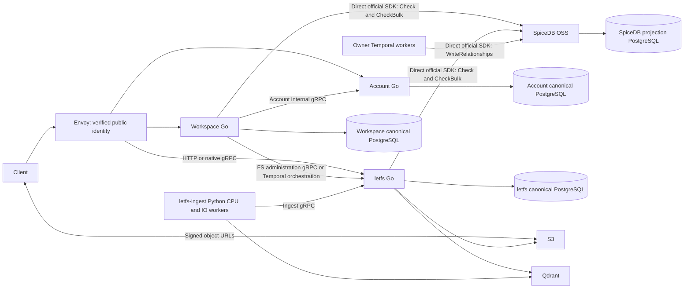

# Foundation architecture and implementation contract

This is the target for this plan, not a description of implemented behavior. It carries forward the accepted [brainstorm](../reports/brainstorm-261102-1032-go-grpc-filesystem-authorization.md), including the later `letfs-ingest` name and removal of the proposed Access service. Current behavior is grounded in the [authorization inventory](../reports/scout-261102-1059-authorization-rpc-inventory.md) and [filesystem inventory](../reports/scout-261102-1059-letfs-go-parity.md).

## Outcome and scope

Replace the Rust filesystem implementation with Go, finish shared action-based authorization and direct filesystem APIs, and remove application-to-application HTTP before implementing Leti. Keep every existing filesystem capability and its recovery/security invariants. Development data and old Rust workflow histories may be reset; back up before mutating an existing environment.

Do not add an Access service, filesystem proxy, custom policy engine, production migration bridge, custom-role UI, sharing UI, user filesystem product, chat resource, agent runtime, Redis streaming, billing, or real-LLM evaluation. Do not add cross-filesystem copy/move. Existing external-provider checks remain distinct from local acceptance.

## Runtime topology

All databases above use the existing PostgreSQL instance with separate database owners. No cross-service SQL. Temporal retains its own existing databases. Add `openlet_spicedb`, not another PostgreSQL container. SpiceDB runs as a separate internal-only service; application clients never receive its credential.

## Ownership

| Owner | Canonical PostgreSQL facts | Projected facts |
|---|---|---|
| Account | Existing user identity/lifecycle and onboarding state | User self relationships derived from the user record |
| Workspace | Existing memberships/assigned roles, invitations, workspace lifecycle and workspace-to-bucket/filesystem references | Member grants, workspace lifecycle and storage inheritance relationships |
| Deployment policy | Version-controlled graph schema and built-in role/action policy file in the repository; no application SQL catalog | Built-in role capabilities loaded directly into SpiceDB |
| letfs | Bucket/filesystem lifecycle, idempotency receipts, tree/file/upload/job state and storage accounting | None in this scope; checks permissions on its bucket/filesystem IDs |

Role-to-action definitions belong to SpiceDB policy. `packages/contracts/authz/schema.zed` declares supported actions and permission evaluation; `packages/contracts/authz/roles.json` declares built-in `role:<id>#<action>@user:*` capability relationships. The deployment initializer loads/verifies both directly in SpiceDB. Policy changes are reviewed/versioned with code. PostgreSQL remains canonical for business facts, including assigned membership roles and storage references; it does not duplicate the graph or store a permission catalog.

Do not create `authorization_role_catalog`, `authorization_roles`, `authorization_actions`, `authorization_role_permissions`, `authorization_heads` or `authorization_intents` in any application database. Do not add catalog revisions, applied-version acknowledgments, saved permission-mutation responses or graph head/epoch marker types. Account and Workspace use their existing domain records, Temporal workflows and reconciliation to synchronize relationships. Keep existing business revisions used for `If-Match`, generation fences, idempotency receipts and lifecycle tombstones. Ingest and letfs do not write business authorization relationships.

Workspace owns its existing workspace-to-bucket/filesystem references and projects inheritance relationships into SpiceDB. Future services own equivalent relationships for their resources. letfs checks permissions directly on filesystem or quota-bucket IDs; it does not resolve a workspace/conversation/user owner, call its service, or persist its resource type/ID. The direction of a graph tuple does not determine its application owner. A future resource type changes its owning service and shared graph schema, not letfs domain logic. Shared contracts move from root `contracts/` into `packages/contracts/` in Phase 1; Phase 2 adds `@openlet/contracts` tasks. Deployables remain under `apps/*`, shared Go under `packages/go`, and `packages/*` joins workspace discovery. Future `/chat` belongs to each conversation; conversations are outside this plan.

## Code and contract layout

| Path to create | Contract |
|---|---|
| `packages/go/go.mod` | One shared module, `github.com/qninhdt/openlet/packages/go`; add to `go.work` and build/test discovery |
| `packages/go/identity/` | Verified public/service principals and delegated actor/job context |
| `packages/go/rpc/` | Authentication interceptors, deadlines, errors and trace propagation |
| `packages/go/authz/` | Official SpiceDB client setup, typed actions/resources, consistency selection; no role evaluator |
| `packages/go/telemetry/`, `packages/go/config/` | Extract only compatible infrastructure actually duplicated by existing Go apps |
| `packages/contracts/proto/openlet_api/{account,workspace,letfs}/v1/` | Versioned application RPC definitions; distinguish public methods from service-only administration/ingest |
| `packages/go/gen/openlet_api/` | Generated Go protobuf/gRPC/HTTP transport types |
| `packages/python/pyproject.toml`, `packages/python/src/openlet_api/` | Shared Python distribution `openlet-python`; generated protobuf messages, client stubs and server interfaces, independent of deployable apps |
| `packages/python/package.json` | Thin `@openlet/python` Turbo tasks with explicit contracts dependency; Python dependencies remain managed by uv |
| `packages/contracts/buf.yaml`, `packages/contracts/buf.gen.yaml` | Pinned standard code generation/lint configuration, finalized by Phase 1 proof |
| `packages/contracts/authz/schema.zed`, `roles.json` | Version-controlled graph schema and built-in role/action policy; initialize/verify directly in SpiceDB |
| `apps/letfs/go.mod`, `apps/letfs/cmd/server/` | Module `github.com/qninhdt/openlet/apps/letfs`, Go server/worker entry point matching existing app conventions |

Python code generation always targets `packages/python/src/openlet_api/`, including before and after the ingest rename. Register `packages/python` in the root uv workspace; the current processor and later renamed ingest declare an `openlet-python` workspace dependency. Build a separate shared wheel with required protobuf/gRPC runtime dependencies. App wheels contain their own modules and depend on the shared distribution; they never vendor generated stubs or import another app. Wire actual package dependencies so Turbo orders contracts generation before shared Python checks/builds and consuming app tasks. Docker build contexts, workspace metadata, lockfiles and CI caches include the shared package. Prove wheel installation/imports outside the repository so editable imports and ambient `PYTHONPATH` cannot hide missing packaging.

Future Python services such as Leti consume the same package. When one exposes internal gRPC, its owning `.proto` is added to `packages/contracts` and generates both Go and Python client/server types. No Leti app, RPC contract or agent runtime is implemented here. Handwritten Python infrastructure is added only for a concrete common need, in a namespace separate from generated `openlet_api`; no speculative Python framework or full mirror of the shared Go library.

Keep database/domain logic in its owner. Do not introduce a generic repository, plugin framework, or shared library that imports app `internal` packages. Reuse Go 1.27.3 and the installed Go Temporal SDK family initially; pin new direct dependencies and codegen tools through supported tooling after compatibility validation.

Protobuf owns RPC shapes. Existing Account/Workspace public HTTP can keep Gin; it need not be rewritten into public gRPC to migrate its internal calls. letfs public HTTP uses generated mappings where they preserve the contract. A thin in-process HTTP adapter for raw bytes/redirects/ZIP is acceptable if generated mappings cannot preserve them; it invokes the same application functions and adds no remote proxy or independent policy logic.

The existing OpenAPI documents are 3.1. Do not label the default grpc-gateway OpenAPI v2 output as 3.1. Phase 1 selects and pins a standard compatible generation/conversion route and validates the output. Keep generated letfs transport reference distinct from the authored Account/Workspace HTTP surface, with one documented navigation entry; remove the obsolete internal HTTP specification after cutover. No hand-maintained duplicate protobuf DTOs.

## Authorization admission and exceptional operations

1. Verify the real public gateway or internal service principal. A payload `actor_id`, mount, filesystem UUID or task queue is not public authorization.
2. Resolve the actual filesystem ID from the route or local node/upload/job record. Validate same-FS ancestry and immutable actor/job identity; a payload owner/workspace cannot supply authorization context.
3. Check the action on that filesystem with SpiceDB, or on the quota bucket for bucket-wide APIs. Check both source/destination capabilities where needed; cross-FS copy/move still rejects.
4. Execute the owner transaction with lifecycle, revision, quota, artifact and generation invariants. Revalidate the observed local resource/revision after locking; do not keep SQL locks across the authorization RPC.
5. Translate errors consistently across native gRPC and public HTTP. Denied hidden resources must not disclose foreign metadata.

Use explicit `fully_consistent` checks initially to make post-success permission changes visible to all subsequent admissions, including inherited filesystem checks. Do not add an authorization cache in this plan. ZedTokens are opaque native values; do not add application SQL token tracking. A future `at_least_as_fresh` optimization requires a concrete need and a verified freshness contract. This is a correctness baseline, not a benchmark claim.

| Operation family | Required permission/scope |
|---|---|
| Account profile | Self-resource action; trusted bootstrap subject has a separate narrow onboarding path before graph/user existence |
| Create workspace / accept invitation | Authenticated account/bootstrap authority as appropriate; invitation acceptance additionally validates the token and Account-sourced verified email |
| Workspace get/status | Member action; preserve nonactive lifecycle visibility and the retained Owner tombstone contract |
| Workspace list | Canonical candidate discovery followed by graph filtering; no role-derived SQL allow decision |
| Workspace update/delete/transfer | Explicit actions granted to Owner; preserve revision, lifecycle and exactly-one-Owner transactions |
| Member read | Viewer/Editor/Owner action |
| Member manage / invitations | Owner actions; no Owner invitation grant |
| Self leave | Caller-bound membership action for members, followed by the invariant that Owner must transfer first; never allow Editor to remove another member |
| File list/stat/resolve/read, processing status, search, archive, storage usage, trash metadata | Viewer/Editor/Owner actions |
| Create/update/copy/trash/restore/reprocess | Editor/Owner actions with existing revision and artifact restrictions |
| Upload admission/follow-ups | Editor/Owner actions; every follow-up additionally binds the immutable initiating actor; Owner cannot use another actor's upload session |
| Copy monitor | Current read access plus initiating actor, or explicit `copy.inspect_any` action granted to current Owner; remove forwarded role header |
| Purge trash | Owner action plus current trash identity and durable purge lifecycle |
| Lifecycle/ingest/cleanup jobs | Authenticated owner/job authority, bounded to the recorded resource/generation/attempt; never unrestricted user impersonation |

Finalize dotted action names and valid SpiceDB permission identifiers once in the Phase 1 matrix; transport callers cannot select arbitrary permission names. Graph roles contain actual action relations/capabilities, following the official role/role-grant model. Services never switch on role names to allow/deny. Role names remain canonical/display data and may participate in invariants such as exactly one Owner.

For workspace discovery, scan bounded SQL membership candidates and use `CheckBulkPermissions`; advance the cursor using the last scanned candidate, even if the returned page is empty. Preserve nonactive workspace status reads without confusing them with active file-operation admission. Tests must cover grant/revoke lag and tombstone visibility. Canonical membership deletion may remove discovery before a pending graph revoke has applied; graph permission remains the admission authority during the accepted projection interval.

Existing native Temporal cross-owner provisioning is durable orchestration, not internal HTTP. Preserve the private namespace's documented trust assumption and explicit service/job authority. Do not put bearer tokens or file bytes into Temporal histories. Ingest may mutate only its generation/attempt-scoped output surface; normal users still cannot edit artifacts.

## PostgreSQL-to-SpiceDB relationship synchronization

The canonical data is the existing Account/Workspace business data. Temporal owner workflows synchronize derived relationships using the official `WriteRelationships` API. Services use `CheckPermission` or `CheckBulkPermissions` at the actual operation/resource boundary. This integration does not introduce a second authorization data model in application SQL.

### Policy and relationship changes

The deployment job initializes/verifies schema and built-in role/action policy from the repository. Account synchronizes its user self relationship. Workspace synchronizes membership grants, workspace lifecycle and its stored bucket/filesystem references. A changed role or ownership transfer replaces the effective grant relationships atomically. Removed memberships and deleted resources remove their derived access; retained Owner tombstones preserve status reads only.

The Workspace primitive groups members by their assigned built-in role. Group IDs derive from the existing workspace ID, business revision, lifecycle status and role; they do not require new SQL state or graph marker types. Read published workspace grant links before reading a consistent owner SQL snapshot, stage its immutable role groups in bounded native writes, then switch the workspace links, enabled state and storage inheritance in one native transaction conditioned on the observed grant link (or its absence on first publication). Every business revision/lifecycle change uses new group identities, so an older publish cannot pass its precondition after a newer state is published. Repeated staging of the same canonical state is idempotent. Retired groups are unreachable before cleanup. Periodic cleanup pages through leftover groups, excludes the current canonical revision/lifecycle and conditionally deletes only groups with no published workspace grant; every partial deletion repeats that native precondition. Isolated real tests cover delayed writes, lost responses, transfer, same-revision lifecycle transitions, more than 1,000 members and fenced rebuild; Owner Temporal creation/deletion and post-mutation synchronization are wired; canonical reconciliation scans keyset pages through Continue-As-New. Application-wide Workspace action admission and full recovery/replay acceptance remain Phase 3 work.

Reuse owner Temporal workflows for durable SQL mutation and relationship synchronization. Where existing HTTP admission commits first, recover the commit/start gap through the existing owner reconciliation schedules reading canonical business records. Serialize synchronization for the same resource, re-read current canonical state on retry/reconciliation, and make repeated relationship writes/deletes idempotent. Use bounded SDK calls and native transaction semantics. Never replay a saved obsolete grant merely because an old Activity payload contains it.

No SQL permission catalog, generic outbox/intent/head/ack framework, projection revision sequence or epoch registry is required. Do not add a service, public sync-status resource or membership pending state. Reconciliation uses bounded reads of existing owner records, including retained deletion state, rather than a second persisted representation of graph tuples.

### Completion and failure semantics

Normal synchronized mutation success follows the actual graph write. Request cancellation stops waiting; it does not cancel durable owner work. A timeout after SQL commit must state that the business change may already be committed and be reconciled through the existing resource/precondition contract. An ambiguous graph acknowledgment triggers current-state reconciliation, not blind replay of old role state. Do not claim a SQL transaction and a graph write are atomic.

Until synchronization completes, prior graph permissions may remain. Graph check outages fail closed without SQL-role fallback. `fully_consistent` checks observe committed SpiceDB state; they do not force SQL-to-graph synchronization or cancel an in-flight write. After a revoke or transfer reports synchronized success, an older delayed or retried write must not restore superseded access. Prove this with real delayed-write and lost-response races, including a write already in flight when newer state is synchronized; eventual parity after work drains is insufficient. Temporal serialization and rereading SQL alone are not proof that an in-flight remote write is fenced. Use the smallest owner-specific synchronization supported by the selected SDK, including native atomic updates/preconditions where applicable. The implementation mechanism remains a Phase 3 proof gate; do not reintroduce the rejected generic framework or weaken this safety requirement to pass the gate.

Already-admitted operations and issued signed URLs retain their existing bounded capability semantics. Existing workspace/file revisions and idempotency keys still prevent a client from blindly reapplying an obsolete business mutation.

### Rebuild and recovery

Reuse the existing maintenance fence: stop public admissions and drain owner/graph writers before restore or rebuild. Verify the supported SpiceDB PostgreSQL datastore repair after logical restore. For a projection rebuild, initialize schema and repository role policy, then synchronize Account users, Workspace memberships/lifecycle and retained storage references from their owning databases. Verify grant/revoke/status/inheritance parity before reopening admission. Never import graph state into business SQL.

No new graph epoch or SQL projection checkpoint system is introduced. Do not resume stale permission command payloads after rebuilding: restarted sync work reads the restored canonical records. Interrupted rebuilds repeat idempotent synchronization while writers remain fenced. Preserve object/upload capability drain and isolated-target recovery rules.

## Generic filesystem and byte contracts

Public file routes move to `/v1/filesystems/{filesystem}/...`. Workspace exposes stable storage references. The integrating app chooses virtual labels such as `/drive`; letfs validates bounded generic mount descriptors against the requested filesystem and never discovers business mounts through an owner-service lookup. Aliases are path context only; always check target filesystem permission. Retain root aliases, hybrid file containers, cwd and artifact restrictions. Generated outputs attach directly below the original file (for example `/drive/report.pdf/text.md`), with no system-created `artifacts/` directory or separate artifact-root identifier. The original file remains immutable during enrichment; its root README supplies document semantics. Bucket-wide usage uses a generic direct quota-bucket API with an explicit bucket read action; one FS grant cannot expose siblings or grant bucket administration. Workspace decides its quota limit and projects bucket permissions; letfs enforces numeric limits and accounting.

### Stable provisioning identity and domain boundary

Remove all `provision_key` columns, constraints and active contracts. The calling service generates bucket/filesystem UUIDs and durably saves them before the first remote call. Retries use the same IDs and caller/operation-scoped idempotency keys. letfs atomically saves receipts, immutable create identity and resource effects. Receipt expiration cannot allocate a new ID for an admitted creation. Resource primary keys and retained frozen/deleting/deleted tombstones fence late create; IDs are never reused. Freeze a preallocated bucket ID even when create acknowledgment was lost. Root creation remains atomic with the filesystem. Authenticate service/method authority independently from supplied IDs and keys.

Replace workspace-specific letfs Activity names and payloads with generic bucket/filesystem operations. Workspace keeps its parent orchestration and business decisions. It saves returned references in its own database, synchronizes their inheritance relationships through its Temporal worker, and waits before reporting synchronized Workspace creation. letfs storage creation returns independently; missing graph permissions deny public access. A crash before publication leaves denied, recoverable storage. Workspace deletion synchronizes removal of inherited access and drives generic freeze/deletion; local storage state also denies operations if graph cleanup lags. Rebuild relationships from retained Workspace references/tombstones, never from a letfs owner-mapping exporter.

letfs has no role switch, business-owner resource fields, Workspace/Leti/Account client, Clerk profile lookup, role header, owner-domain import or business-event subscription. Generic actor-bound upload checks, job generation/attempt scope, artifact immutability, revisions, quota and lifecycle remain its responsibilities. Its ingest workers and S3/Qdrant/provider calls belong to the filesystem pipeline. Operations/recovery coordinates services externally.

Object bytes continue directly between client/ingest and S3 using signed URLs. Inline bytes remain in letfs PostgreSQL and use the API. Keep single/multipart verification, opaque ETags, exact size/checksum, saved finalize preconditions, transfer grace and durable late-write cleanup. Public uploads remain object-only; small inline user writes use nodes/content.

HTTP contract gates include decimal-string counters/revisions, UUIDs, ETag/If-Match and required-precondition errors, no-store, safe Location, exact byte bodies, single Range, 307 object redirects and expired-copy 410. Native gRPC represents redirects through an explicit download descriptor, not HTTP status fiction. ZIP is request-owned streaming with backpressure and cancellation; pre-header validation errors map normally, post-header failures truncate/abort rather than append JSON into the ZIP.

Current code serves inline content using the file MIME with safe attachment disposition and `nosniff`; one existing doc says octet-stream. Preserve the implemented safe headers and exact bytes, then correct the doc. Do not accidentally turn uploaded HTML into same-origin rendered application content.

## Application transport and deployment

Public letfs HTTP and native gRPC traverse Envoy's verified identity handling. Native gRPC requires HTTP/2 routing and a public service/method allowlist. Internal administration and ingest RPCs cannot be reached by forwarding a public JWT to their method paths. Verify caller and delegated identity in application entry points even when an in-process HTTP gateway bypasses a server interceptor. Strip spoofed/duplicate trusted metadata on ingress.

Replace Workspace-to-Account summaries/verified-email HTTP and Python-to-letfs metadata/publication/inline HTTP with generated gRPC clients. Keep native Temporal child workflows/remote Activities where already appropriate; do not wrap old HTTP in a new RPC. Standard gRPC health is used for internal application readiness. External/vendor-native protocols remain supported: Clerk, OpenRouter, S3 and Qdrant are not custom application-to-application HTTP.

SpiceDB OSS runs on the internal Compose network with a dedicated database owner and pinned image. Migrate the datastore before serve, install/validate the authorization schema, then enable dependent readiness. letfs readiness checks its own dependencies and expected graph schema; it never calls Workspace/Account or waits for per-resource inheritance acknowledgment. Missing resource permissions deny at admission. Keep shared PostgreSQL connection budgets bounded; current instance max_connections is 200. Watch API is not required; if introduced later it needs PostgreSQL commit timestamp tracking. Do not claim OSS credentials have managed per-domain restrictions. All runtimes holding broad SpiceDB credentials are in the same trusted backend boundary.

## Execution staging and rollback boundary

Phases run sequentially because schema, contracts, Compose and test consumers overlap. Go letfs develops beside the Rust reference only in separate native test environments. Do not attach both implementations to one database or task queue. Phase 5 finishes Go parity and prepares the target Python activity path under the current app name, retaining the old entrypoint. Phase 6 atomically switches Compose/runtime/consumers and performs the full ingest rename, removes the Workspace proxy, and enables public routes. Phase 7 deletes Rust and proves a clean setup.

Before the switch, revert only owned code changes if a gate fails. After a schema/environment reset, stop new writers and restore a matching isolated backup/checkpoint; do not run old binaries on new tables or replay Go histories with Rust. Reset permission removes compatibility work, not backup/recovery obligations.

## External evidence and implementation gates

- [SpiceDB datastores](https://authzed.com/docs/spicedb/concepts/datastores): PostgreSQL/self-host support, transaction-ID restore caveat and optional Watch prerequisite.
- [Datastore migrations](https://authzed.com/docs/spicedb/concepts/datastore-migrations): use the selected binary's supported migration path before serving.
- [Role modeling](https://authzed.com/docs/spicedb/modeling/access-control-management): explicit role actions and grants.
- [Dual writes](https://authzed.com/blog/the-dual-write-problem): durable execution/outbox does not make SQL and graph one transaction.
- [Consistency](https://authzed.com/docs/spicedb/concepts/consistency) and [read after write](https://authzed.com/docs/spicedb/concepts/read-after-write): define freshness explicitly.
- [Relationship API](https://authzed.com/docs/spicedb/api/http-api): atomic updates/preconditions; use native atomic updates; no application projection framework is required.
- [gRPC-Gateway HttpBody](https://grpc-ecosystem.github.io/grpc-gateway/docs/mapping/httpbody_messages/): verify raw-byte behavior, streaming and headers using real HTTP/gRPC transports.

No product decision is pending. Dependency versions, relationship synchronization, schema/policy validity, OpenAPI generation and binary mappings are implementation proof gates with explicit stop/replan conditions, not presumed working features.
