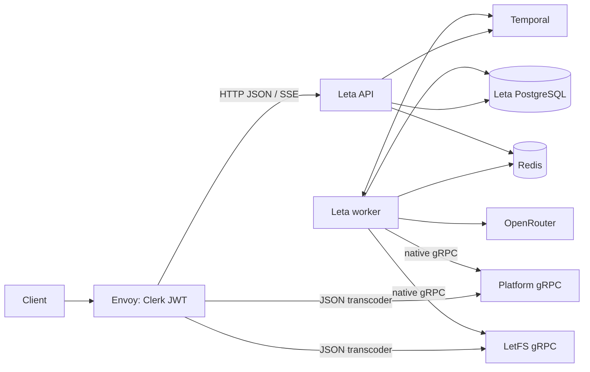

# Leta viết mới: kiến trúc đã chốt

Đã reconcile boundary/schema theo [workspace resources đã chốt](../261111-1727-platform-letfs-rewrite/workspace-service-redesign.md) và [API Platform/LetFS](../261111-1727-platform-letfs-rewrite/api-contract.md), cập nhật Mirage/cache 2026-11-13. Root resource là agent subject độc lập; letas giữ workspace_id/storage_id/state/paused, agents giữ executable fields chung. Schema 11 bảng/constraints và runtime 24/7 đã duyệt; owner/operator ở SpiceDB. Giữ dynamic mounts public/shared và granted private, một storage_id là home binding. HTTP/streaming/replay, operator access, shared cleanup, retention MVP và native bounded Redis content/index cache đã chốt; DTO/errors cần cụ thể hóa. Transfer và đổi home storage hoãn.

Khảo sát bắt đầu 2026-11-11; trạng thái quyết định cập nhật 2026-11-13. Kiến trúc đã duyệt, app mới chưa implementation; archive source/tests cũ đã được core báo hoàn tất. Không dùng skill/subagent. [Plan thực hiện, acceptance và coverage](plan.md), [hệ thống/infra đã chốt](system.md) và [API/boundary review](boundaries.md) phân biệt approved design với integration/validation chưa thực hiện.


[Thiết kế Temporal cuối](temporal.md) chốt sáu workflow types, 22 activities và ba native queues trong một worker process; thêm workspace cleanup activity theo [shared contract](../261111-1727-platform-letfs-rewrite/workspace-cleanup.md), không workflow/poller mới.

## 1. Quyết định chính

Viết mới Leta thành một Python service với API role và một worker deployment. Giữ LangChain/LangGraph, Temporal, Mirage, PostgreSQL, Redis và native SpiceDB client. Leta quản lý/check agent relations, ghi/dọn hai chiều agent.workspace và workspace.agent trong cùng native graph batch; Platform quản lý workspace/membership và generic CheckWorkspaceActive; LetFS quản lý storage/grants. Bỏ RegisterAgent/UnregisterAgent và đổi tên relation registered_agent thành agent theo quyết định 2026-11-12. Agent độc lập với membership của human owner; RemoveMember chỉ thu hồi human membership, không quét/dừng agent. Không SQL owner/grant mirror hoặc direct writes vào relations service khác sở hữu. Chi tiết tại [boundary](boundaries.md#71-removemember-và-agent-độc-lập).

Platform/LetFS vẫn application gRPC và Envoy JSON. Leta dùng HTTP JSON + SSE trực tiếp sau Envoy theo quyết định mới đã chốt trong streaming.md; Leta gọi core bằng native gRPC clients, không application gRPC listener thứ hai. Async owning business cleanup được phép khi đã có contract, không stop-ACK barrier/readiness hoặc permission hot-path dependency.

Không lấy ít bảng, ít workflow types hoặc một con số LoC làm tiêu chí duy nhất. Giảm cơ chế cần hiểu để thay đổi một tính năng. Một constraint/lock ngắn ngăn mất dữ liệu đáng giữ hơn hàng trăm dòng phục hồi hậu quả của việc bỏ nó.

Leta/Leti phải hoạt động liên tục 24/7 nhiều tháng, nhiều năm, kể cả không bao giờ hết việc. Logical agent/context không phụ thuộc tuổi đời một workflow run, activity attempt hoặc worker process; rollover/restart không yêu cầu người dùng tạo lại agent.

## 2. Bằng chứng và plan song song

Đã đọc root README/docs navigation, Leta design/tool contracts, schema, API, runtime/middleware/history, filesystem/cache policy và Temporal workflows/bridges. CodeGraph được dùng trước khi đọc source. Đã đọc plan rewrite Platform/LetFS mới nhất, final proposal, schema/config/query contracts, transport notes và archive report.

Snapshot khảo sát trước đợt archive tests/tooling mới nhất, đếm physical Python lines gồm blank/comment, không tính generated/dependencies/migrations:

| Phần active của Leta | Files | Lines |
|---|---:|---:|
| Production Python | 57 | 11.211 |
| Tests Python còn active lúc khảo sát, nay đã archive | 28 | 6.339 |
| Boundary tests đã archive trước đó | 16 | 4.402 |

Trong snapshot production cũ: HTTP 1.728 lines, runtime 2.294, Temporal 2.308, filesystem 998. `store.py` là 1.699 lines. Đây là kích thước source lúc khảo sát, không phải active tree mới, số đo chi phí chạy hoặc bằng chứng mọi dòng đều thừa.

Các nguyên nhân phức tạp quan sát được:

- `runs` lưu inbox cursor, checkpoint ID/namespace, continuation, result, attempt và yield state ngoài native saver; AgentWorkflow lại giữ cursor/run/continuation/paused/latest_seq.
- Cấu hình agent đi qua validate, lifecycle bridge, lifetime workflow, activity rồi SQL; caller đọc lại row để tạo response.
- Root/box lifecycle coordinators sống sau provisioning để nhận cả các lệnh mà một SQL transaction đã xử lý được.
- Runtime tự kiểm tra nhiều chi tiết model/tool protocol, tạo summary orchestration quanh native middleware và dùng public history như một phần replay mechanism.
- SSE có snapshot materialization, FreshReplay, started-block filtering và server-side coalescing ngoài Redis replay và UI reducer.
- Leta có FastAPI cùng một application gRPC server chỉ phục vụ binding/list/stop callbacks.

Nguồn kiểm chứng: `apps/leta/migrations/0001_agent_domain.sql`; `runtime/{runner,state,middleware,history}.py`; `temporal/{agent,lifecycle,box,schedules,bridges}.py`; `http/{agents,events}.py`; `transport/grpc.py`.

[Plan 261111-1727](../261111-1727-platform-letfs-rewrite/plan.md) mới hơn và có archive report thực tế, được dùng làm boundary hiện hành. Plan 261111-1649 còn mô tả Account/Workspace tách riêng và migrate Leta public sang gRPC; phần đó không phù hợp scope mới. Không tiếp tục theo nó.

Archive report core 261111-1727 lúc trước ghi archive Leta tests/tooling và giữ source/migrations/dependency files. Snapshot active tree 2026-11-12 không còn apps/leta; tiến độ mới trong core plan đã báo archive nốt source/migrations/native dependencies, 60 files đối chiếu hash. Lượt này không chạy lại hash audit. Core hiện đã có proto/generated Go/selected handlers mới; không dùng trạng thái implementation cũ trong plan làm bằng chứng runtime. Rewrite nội bộ Leta thuộc plan này; shared contracts/authz/config/infra do core owner quản lý, cần đồng bộ trước code. Chưa runtime mới được triển khai.

## 3. Khả năng sản phẩm giữ lại

- Root Leta là workspace resource và subject agent độc lập; current owner/operator và workspace gate quyết định quyền, không creator. Workspace owner có administrative delete, không tự động dùng agent/đọc private data.
- Root Leta và mỗi Leti có context/inbox độc lập. Whole-box graph bất biến, representative và các cạnh giao tiếp giữ nguyên; create box không tự gửi việc.
- [Box/Leti đã chốt](boxes.md): representative dùng cùng runtime, mỗi Leti lazy-start độc lập, shared home theo box và root actor/external grants chung. Home-first rồi atomic active graph/receipt; không SQL boxes.provisioning hoặc box runtime riêng.
- Root nhận inbox notifications theo nguồn/cuộc trao đổi; Leti nhận đầy đủ batch mới. `read_at` chỉ là đã đọc chi tiết, không phải đã xử lý xong.
- Chỉ `inbox_send` chuyển lời. Không auto-forward final text, không child-human chat, không cross-box routing mới.
- Checkpoint, model selection/inheritance, public history/search, compaction, pause/resume và cancel current run vẫn có.
- Ask/approval không chặn toàn agent. Ask chọn explicit bất kỳ human owner/member hiện tại cùng workspace; recipient không cần agent.use hoặc quan hệ với owner. Form giữ single/multiple/text và empty answer hợp lệ. Approval nhắm storage cụ thể, human có current manage_access cấp quyền root agent qua LetFS; không cấp cho creator hoặc từng Leti.
- Native at/interval/calendar schedules, timezone, recurring end, calendar view và nominal scheduled time giữ lại.
- Mirage shell/Monty, text operations, image reads, literal/semantic search, artifacts và per-box home restriction giữ lại. Một root home binding; external storages public/shared/private được cấp quyền truy cập bằng native dynamic mounts. Đổi home storage hoãn.
- Một AG-UI/SSE connection cho root và children; reconnect replay và committed history giữ lại. Cleanup do người dùng yêu cầu tại Leta thuộc nội bộ Leta; storage/Platform SQL deletion không chờ agent cleanup, Platform workflow tiếp tục observe owning activity theo [cleanup contract](../261111-1727-platform-letfs-rewrite/workspace-cleanup.md).

Không thêm task engine, mutable graph editor, external channels, scheduler service, agent framework hoặc compatibility API.

## 4. Topology và transport



Hai process roles: `python -m leta.api` và `python -m leta.worker`. Worker chạy ba native Worker instances: orchestration/effects, runtime, bridge activities chờ workflow Updates/results. Phân tách slot ngăn runtime/cleanup chiếm hết pool cần để xử lý chính Updates đang chờ; vẫn một worker process/deployment. Native activity concurrency giới hạn model/remote work. Không mở health webserver riêng trong worker.

[Hệ thống/infra đã duyệt](system.md) sở hữu image/process roles, Compose profile/migration job, database/native saver, config/secrets, concurrency/pools, shutdown, backup và telemetry/CI. Đây là target chưa deploy; một image/hai permanent roles, không thêm process theo agent hoặc service scheduler/sandbox riêng.

Leta là gRPC client của Platform/LetFS, dùng generated stubs trực tiếp. Native Authzed quản lý/check agent owner/operator và hai chiều agent.workspace/workspace.agent. Platform quản lý workspace/membership; LetFS quản lý storage grants qua owning gRPC APIs. Leta không tự ghi workspace membership/owner hoặc storage grants. Không truy cập SQL/Qdrant service khác; S3 bytes chỉ qua signed URLs LetFS cấp. Core startup/readiness không cần Leta; workspace cleanup đã chốt native owning activities tại [cleanup contract](../261111-1727-platform-letfs-rewrite/workspace-cleanup.md), backend integration chưa làm.

Public transport và routes chính ở streaming.md. Full DTO/errors cần cụ thể hóa; operator access, workspace cleanup và retention MVP không auto-purge đã chốt, transfer hoãn. Không dual HTTP/gRPC server, wrapper framework hoặc application proto/listener/deployment thứ hai.

Envoy giữ JWT validation và strip trusted actor headers. Leta lấy human identity từ trusted ingress; runtime inject root Leta actor vào native calls, model không chọn actor. Chỉ Envoy public; internal routes không có public route. Giữ MVP private-network trust đã chốt; không thêm service-token registry/caller-name authentication. Các process trong mạng trusted có quyền gọi internal methods, cùng giới hạn của plan song song.

Core giữ native ProtoJSON/HttpBody/google.rpc.Status; không ép Leta/schema nội bộ theo một shared HTTP error envelope. SSE event/cursor/replay contract của Leta ở streaming.md; đầy đủ command DTO/errors vẫn cần review.

Quyết định HTTP JSON + SSE không đổi consumer contract Platform/LetFS, workspace/storage actors hoặc schema SQL. Shared ingress/config wiring là integration work, không tự sửa core trong lượt chốt plan.

## 5. Một owner cho mỗi loại state

| State | Owner | Các nơi khác được giữ gì |
|---|---|---|
| Agents, boxes, messages, product history, HITL, schedule definitions | Leta PostgreSQL | IDs và response projections |
| Working messages, summary, inbox cursor, graph continuation | Native LangGraph PostgreSQL saver | `runs` không mirror checkpoint/progress |
| Wakeups, activity retry/cancel, timer, lifecycle execution | Temporal | Workflow giữ handles/flags để điều phối, không giữ bản progress thứ hai |
| Membership, agent/storage ownership và grants | SpiceDB theo owning service | Platform workspace/membership; Leta agent relations và hai chiều workspace binding; LetFS storage relations. Không SQL owner/grant mirror |
| File tree/bytes/version/quota | LetFS | Root giữ một storage_id, boxes giữ directory IDs; không scope/personal mapping |
| Provisional events và Mirage cache | Redis | Không canonical history hoặc execution state |

Một public history khác working context là cần thiết: compaction không được xóa lịch sử mà người dùng xem. Tuy nhiên history không trở thành một workflow journal để dựng lại agent bằng code tự viết.

## 6. Inbox và agent execution

1. Caller có stable message ID. Native Temporal Update-with-Start gọi admission SQL activity; message chỉ được ACK sau commit. Không thay bằng SQL INSERT rồi best-effort signal vì sẽ tạo khoảng mất wakeup.
2. SQL transaction kiểm route/liveness và cấp `seq` bằng counter của recipient. Counter được serialize trên đúng agent row, cùng transaction INSERT; không dùng global sequence làm committed high-water vì concurrent commit có thể đảo thứ tự.
3. Workflow `Agent` duy nhất theo agent ID đánh dấu có việc và chạy một runtime activity dài, heartbeat độc lập. Workflow không giữ notified cursor hoặc graph continuation. Mọi receive Update làm tăng Temporal history, kể cả khi runtime đang chạy; các vòng model/tool bên trong activity không tạo event riêng cho từng vòng.
4. Activity mở stable LangGraph thread theo agent ID, lấy checkpoint native và đọc inbox sau cursor đó. Root dựng inbox notifications, Leti dựng full batch. Cursor và batch vào cùng checkpoint. Không cursor advancement trước khi batch hợp lệ/đủ context.
5. LangChain `create_agent` chạy model/tools. Middleware abefore_model lấy bounded inbox batch sau checkpoint cursor trước mỗi model call chính; batch và cursor cùng state update. Inbox mới không cancel model/tool đang chạy. Giữa model/tool boundaries mới nhận control và refresh mounts/config. Không poll PostgreSQL từng token hoặc kiểm Temporal history trong LangGraph.
6. Khi graph idle, activity hoàn tất và Workflow chờ input. Khi còn việc, activity tiếp tục, không thoát mỗi năm phút. Một wakeup trùng có thể tạo lượt kiểm tra rỗng, chấp nhận được; không xây scheduler protocol để tối ưu nó.

Giữ session advisory lock theo agent trong activity để ngăn hai Temporal attempts cùng ghi một thread. Đây là nguy cơ ghi đè context/effect thật, không phải edge case chỉ để tăng coverage. Không lock toàn Leta/workspace, không lease/epoch/fencing framework.

`runs` phục vụ UI/history/cancel, không resume agent. Bỏ `checkpoint_id`, `checkpoint_ns`, `continuation`, `inbox_cursor`, `attempt`, `yield_requested` và result snapshot khỏi bảng này. Native saver quyết định resume.

Pause/resume toàn Leta dùng finite lifecycle operation để lưu desired root pause rồi fanout control refresh bền vững; runtime dùng native interrupt tại safe boundary. Cancel current run dùng native activity cancellation để trả quyền điều khiển và giữ checkpoint; node chưa checkpoint có thể chạy lại khi resume. Không tuyên bố rollback effect đã commit. Delete dùng stop/cancel rồi đợi runtime thực sự thoát và nhả writer lock. Không tạo riêng interrupt kind cho history rotation.

Agent workflow kiểm native Continue-As-New suggestion khi xử lý receive/control hoặc activity completion; không timer rollover hoặc check theo mỗi model call. Khi chưa cần rollover, runtime tiếp tục chạy. Khi cần, workflow latch rotating và đóng receive admission, yêu cầu native cancellation đúng một lần cho active activity với WAIT_CANCELLATION_COMPLETED. Runner bảo vệ bước graph đang chạy khỏi cancellation trực tiếp, đợi bước đó tới sync checkpoint và public projection rồi đóng workspace/nhả writer lock; sau đó mới propagate cancellation. Workflow drain accepted handlers, không finish_run(cancelled) cho technical rotation, rồi Continue-As-New cùng IDs. Không chờ graph/inbox hết việc hoặc chuyển activity còn chạy sang execution mới; không thêm yield RPC, SQL flag hoặc control channel riêng. Explicit user cancel/stop giữ ý nghĩa domain riêng.

Runtime dùng native breakpoints sau model/tools và durability sync; resume pending graph bằng None trên cùng thread. Model/tool calls có deadline riêng. Bỏ soft slice 5 phút và hard attempt 30 phút; technical start-to-close khởi điểm 365 ngày, heartbeat timeout 10s/pulse khoảng 2s, không total schedule-to-close. Timeout kỹ thuật vẫn có thể retry từ checkpoint, không reset tuổi đời agent hoặc dùng làm timer rollover.

Rollover đóng admission trên run cũ trước khi drain handlers; caller retry cùng message/request key vào workflow ID, không pin Run ID. Không lifetime timeout cho Agent/ScheduleChanges. Transient runtime errors dùng native backoff đến khi dependency phục hồi; permanent config/context errors vẫn cần xử lý. Deploy workflow changes dùng native Temporal patch/versioning.

Model/effort resolve một lần mỗi safe boundary; inherit từ root nếu child không override. Validate catalog tại startup và configuration write; không scan mọi agent rồi revalidate toàn bộ catalog mỗi startup. Sai persisted model config báo lỗi đúng agent khi chạy.

Compaction đã chốt: summary + bounded tail, tận dụng prompt cache và native saver; dùng native SummarizationMiddleware ở integration boundary phù hợp, không mặc định coi mọi cấu hình native đều giữ cache prefix. Cấu hình budget theo catalog và kiểm provider integration khi implementation; đây không phải gate duyệt lại kiến trúc. Một boundary check từ chối input thật sự không vừa, không tự viết vòng summary/re-summary/protocol repair. Không dump hidden reasoning ra summary/history. [LangGraph persistence](https://docs.langchain.com/oss/python/langgraph/persistence), [native summarization](https://docs.langchain.com/oss/python/langchain/middleware/built-in).

Working context là một rolling summary cộng recent tail trong state.messages; native middleware thay prefix đã tóm tắt bằng summary message, giữ tail theo token budget và không tách tool calls khỏi results. Summary cũ được hấp thụ vào summary mới ở lần compact sau. Checkpoint lưu sẵn danh sách này cùng inbox cursor và graph continuation. Resume cùng thread_id khôi phục native checkpoint, không quét public history hoặc ghép lại từ một bảng summaries/summary_until. Inbox mới vẫn đọc seq > checkpoint cursor theo bounded batch. Budget trigger/tail/summary là thông số cấu hình/tuning của thiết kế đã duyệt, không là quyết định kiến trúc còn mở.

Native saver lưu checkpoint metadata/channel versions và blobs; channel không đổi tái dùng version, còn messages channel thông thường được serialize cả danh sách khi đổi. Mặc định saver giữ nhiều snapshots, không tự giới hạn một bản. Sau mỗi model/tools boundary đã durability sync và hoàn tất public-history projection, dưới writer lock và trước khi resume graph, gọi native AsyncPostgresSaver.aprune([thread_id], strategy="keep_latest"). Không đợi compaction hoặc activity kết thúc; pause/idle/cancel dùng cùng safe-boundary ordering trước khi nhả writer lock. Nếu checkpoint/projection chưa thành công thì chưa prune boundary đó.

keep_latest giữ latest checkpoint của mỗi namespace cùng pending writes/blobs và dependency phục hồi native cần thiết; với graph một namespace hiện tại, sau prune thường còn một snapshot, không hứa chỉ một database row hoặc một snapshot cho mọi subgraph. Các checkpoints trung gian có thể tồn tại trong bước đang chạy rồi được prune ở boundary tiếp theo. checkpoint-postgres 3.2.0 đã có API này; không custom saver, SQL xóa bảng nội bộ, timer/count-based retention service hoặc DeltaChannel/time travel. Working context và inbox batches có token/byte/count budgets; Redis và closed Temporal history dùng native retention. Public history/inbox/receipts vẫn là dữ liệu lưu lâu dài, cần dung lượng tương ứng và không bị tự xóa bởi compaction/pruning.

## 7. Tools, side effects và history

[Tool inventory/schema/token budget đã sửa](tools.md) liệt kê 28 root tools/22 Leti tools; [TypeScript draft](tool-contracts.ts) giữ descriptions cần thiết, catalogs hiện khoảng 2,7k/2,1k reference tokens, chưa gồm system prompt/context. Model chọn ý định; system giữ versions/timeouts/page sizes, sinh form IDs/type và dựng canonical schedule type/spec từ flat timing. Backend schema không bị bind nguyên dạng cho model. Chưa provider-billed measurement hoặc runtime implementation; không thay SQL/Temporal inventory.

Feature functions là code nghiệp vụ thật; HTTP routes, tools và activities gọi cùng functions. Feature function nhận concrete pool/clients và trusted actor/context, không repository/usecase/interface factories.

Tool đọc có thể nhận ID hoặc tên để tiện tìm; tool gây thay đổi phải xác định stable target ID trước effect. Ví dụ delete box dùng ID lấy từ roster/list, không resolve lại tên sau crash rồi xóa một box khác vừa tái sử dụng tên đó. Đây là thay đổi tool schema có chủ ý, không giữ name-write adapter.

Business effects dùng ID ổn định từ agent/message/tool-call identity. Message/HITL/box dùng unique domain ID; LetFS non-idempotent mutation dùng request key native của LetFS; permission grant dùng native idempotent write/owner contract. Không bọc mọi tool bằng permanent exactly-once ledger.

Native checkpoints giữ completed tool outputs. Bỏ SavedToolResults replay layer riêng và việc serialize toàn bộ ToolMessage vào public activity row để phục vụ replay. Crash trước checkpoint có thể gọi lại tool; owner idempotency bảo vệ durable mutations. Một Mirage shell/Monty command có nhiều effects có thể chạy lại; từng domain mutation vẫn có boundary bảo vệ, không hứa exactly-once cho toàn command.

History ghi input, assistant/tool calls/results, final note và compaction theo stable entry IDs. Dùng một normalization boundary chỉ expose public text/tool args/results/file references; không raw provider payload, hidden reasoning hoặc image base64 ở UI history. `INSERT ... ON CONFLICT` theo event identity xử lý retry; không protocol identity registry riêng.

History search dùng PostgreSQL FTS theo agent: GIN trên jsonb_to_tsvector('simple', payload, '["string"]'), query cùng expression @@ plainto_tsquery('simple', query), keyset seq. Đây là token search, khác literal substring search bằng pg_trgm của LetFS; không thêm trigram index thứ hai hoặc embedding/memory service cho history. Archive dùng position(lower(query) IN lower(JSON text)) không có search index; bản mới thay semantics có chủ ý sang tokens, không hứa infix/fuzzy/tiếng Việt không dấu. List không trả toàn bộ bodies/tool output. Không duplicate mỗi business check trong route, mapper, store và activity.

## 8. Lifecycle, HITL và schedules

### Lifecycle

Agent config, metadata/list/history và immutable graph creation SQL không đi qua lifetime root/box mutex. Root/box create/delete đi qua workflow hữu hạn vì thật sự có graph/storage/worker effects. `LetaLifecycle` chạy đúng một create/delete/pause/resume operation rồi kết thúc; pause/resume cần durable fanout để không bỏ sót paused children. `BoxLifecycle` chỉ create/delete.

Root create: durable Temporal admission và local SQL transaction; gọi Platform CheckWorkspaceActive, kiểm quyền tạo tại admission và ghi agent.workspace/workspace.agent cùng owner/operators trong một native graph batch, rồi CreateStorage qua LetFS. Sau external ACK mới chuyển root provisioning sang active. Box create theo [home-first đã chốt](boxes.md#4-home-first-provisioning): Temporal lưu canonical input, provision_box lấy LetFS-generated directory ID trước, prepare_box ghi active box/Leti/edges/finalized receipt atomically với home_node_id NOT NULL; pending create không có SQL placeholder. Không bước/trạng thái registration riêng; quyền chạy không phụ thuộc membership owner về sau. SQL và remote effects không chung transaction. Delete: đóng admission trước, settle provisioning, schedules/HITL effects và agents, xác nhận producer/writer barriers, trash box home và xóa hai chiều workspace binding trong cùng graph batch; physical graph/storage cleanup theo contract còn hoãn, cuối cùng archive rows để giữ history. Root cleanup gọi concrete box cleanup function inline; không chờ BoxDelete workflow đang xếp hàng trên cùng bridge pool. RemoveMember không đi vào lifecycle này.

API lifecycle chỉ báo đã nhận sau durable admission; API timeout không hủy workflow. Retry dùng operation identity cũ, không tạo root/box mới. Không SQL commit rồi đợi một best-effort workflow start mà không có retry path.

Có hai lifecycle workflow types cụ thể, không generic ResourceChanges/command dispatcher. Không cần giảm tổng số workflow types bằng cách gom các luồng khác nhau vào một engine.

### HITL

[Thiết kế HITL cuối đề xuất](hitl.md) đối chiếu archive/forms/grant/cleanup. Ask nhận explicit recipient_user_id là bất kỳ human owner/member hiện tại cùng workspace, không agent.use hoặc agent-owner routing; approval chỉ rõ storage_id/recipient_user_id và kiểm quyền manage_access. Không thêm workflow/activity hoặc SQL fields.

Một HitlRequest workflow sống đúng đời request: pending, answer/expiry/cancel, grant nếu có, inbox delivery rồi kết thúc. Tool trả pending ngay, không giữ stack hoặc pause toàn agent. Không dùng native dangerous-tool approval để thay async product HITL vì semantics khác nhau.

SQL conditional transition bảo vệ answer-vs-expiry và duplicate responses. Decision và grant outcome phải phân biệt: người dùng chấp nhận chưa có nghĩa grant đã thành công. Trước grant kiểm root/resource còn active và current storage.manage_access của addressed human. Native retry, không receipt/journal grant thứ hai.

Kết quả vào đúng requester bằng stable outcome message ID. Khi người dùng xóa Leta/box, cleanup nội bộ đợi grant effect đã settle trước khi báo xong thao tác của Leta; không đợi result delivery vào inbox đã đóng. Admission gate khiến queued delivery trả skipped. Storage grant/revoke qua LetFS theo current approver rights/native graph semantics, không globally exactly-once. Đây không phải barrier hoặc ACK để Platform xóa workspace storage.

### Schedules

[Thiết kế scheduler cuối đề xuất](scheduler.md) đối chiếu 1.125 lines trong sáu archive modules và các schedule store operations; owning Temporal inventory giữ nguyên.

Giữ `schedules` PostgreSQL vì UI/calendar cần definitions và history ngay cả khi Temporal preview unavailable; native Temporal sở hữu timing/execution. Không chuyển definition authority hoàn toàn sang Temporal rồi mất SQL product view hoặc dựng cache/reconciler mới.

Giữ một ScheduleChanges workflow nhỏ theo schedule để serialize SQL definition và native Schedule API. Đây là coordinator có lý do cụ thể, khác việc bắt mọi agent metadata edit qua lifecycle workflow. Không xóa nó để thay bằng dual-write best effort hoặc application lock giữ qua remote I/O.

Actor cũng Continue-As-New theo native suggestion để hoạt động nhiều năm edits. Canonical pending command/normalized timing ở native Temporal history. Receipt dùng đúng schema core và chỉ finalize applied outcome sau native ACK; next command/CAN chờ accepted handler settle. Retry completed command qua rollover trả receipt, không apply definition cũ. Không result-pending bag/completed_at, processed-ID set hoặc journal riêng; pure-SQL metadata edit finalize receipt cùng transaction.

Native schedule action khởi ScheduleDelivery ngắn, dùng nominal scheduled time tạo occurrence message ID, kiểm current source/target rồi giao inbox. BUFFER_ONE chỉ bao delivery, không bao thời gian LLM chạy. Không custom cron/parser/calendar engine, occurrence table hoặc exactly-once timer machinery.

Pause cho phép occurrence đã được admit; delete đóng source để chặn delivery muộn, không retract message đã commit. Metadata-only edit không rearm one-shot đã chạy. Calendar query dùng native matching-times trong range hữu hạn, trả đủ kết quả hoặc yêu cầu hẹp range; không silently truncate.

## 9. Schema mới đã duyệt

[Field audit](schema.md) và [DDL review](schema.sql) sở hữu schema 11 bảng cho database mới. Không lấy số bảng/cột/constraint làm target tối ưu. Home-first đã chốt dùng native LetFS CreateDirectories, giữ home_node_id NOT NULL và chỉ bỏ boxes.provisioning khỏi state CHECK; root letas vẫn có provisioning. Không đổi core contract hoặc số bảng/cột.

| Bảng | Nội dung |
|---|---|
| letas | Root resource workspace/storage binding, lifecycle và desired pause |
| agents | Common executable identity/profile/prompt/model/inheritance và inbox/history counters |
| boxes | Immutable graph container, representative, home directory và lifecycle |
| box_edges | Allowed undirected pairs |
| agent_messages | Agent-only delivery, committed seq/source/conversation/reply/body/nominal time/read state |
| user_messages | Explicit root-to-human delivery; chat UNION với user inputs, không duplicate body |
| runs | Logical status/cancel/correlation; không runtime progress |
| history | Public transcript/search, không checkpoint/replay authority |
| hitl_requests | Scalar type/status, typed payload/response và actual external outcome |
| schedules | Creator/target/title/content, scalar type, timing spec và desired pause/delete |
| idempotency_keys | Cùng caller/method/key/request_hash/result bytea/expires_at của Platform/LetFS |

Root resource ID đồng thời root executable agent ID; root create ghi hai rows cùng transaction. Leti state/control suy từ letas + box. Source hitl là request result, khác direct user chat; source box suy actual sender từ immutable representative. Schedule/HITL discriminators không giấu/lặp trong JSON. Không owner/creator mirror, personal mapping hoặc arbitrary lifecycle/progress columns.

Giữ PK/FK/UNIQUE/CHECK thật: same-root membership, same-box representative/edges, naming/home isolation, positive committed order/counters, one unfinished run, same-agent history/run, status/timestamp/outcome consistency. Không đẩy relational checks sang application chỉ để giảm constraint count. Polymorphic source/cross-table reply và typed JSON validate tại owning boundary.

Pure-SQL effects/receipts atomic local; lifecycle admission receipt chỉ ACK admitted identity. Schedule pending work thuộc Temporal, SQL desired definition → native ACK → finalized receipt trước nhả ordering. Không SQL transaction qua RPC hoặc distributed atomicity claim. Native saver quản lý checkpoints, public history độc lập. HTTP JSON/SSE, native file-conflict/finite-horizon recovery, operator access và shared workspace cleanup đã chốt. Receipt serialization/complete DTOs cần cụ thể hóa; retention MVP không auto-purge durable inbox/public history/archived records đã duyệt, future purge/expiry và transfer ownership hoãn.

## 10. Filesystem và cache

[Thiết kế chi tiết đã chốt](filesystem.md) dùng Mirage dispatcher cho mọi file_*/exec_*, native Redis content/index cache và ReadPolicy.BOUNDED. Bỏ policy.py kiểm quyền/version trước cache hit; rút đề xuất bỏ persistent cache. Default content/index TTL 600 giây theo Mirage 0.0.8, không số 5 giây tự đặt.

Mirage vẫn là command/VFS engine; Monty vẫn là sandbox. Viết adapter LetFS mới theo proto/stat/version của plan song song, không port LetFSVFS/fingerprint/observed-ID implementation cũ.

- Agent dùng `~`/`~/...`; Mirage expand qua virtual HOME=/home. Root home dùng root.storage_id/root node từ GetStorage; Leti home dùng box.home_node_id trong cùng storage. Locators/raw IDs và cả hai đầu copy/move mang containment root theo mount tới LetFS.
- Giữ dynamic external mounts `/mnt/<storage_id>` từ LetFS ListStorages bằng root actor, gồm public/shared và private được grant trực tiếp/HITL. Discovery giữ trong runtime RAM, refresh lazily ở safe boundary khi cũ hơn 30 giây hoặc sau HITL grant; không list lại trước mọi file call. Không external alias cho home storage_id, không Platform ListAccessibleScopes/per-user resolver hoặc `/shared`/`/users` mapping. Không đổi home binding hoặc thêm SQL mount/grant mirror.
- LetFS kiểm quyền/tree/mount containment/readonly artifacts/quota/version trong request tới service. Leta không lặp tree validation trong SDK. Bounded cached bytes được dùng tới expiry/unmount, không remote Stat/auth/version check trước cache hit.
- File tools gọi native VFS APIs/dispatch; không gọi gRPC ngoài Mirage hoặc convert thành Bash. Custom write_text/edit_text khai báo native WRITE để dispatcher invalidate content/index sau mutation; edit dùng atomic literal replacement tại LetFS. Tận dụng native written-byte cache path, không tự ReadText/Stat sau write chỉ để refill.
- Cache prefix ổn định theo root/home binding, native index scope theo mount; tái dùng qua tool batches/retries. Same-namespace mutation invalidates ngay; thay đổi từ view khác/bên ngoài có thể cũ tới TTL. Không fingerprint policy, global invalidation bus hoặc cache tables.
- Text nằm PostgreSQL, blob nằm S3, chỉ LetFS expose bytes/metadata/artifact tree/image preview. Không lấy lại thuật ngữ revision/generation cũ để ép LetFS thay schema `files.version`.
- TextSearch/ReadTree/ReadImage là native APIs đã có trong plan; adapter không dựng grep/image/parser engine thứ hai. SemanticSearch giữ riêng literal search.
- `rm` là trash. Sandbox không host filesystem/environment/network; chỉ native cache connection được runtime cho phép. Giới hạn text/image/command output giữ budget cần thiết cho memory/context.

Workspace/session tạo lazily rồi dùng lại qua các tool batches trong một lần thực thi run_agent; đóng khi activity thoát sau khi executions/writes settle. Shell dùng record=False; không giữ command history hoặc khôi phục shell env qua activity retry. Redis content/index cache tái dùng qua batches, có TTL và server memory limit/eviction; shared clients/pools thuộc worker process. Requests mới chịu quyền tại LetFS; không cố thu hồi bytes đã nằm trong cache/transcript hoặc thêm permission-cache riêng.

## 11. API HTTP và public events

[Contract đã chốt](streaming.md) sở hữu routes chính, public projection, bootstrap/reconnect và client adapter. Một HTTP JSON + SSE API sau Envoy; một Redis Stream theo root multiplex root/children. SSE data là AG-UI event trực tiếp, agent/run attribution trong metadata.openlet; Redis ID là cursor. Đây là Leta subscription dùng AG-UI schema, không stock HttpAgent/full standard HTTP-binding compatibility.

Fresh browser chỉ đọc current state và một trang SQL history previews có count/byte budgets rồi nhận suffix sau tail chụp trước snapshot. Không load toàn logical run, Redis prefix, tất cả child histories hoặc checkpoints dù agent chạy nhiều tháng. Full body đọc theo entry, history/chat/roster phân trang theo view. Nếu vào giữa response chưa commit, hiển thị đang trả lời, không render orphan delta mất đầu; committed entry thay provisional cùng identity.

Tool result trả hoàn chỉnh cho runtime, không chunk thành từng nhóm token. Redis/SSE dùng bounded public preview + entry reference, không hai events lặp full body. Native model/graph ghép response trong working RAM; public history/checkpoint ghi ở boundaries, không UPDATE SQL theo provider token.

Reconnect có state/cursor còn coverage thì XREAD suffix rồi live trên cùng read path. Gap lúc connect hoặc trong read phải openlet.resync_required và fresh bootstrap; không reset chỉ vì technical attempt đổi. Chỉ fold adjacent compatible text/args deltas trong batch đã đọc, ID lấy record cuối; không timer merge, FreshReplay/server reducer/full-log reordering hoặc byte-accounting Lua. Native MAXLEN/idle expiry giữ replay hữu hạn, không per-run stream/counter mới.

Canonical visible queries refetch khi mount/reconnect/focus/notification và khoảng 30s khi tab visible để sửa SQL-commit/Redis-notification gap. SQL history fetch theo committed seq và page budgets; không whole-history reload hoặc Temporal Update theo UI refresh. Publication failure không rerun effect đã commit hoặc retry mù delta sau ambiguous ACK; không durable outbox chỉ để replay provisional tokens.

Authorize trước stream và định kỳ kể cả idle; bounded send timeout đóng slow subscriber. Shared events không bypass exact-recipient HITL. Browser giữ window hữu hạn, subscription đóng không cancel agent. Redis vẫn là dependency của event service, không thêm optional execution mode; outage được phục hồi bằng canonical data theo contract.

## 12. Cấu trúc thư mục hoàn chỉnh

```text
apps/leta/
  pyproject.toml
  package.json
  Dockerfile
  migrations/
    0001_initial.sql
  src/leta/
    __init__.py
    api.py                    # HTTP JSON/SSE và lifespan wiring
    worker.py                 # Temporal registrations và graceful shutdown
    config.py                 # owning YAML settings và model catalog
    db.py                     # concrete pool/transaction + SQL error boundary
    auth.py                   # trusted actor + current native agent permissions
    agents.py                 # models/functions/SQL/routes của Leta
    boxes.py                  # immutable graphs + functions/SQL/routes
    messages.py               # inbox/routing/delivery + functions/SQL/routes
    history.py                # public types/projection/search + SQL/routes
    hitl.py                   # type/status/forms/response/outcome + SQL/routes
    schedules.py              # product definitions/native Schedule API/routes
    events.py                 # public AG-UI normalization, Redis cursor/batch và SSE
    runtime/
      agent.py                # create_agent, model, native saver, runner activity
      inbox.py                # native middleware cho input/control boundaries
      tools.py                # tool schemas + calls tới feature functions
      history.py              # native middleware cho public records/compaction
    filesystem/
      workspace.py            # home/box binding, dynamic mounts, session và Monty
      letfs.py                # concrete Mirage VFS implementation
    jobs/
      agent.py                # inbox/update/control và activity scheduling
      resources.py            # finite Leta/Box create/delete workflows
      hitl.py                 # request timer/grant/outcome delivery
      schedules.py            # definition changes và occurrence delivery
  tests/
    conftest.py               # một dependency environment mỗi run
    test_rules.py
    test_runtime.py
    test_filesystem.py
    test_api.py
    integration/
      test_agent_journey.py
      test_cleanup.py
```

Không tạo empty files cho đủ tree. Modules là boundaries cụ thể; không một file per RPC/tool/DTO. Pydantic types đặt cạnh feature, functions/SQL cùng feature, HTTP handler gọi trực tiếp functions. `runtime` chứa integration với agent library; `jobs` chứa deterministic orchestration; chúng không giữ bản domain service thứ hai. API/events theo streaming.md; frontend có một concrete SSE adapter, không event framework.

Bỏ nguyên các cây cũ `http/`, `temporal/`, `transport/` và `store.py`, `domain.py`, `lifespan.py`, `rebuild.py` trong active implementation. Không di chuyển chúng rồi đổi tên và gọi là rewrite. Migrations dùng native migration tooling chung; native saver setup tại migration task, không tự viết migration engine hoặc chạy schema setup mỗi request.

## 13. Contract với các service viết song song

[Boundary review](boundaries.md) là inventory hiện hành: native actor headers, provisioning input, file/mount/grant APIs, inbound API còn hoãn, cleanup independence và các gaps đã tìm từ active code. Generated Python stubs/core SDK đã có; chưa có new Leta consumer/app trong active tree.

| Boundary | Chốt cho implementation |
|---|---|
| Platform → Leta | Shared DeleteWorkspaceAgents activity trên bridge đã chốt; không stop-ACK barrier trước storage deletion/readiness/authorization hot path |
| Leta → Platform | Generic CheckWorkspaceActive và BatchGetUsers/workspace APIs qua native gRPC; bỏ RegisterAgent/UnregisterAgent, không storage discovery/grants proxy |
| Leta → LetFS | CreateStorage/GetStorage/ListStorages/SetStorageAccess và native file operations, locator + containment root, text/blob/files.version/request key |
| Rights | SpiceDB canonical; Leta quản lý agent owner/operator và hai chiều agent.workspace/workspace.agent, Platform workspace/membership, LetFS storage ownership/grants. eligible_actor = participate + agent; RemoveMember chỉ tác động human. Không SQL owner mirror; native checks/bulk theo minimize_latency/optional ZedToken |
| Shared config | Cùng OPENLET_CONFIG/YAML và role-scoped ENV references, models.leta; không model JSON hoặc app service tokens cũ |
| Telemetry | Native OTEL outbound + JSON stdout, không metrics HTTP server/telemetry framework mới |

Ba callback binding/list/stop và barrier cũ đã bỏ. Core dispatch shared DeleteWorkspaceAgents theo cleanup contract; storage/Platform SQL không chờ runner ACK, workflow vẫn observe cleanup future. RemoveMember không đọc agent ownership hoặc thu hồi workspace.agent; core không đọc SQL/thread hoặc gọi private workflows Leta. In-flight signed transfers giữ expiry semantics core. Retention MVP giữ durable inbox/public history/archived records, không auto-purge; native checkpoint pruning và LetFS GC giữ policy riêng.

Actor/storage model và core APIs đã chốt. Schema này đã bỏ creator/scope fields, dùng agent subject và một storage_id làm home binding; dynamic access mounts không cần SQL mới. HTTP JSON/SSE/operator access/workspace cleanup và retention MVP không auto-purge đã chốt; complete DTO/errors cần cụ thể hóa, transfer/đổi home storage hoãn. Không thêm registry/table/endpoint để bù phần đang hoãn. Shared contracts/authz/YAML/infra thay đổi phải đồng bộ core owner trước code.

Shared leta_bridge queue mapping phải được Go/Python/YAML đồng bộ để Platform route workspace cleanup; core không đòi Leta healthy hoặc models/Redis/secrets của Leta. Không thêm application Leta client/listener cho đường này. Native Compose profile leta cho phép deploy/test tích hợp khi chọn; core startup/readiness/permission hot path không phụ thuộc Leta.

## 14. Test và CI ở knee point

Archive toàn bộ Leta tests/fixtures/replay/crash harness hiện tại. Không dùng test đỏ làm lý do phục hồi old code. Tests mới viết từ invariant và journey; deterministic model stub chỉ để điều khiển model/tool sequence trong test, production không có fake provider.

| Check | Bằng chứng cần có |
|---|---|
| Fast rules | Allowed messaging graph/actor; mixed HITL forms; model inheritance; schedule normalization |
| Runtime | Inbox không mất/không duplicate; activity chạy dài không bị inbox mới hoặc timer cắt; rollover khi bận settle native cancellation trước CAN; restart cùng logical run; prune/compaction giữ resume/history |
| Filesystem | Native Mirage read/write/search, bounded Redis hit không remote checks; custom WRITE invalidates shared cache; miss/mutation bị LetFS chặn sau revoke; raw ID/copy không thoát box, readonly artifacts |
| API/events | Fresh bounded previews/detail, concurrent snapshot/suffix không duplicate; reconnect/gap resync, publication failure + canonical refresh, current authorization và subscriber timeout; không lộ internal route/hidden reasoning |
| Agent integration | Owner → Leta → box/Leti → question + schedule → human answer → đúng requester → owner result, gồm retry một durable mutation |
| Cleanup integration | Người dùng xóa Leta/box thì settle công việc của Leta; resource core bị revoke/xóa được xử lý ở consumer; async business cleanup nếu có theo API đã review, không core stop barrier |

Không lập matrix mỗi method × HTTP/gRPC/SDK/store/activity × mọi failure boundary. Không snapshot exact graph/middleware order, exact file count, every config key, library parser/protocol internals hoặc tất cả Continue-As-New timing permutations. Mount/permission/data-loss checks được ưu tiên vì hậu quả thực.

Chứng minh long-lived execution bằng forced rollover sớm, graph/model fixture luôn có việc, retry command cũ qua rollover và một worker restart. Đây là integration check ngắn trong môi trường chung, không chờ test chạy hàng tháng hoặc thêm một soak stack vào mỗi PR.

PR Leta chạy lint/import/build, fast behavior checks và focused integration khi runtime/domain/boundary đổi. Dùng một shared disposable dependency environment; không Docker stack từng test. Contract/SDK đổi chạy affected consumers. Cross-service journey gộp vào journey đã có ở plan Platform/LetFS; không tạo E2E suite trùng.

Real-provider quality, full restore và long-running soak chạy trước release/theo lịch phù hợp. Không trả chi phí inference/OCR toàn stack trong mọi PR. Một resume check thật cần hơn hàng chục fake crash-worker scripts.

## 15. Archive, viết mới và cutover

1. Dùng archive/progress record mới của core: apps/leta absent sau batch archive source/migrations/native dependencies đã báo hash-check 60 files. Kiểm actual inventory/dirty tree trước tạo app mới. Nếu còn source cần archive thì giữ dirty diff/hash và snapshot riêng, không ghi đè archive trước. Không recreate/restore old source/tests để thực hiện lại archive hoặc copy sang app mới.
2. Tạo `apps/leta` mới từ contracts/design. Archive chỉ để tra ngữ cảnh; không copy/paste handwritten implementation, SQL implementation hoặc tests. Generate native stubs còn cần từ active contracts mới.
3. Viết từng feature bằng concrete libraries/SQL. Không tạo adapter/re-export/legacy route để pass tests cũ. Cập nhật callers/config/exports/manifests/build/test discovery cùng scope.
4. Dùng database mới theo quyết định plan song song, không import domain data/checkpoints/HITL/schedules cũ. Temporal namespace mới cho bộ database mới; dừng old writers/native schedules trước cutover, không để jobs cũ phát việc vào database mới hoặc replay histories cũ bằng worker mới.
5. Giữ nguyên database cũ tới cutover riêng; backup/restore path trước thay đổi vận hành. Không viết importer, checkpoint converter, compatibility migration hoặc tự reset môi trường đang dùng. Baseline schema chỉ tạo trong database mới.
6. Cutover consumer Leta theo gRPC contract core được hỗ trợ; không phục hồi callbacks binding/list/stop hoặc buộc core chờ deploy/health Leta. Async business cleanup theo API được review riêng. Không dual write/dual serve. Nếu cần rollback, dừng new writers và restore/deploy bộ cũ phù hợp snapshot; không merge hai lịch sử ghi.

## 16. Giới hạn và định nghĩa hoàn thành

Chấp nhận provisional tokens mất khi replay hết hạn; người mới vào giữa response chờ committed entry thay vì dựng prefix chưa commit. Shell multi-effect có thể chạy lại sau crash, native dependency outages và ordinary-read revoke freshness theo chính sách SpiceDB đã chốt. Các giới hạn này không cho phép lộ quyền, mất committed inbox hoặc nhân đôi non-idempotent mutation. Core có thể xóa workspace/storage khi Leta còn chạy hoặc đang tắt; consumer xử lý lỗi API, không có stop barrier xuyên hệ thống. Cleanup do người dùng yêu cầu trong Leta vẫn phải bảo vệ công việc/dữ liệu do Leta sở hữu.

Không cam kết LoC/latency/CI savings trước implementation. Đo handwritten production/tests/generated riêng; exclude archive/dependencies/build. Đo CI elapsed/container starts và các journey thường dùng; không thêm benchmark framework trong đợt rewrite chỉ để chứng minh một con số.

Hoàn thành khi toàn bộ khả năng ở mục 3 và behavior checks mục 14 chạy qua active implementation mới, parallel boundaries khớp, archive không nằm trong build/import/tests, và các giới hạn đã công bố đúng implementation. Ít code hơn nhưng bỏ mất capability hoặc thay bằng cơ chế tự chế lớn hơn không đạt.

Khảo sát hiện tại chỉ xác minh source/docs và upstream capabilities. Lượt này chỉ cập nhật plan/schema artifacts và rà soát selected active core contracts/code; chưa archive thêm, chạy build/tests/Envoy/provider, đo performance hoặc thay database. Không có owned background process.
