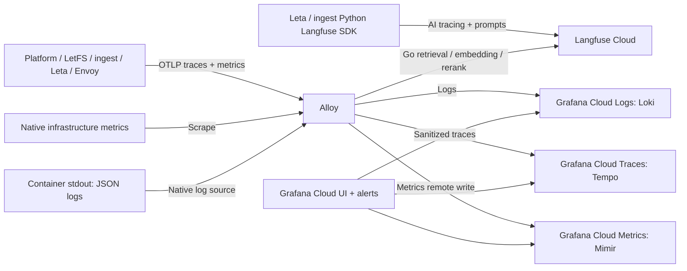
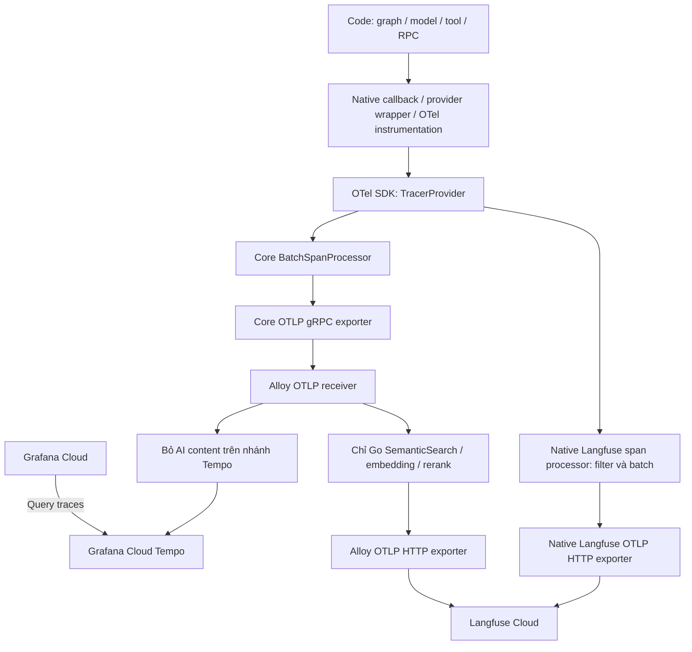
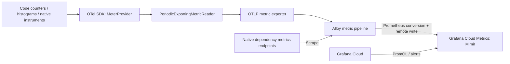

# Monitoring và observability toàn Openlet

Thiết kế được người dùng chốt 2026-11-13, chưa implementation. [Plan/status](plan.md), [Langfuse và prompting](langfuse.md), [feature/source audit](feature-audit.md). Người dùng đã chọn Grafana Cloud Free và Langfuse Cloud Free; defaults cụ thể đo khi triển khai.

## 1. Hiện trạng và phần thực sự cần thêm

[Core telemetry](../261111-1727-platform-letfs-rewrite/telemetry.md) đã có một native OTel provider/process, OTLP/gRPC traces + metrics, gRPC/HTTP/S3/Qdrant/pgx/runtime instrumentation, native Temporal propagation/metrics và JSON log correlation. Envoy có tracing/access logs. [Local proof](../reports/implementation-261112-native-telemetry.md) đã thấy parent chains liên service và core vẫn chạy khi collector unavailable.

Chưa có Alloy hoặc Cloud endpoints/dashboards/alerts provisioning trong active deployment. Temporal server template chưa mở native metrics endpoint. Leta mới là accepted design, chưa có active app. Vì thế giữ instrumentation đã có; bổ sung Alloy/Cloud destinations, native dependency scrapes và các AI/domain boundaries mà auto-instrumentation không biết.

Không rewrite handlers để bọc telemetry. Không bổ sung bảng telemetry vào Platform/LetFS/Leta.

## 2. Topology

Người dùng chốt **Grafana Cloud Free + Langfuse Cloud Free**. Máy Openlet chỉ chạy Alloy cho observability; không local Prometheus/Tempo/Grafana/Loki hoặc backend object-store riêng.

JSON stdout logs tiếp tục có trace/span IDs và local rotation. Alloy đọc bằng native container log source rồi gửi Cloud Loki, không thêm app log SDK/processor hoặc custom log pipeline service. Service/environment/level là labels khi cần; trace/span/workspace/agent IDs giữ JSON fields, không Loki labels high cardinality. Grafana Explore tìm logs và đối chiếu TraceID với Tempo.

Grafana Cloud quản lý UI/storage/alerts, metrics backend là **Mimir tương thích Prometheus**, không Prometheus server tự host. Dùng Grafana-managed alerts/contact points và Langfuse-native dashboards/alerts, không thêm Alertmanager hoặc custom Cloud polling.

## 3. Shared provider, native exporters

Core Go/Envoy/Python giữ native OTLP exporter → Alloy → Tempo. Python có Langfuse khởi tạo SDK sau core telemetry, dùng chung global TracerProvider; Langfuse tự thêm processor/exporter **trực tiếp Cloud**. Giữ exporter core, không override Langfuse exporter hoặc tạo collector route cho Python AI spans lần nữa. Đây là [native coexistence](https://langfuse.com/faq/all/existing-otel-setup), hai backends từ cùng instrumentation không phải instrument model hai lần.

Default Langfuse filter giữ LF/GenAI/known LLM scopes; thêm đúng native gRPC client SemanticSearch để nối cây RAG, không gửi toàn bộ infra spans vào Cloud. Alloy bỏ AI input/output/tool args/results/media trước Tempo; LF SDK upload giữ native content cho demo. Không dựa LF-only masking để bảo vệ exporter core.

Core BatchSpanProcessor giữ cả infrastructure và AI spans đã sample; không thêm AI filter vào core processor. Nhánh Tempo cần graph/model/tool timings và downstream RPC correlation, còn Langfuse giữ nội dung/usage/prompt UI. Alloy chỉ bỏ content trên nhánh Tempo, không drop toàn bộ AI observations. LF processor dùng native should_export_span kết hợp default helper và ngoại lệ SemanticSearch client, không filter framework mới. BatchSpanProcessor chuẩn chịu batching/export, không tự phân loại AI.

Riêng LetFS Go không dùng Python SDK: existing SemanticSearch server span được annotate type retriever, query embedding có type embedding/model/actual usage, rerank là span với model/counts/selected indices/scores trong metadata/output. Alloy chọn đúng service/operation spans này rồi gửi Cloud bằng official HTTP/protobuf OTLP endpoint theo region; không lọc bằng embedding/generation types đơn thuần vì sẽ mất rerank. Nhánh này không nhận Python LF spans để tránh duplicate. Headers/auth theo [official native OTLP](https://langfuse.com/integrations/native/opentelemetry), Cloud credentials chỉ collector cần nhánh Go và server-side LF clients. [RAG detail](langfuse.md#rag-online).

Grafana Cloud Metrics nhận existing OTLP metrics/native scrapes qua Alloy, không dùng Langfuse làm collector metrics và không mirror Cloud dashboards qua custom polling.

### Từ code đến trace backends

Sơ đồ sau mô tả một Python process có Langfuse. Mỗi process có provider riêng; Openlet SDK là owning initialization, Langfuse SDK tích hợp vào provider đó.

Go/Envoy dùng native provider → BatchSpanProcessor → OTLP exporter → Alloy, không Langfuse Python processor. Nhánh Go trong Alloy không chọn Python AI spans. Core processor không thay thế Langfuse processor; mỗi processor có exporter/backend riêng. Callback và wrapper là lựa chọn theo owning call, không dùng cả hai cho cùng provider invocation.

Processor chạy trong app process: quan sát span lifecycle, filter/batch bằng native SDK. Exporter serialize và gửi batch ra network. Alloy là collector process bên ngoài app, chịu routing/transform/scrape. Tempo và Langfuse là backends lưu/truy vấn spans; Grafana query Tempo, không là exporter.

### Metrics đi đường riêng

Metrics không đi qua SpanProcessor. Span attributes không tự thành Prometheus counters/histograms; dùng native instruments và sáu Leta instruments đã nêu. Prompt fetch là HTTP API call của Langfuse client + RAM cache, không đi qua span exporter hoặc Alloy.

### GenAI semantic attributes

`gen_ai.*` là standard semantic attributes mô tả AI operation; chúng là dữ liệu trên spans/metrics theo từng convention, không là một collector hoặc SDK mới. [Current OTel GenAI registry](https://github.com/open-telemetry/semantic-conventions-genai/blob/main/docs/registry/attributes/gen-ai.md) và [Langfuse mapping](https://langfuse.com/integrations/native/opentelemetry).

| Attribute family | Ví dụ | Owner |
|---|---|---|
| Resource identity | service.name, service.version, deployment.environment.name | Core SDK initialization |
| Native operation | HTTP/RPC/database attributes | Native OTel instrumentations |
| GenAI | gen_ai.operation.name, gen_ai.provider.name, gen_ai.request.model, gen_ai.usage.input_tokens/output_tokens | Native AI integration; Go provider boundary khi tự instrument |
| Langfuse-specific | langfuse.observation.type, langfuse.session.id, prompt name/version | Langfuse SDK; Go chỉ thêm mapping cần thiết |
| Domain metadata | workspace/agent/run/root/box IDs | Owning Openlet boundary qua native metadata propagation |

Langfuse hiểu supported GenAI attributes để map model/usage/type, đồng thời SDK quản lý attributes riêng cho session/prompt/observations. Python giữ native integration output, không tự duplicate toàn bộ GenAI/Langfuse attributes hoặc viết compatibility mapper. Go query embedding dùng gen_ai operation/model/actual usage và explicit langfuse.observation.type=embedding; SemanticSearch dùng retriever, rerank dùng span/model metadata khi chưa có actual usage. Không tự gắn model attributes vào mọi tool/RPC span.

Attribute token counts chỉ ghi khi provider trả; latency lấy start/end/timing của observation. GenAI conventions còn thay đổi, dùng contract của pinned integrations và supported Langfuse mapping, không tự thêm normalization framework. AI metadata/timing có thể giữ ở Tempo; content bị bỏ theo nhánh đã nêu. Không promote mọi span attribute thành Prometheus labels.

## 4. Sampling, batching và outage

Demo 1–10 testers dùng existing `trace_sample_ratio: 1.0` trong SDK/Envoy để thấy đầy đủ thông thường; giữ native ParentBased sampler và config contract. Tempo nhận các spans đã export, không thêm collector sampling layer ở workload này. Langfuse giữ native default sample rate 1.0. Không global AlwaysOn redesign, xóa config setting, tail sampling, content sampling 10% hoặc custom capture caps.

Sampling dưới 1 là cách vận hành thực tế khi traffic/chi phí tăng, không cần áp dụng chỉ vì có vài users/workspaces/agents. Nếu sau này chỉ Tempo cần giảm volume thì dùng native trace-consistent sampler ở riêng Alloy → Tempo; provider vẫn 1.0 để không cắt dữ liệu Langfuse trước khi chia nhánh. Chưa thêm collector sampler/config knobs cho demo. Sampling traces không giảm metric series hoặc logs; metrics không sampling và logs theo existing level.

**Không coi hai sample-rate settings độc lập.** Đã kiểm public Langfuse Python 5.2.0 source: `_init_tracer_provider` dùng `sample_rate` để tạo ratio sampler khi chưa có global provider; nếu existing provider đã có thì reuse sampler của nó. Trong wiring hiện tại, đổi `LANGFUSE_SAMPLE_RATE` không bảo đảm giảm riêng LF branch, và đặt LF 1.0 không lấy lại spans bị common provider drop. Nếu LF quota thực sự gần đầy thì quyết định trace sampling phù hợp tại owning export pipeline/native API đã kiểm của version đó; không tự thêm custom sampler hoặc tách providers lúc này. [Sampling docs](https://langfuse.com/docs/observability/features/sampling), [existing OTel](https://langfuse.com/faq/all/existing-otel-setup).

Spans upstream đã không sample không thể phục hồi ở Langfuse; không gọi đây là guaranteed accounting. Metrics không sampling; error logs giữ theo level. Sau khi có workload thực mới tune existing ratio nếu cần, không thiết kế quy mô hàng trăm agents 24/7 cho demo.

Dùng native SDK batching/export timeout/retry và bounded queues mặc định, flush khi shutdown, không mỗi model/tool/token. Alloy memory limiter/native exporter queue theo container budget, native metrics remote-write WAL có volume. Không custom queue/spool/SQL telemetry outbox.

Upload telemetry down không rollback business effects; queue hữu hạn có thể drop. **Prompt cold miss là dependency khác:** demo chưa fallback artifact; cache rỗng + Cloud prompt API down thì invocation báo lỗi theo existing handling/retry, không hứa vẫn chạy model bằng prompt không có. Native warm stale cache giúp transient outage.

## 5. Correlation và cardinality

Giữ resource attributes `service.name`, `service.version`, `service.instance.id`, `deployment.environment.name`; release commit SHA qua standard resource environment. Core Go/Python dùng cùng release, không dùng Python SDK package version làm application release. `worker.role` dùng tập CPU/IO/control/runtime/bridge đã có.

| Dữ liệu | Đặt ở đâu | Mục đích |
|---|---|---|
| trace_id/span_id | OTel + JSON logs | Mở sampled Tempo trace hoặc Cloud observation |
| workspace/root/agent/run/box IDs | Selected spans/logs/Langfuse metadata | Điều tra đúng resource, gom hoạt động đa agent |
| workflow_id/run_id/activity/attempt | Temporal native history/logs + finite execution spans | Phân biệt logical agent run với Temporal attempt/retry |
| message/tool_call/hitl_request IDs | Chỉ span thực sự xử lý event đó | Theo cause/effect và delivery, không nhét mọi ID vào mọi observation |
| service/role/method/status/stage/model/tool/reason | Bounded metric labels | Dashboard/alerts với số series hữu hạn |

Không user/workspace/agent/file/path/trace IDs trong Prometheus labels; không raw error text, SQL/request content. Model/tool names lấy finite catalog/contracts. Không tự bật resource-to-label conversion cho tất cả resource attributes: chỉ promote service/environment/role và label native thực sự cần; process instance làm churn series nếu đưa bừa vào labels.

Trace context chỉ correlation; không auth. Không credentials/actor tokens/bodies trong baggage. Langfuse `propagate_attributes` dùng local scope mặc định, không `as_baggage=True` tới model provider.

## 6. Tracing boundaries theo service

| Thành phần | Giữ/thêm spans | Không làm |
|---|---|---|
| Envoy | Native HTTP/gRPC request/status/upstream | Không dùng đường dẫn resource làm span name hoặc capture headers/body |
| Platform | Native RPC, pgx, SpiceDB/Clerk; finite provisioning/cleanup activity tracing | Không span cho từng relationship hoặc membership trong list |
| LetFS | Native RPC, pgx/S3/Qdrant/SpiceDB; meaningful mutation/search/ingest stages; SemanticSearch retriever/query embedding/rerank | Không span mỗi file line/chunk/token; cache hit không remote permission call vì telemetry |
| Ingest CPU | parse/export stages và process metrics | Không observation mỗi artifact/row; parser subprocess failure vẫn vào owning activity log/status |
| Ingest IO | enrichment generation, batch embedding, index stages | Native wrapper capture input batch và output count/dimensions; không lưu embedding vectors hoặc tạo observation mỗi chunk |
| Leta API | Native HTTP server instrumentation của framework, RPC/db/Redis clients; SSE admission/reconnect | Không dùng SSE connection duration làm request-latency SLO |
| Leta worker | Native LangGraph callback mỗi invocation; model/tool/compaction children; native activity spans và state timing | Không span suốt agent lifetime, heartbeat hoặc empty inbox poll |

Leta dùng native callback chi tiết ở [Langfuse integration](langfuse.md#2-tích-hợp-leta-và-leti). Core native Temporal integration giữ nguyên; không exporter/network/wall-clock instrumentation thường trong workflow code. Replay-safe logger/metrics/native history vẫn là nguồn orchestration.

[File processing](langfuse.md#file-processing): Grafana theo dõi queue/parse/export/enrich/embed/upsert/commit và lỗi; LF nhận enrichment/batch embedding content/usage. Dùng file_id/source_version để đối chiếu selected spans/logs/observations, không thêm metric labels. Product file status vẫn lấy từ LetFS processing state; không mirror mọi processing stage sang LF.

## 7. Metrics coverage

Ưu tiên names/units của integrations đã pin; bảng sau là signals cần có, không ép rename toàn bộ native metrics. Tắt duplicate instrumentation cho cùng transport/provider.

| Nguồn | Signals và dashboard dùng |
|---|---|
| Gateway/API | Traffic, success/error ratio, latency theo normalized route/RPC; upstream errors, overload |
| Go/Python process | CPU, RSS/heap, GC, threads/goroutines, restarts/OOM |
| PostgreSQL + pgx | Availability/connections/locks/transactions/disk; pool acquire wait và query duration; native exporter không custom per-workspace SQL |
| SpiceDB | Native `/metrics`: latency/error/cache/datastore pressure; bỏ resource/subject IDs khỏi scrape labels nếu có |
| Temporal server + SDK | Frontend/persistence errors, schedule-to-start, retries/failures/timeouts, worker slots/pollers; queues role-specific |
| Qdrant | Native collection/index/query/point counts, memory/disk/status; không text/vector payload |
| Redis | Memory/maxmemory, evictions, hit/miss, command latency, connections; stream/cache namespaces không là label mỗi key |
| S3 | Client requests/errors/latency từ SDK; external bucket capacity/billing xem native provider monitoring khi có |
| Host/containers | CPU/memory/disk/inodes/container restarts; native Alloy Unix/cAdvisor exporters |
| Alloy/Prometheus/Tempo/Grafana | Export failures, refused/dropped data, queue/WAL growth, scrape failures, TSDB series/disk, Tempo discarded/oversized spans and storage errors |

Alloy scrape native endpoints, dùng built-in Postgres/Redis/Unix/cAdvisor exporter khi cần. Temporal server thêm native metrics listen config vào existing template. Administrative/metrics endpoints ở private network; không publish qua public Envoy. Alloy gửi self-metrics cùng pipeline; Grafana Cloud có no-data/absent-series alerts để thấy ngừng gửi từ host. Không duplicate app scrapes hoặc kết luận Cloud connectivity loss chắc chắn là host down.

Leta chỉ bổ sung các instruments có mục đích cụ thể:

| Instrument đề xuất | Loại | Dimensions | Cách ghi |
|---|---|---|---|
| `openlet.leta.runtime.active` | UpDownCounter | agent_role | Active runtime trong process; native worker slots vẫn là capacity |
| `openlet.leta.tool.duration` | Histogram s | tool, outcome, agent_role | Một lần/tool execution, kể cả failed/expected domain outcomes |
| `openlet.leta.inbox.messages` | Counter | direction, agent_role | Accepted/consumed ở existing boundary; không counter mỗi empty poll |
| `openlet.leta.inbox.age` | Histogram s | agent_role | Existing message timestamp → first consumption |
| `openlet.leta.state.duration` | Histogram s | operation, outcome | checkpoint/projection/prune; không span từng saver SQL row |
| `openlet.leta.stream.resync` | Counter | reason | Cursor gap/slow client; dùng native HTTP active connections khi có |

Model latency/usage/cost/TTFT chủ yếu dùng Langfuse-native dashboards/alerts. Nếu cần model availability alert độc lập Cloud, ghi native OTel GenAI operation-duration histogram tại cùng model boundary; histogram count đủ requests/errors, không thêm mirror counters cùng ý nghĩa.

Không background COUNT/SUM mọi workspace/agent để có dashboard. Inbox age chỉ đo khi message được consume, nên **không phát hiện queue đứng hoàn toàn** một mình: kết hợp Temporal queue/poller/process signals và accepted/consumed trends; khi điều tra xem canonical inbox/history. Không suy SQL backlog chính xác từ counter difference sau process restart.

## 8. Dashboards và alerts ban đầu

Bốn Grafana Cloud dashboards: service overview; infrastructure/data stores; Temporal/worker capacity; Leta runtime/stream/state. Dùng dashboard native dự án upstream làm nền, chỉ giữ panels cần; không tự viết mỗi dependency một UI.

Langfuse dashboards: model latency/error/TTFT; tokens/cache/cost theo model/prompt/role; trace/session/input/output/tool inspection; evaluation hoãn. Pulse/search/table charts dùng điều tra nhanh. Usage dashboard theo dõi chính Cloud units, tách khỏi model-provider spend.

| Alert | Điều kiện đề xuất ban đầu | Vì sao / tránh false alarm |
|---|---|---|
| Service/dependency down | Scrape/readiness failed 2–5 phút | Phân biệt deploy ngắn với outage; không gộp Leta optional vào core readiness |
| API availability | Unexpected server error >5%/5 phút, có minimum traffic | Không tính permission denied/version conflict/quota thành platform outage |
| Worker backlog | Schedule-to-start cao kéo dài + pending work/poller signals | Agent idle là bình thường; alert queue/worker signals thay vì agent lifetime |
| Worker/process failure | Restart/OOM hoặc không poll khi có queued work | Không alert agent idle/pause/HITL wait vì không gọi LLM |
| DB/Redis/storage pressure | Pool wait/saturation kéo dài; disk >80% warning, >90% critical; Redis evictions bất thường | Đặt headroom trước fail; cache-hit ratio thấp không tự là incident |
| Telemetry loss | Export/refused/drop tăng hoặc remote-write lag/queue gần đầy | Không kết luận “không lỗi” từ dashboard không có dữ liệu |
| AI failure/spend | Langfuse error ratio/model latency hoặc rolling cost vượt budget đã chọn | Budget do vận hành đặt theo workload; alert không phải hard billing cap |

Thresholds là defaults để hiệu chỉnh bằng workload thực, không business limits mới. Contact points cấu hình lúc deploy; không gửi thông báo hay tạo webhook bên ngoài trong lượt research. Cloud alerts có thể thấy telemetry biến mất khi host/network/collector lỗi bằng no-data policy, nhưng không phân biệt nguyên nhân chỉ từ missing data; không gọi single Alloy host là HA.

## 9. Cloud Free và footprint

- **Local:** một Alloy container/process, config và native remote-write WAL/state volume. Apps giữ SDK/native export queues. Chưa đo RAM/CPU; lượng series, scrape/export buffers và log volume quyết định footprint, không áp sizing Tempo self-host vào lựa chọn Cloud.
- **Grafana Cloud Free:** managed Mimir/Tempo/Loki/Grafana UI. Theo [pricing](https://grafana.com/pricing/) tại ngày kiểm: 10k active metric series, traces 50 GB ingest/tháng, logs 50 GB ingest/tháng, retention 14 ngày cho cả ba signals. Đây là target đã chọn, thay Prometheus 30 ngày/Tempo 7 ngày self-host trước đó.
- **Langfuse Cloud Hobby:** 50k units/tháng, 30 ngày data access, hai dashboard seats; prompt fetching unlimited theo [pricing](https://langfuse.com/pricing/). Access window không là automatic deletion. [Usage](langfuse.md#8-free-và-features-dùng-ngay).
- **Logs local:** giữ Docker rotation để bounded disk; logs đã upload có retention Cloud riêng. Không liên quan durable inbox/public history MVP.
- Không local Prometheus TSDB, Tempo WAL/blocks/S3, Grafana DB, Loki storage hoặc self-host Langfuse dependencies. Không HA/Kafka/Kubernetes/monitoring backend matrix.

Hai Free tiers phù hợp để bắt đầu demo/POC 1–10 users; không coi số users là capacity proof. Langfuse units tính traces + observations + scores, không số runs. Ví dụ thuần số học nếu measured total 50 units/run thì 50k cho khoảng 1,000 runs/tháng; native node/tool/model observation counts phải đo, không giả mặc định luôn 50. Grafana series có thể nhiều từ native histograms dù ít users; không nhân IDs vào metric/log labels. Theo dõi native Usage, chưa custom quota controller hoặc paid upgrade.

## 10. Phạm vi files và verification khi implementation

Infra bổ sung owning Alloy config dưới `infra/config/observability/`, Compose Alloy service/state volume, native Temporal/Envoy metrics wiring, Cloud endpoints/secret refs và dashboard/alert provisioning. Không thêm local backend services. Tận dụng existing one-YAML route; app config chỉ cần existing telemetry endpoint/interval plus Langfuse base URL/key references/prompt label. Giữ existing telemetry sample ratio; không thêm capture-policy framework hoặc prompt fallback artifact config.

Shared SDK giữ native sampler/exporter lifecycle/log fields; Python LF SDK dùng chung provider và default Cloud exporter như trên. Ingest sửa owning model call boundary; LetFS annotate SemanticSearch và instrument query-embedding/rerank calls. Leta dùng native callback run_inline và native filter extension cho đúng SemanticSearch client trong feature/runtime modules của folder structure đã chốt, không tạo observability package/service mới. Không đổi executable tool schemas, domain receipts, API business payloads hoặc Temporal queues để phục vụ dashboards.

Focused proof cần đủ:

1. Native Alloy config validation + one shared integration journey; core metrics/traces có trong Grafana Cloud, JSON logs có trong Loki và đối chiếu TraceID được.
2. Cùng TraceID Tempo/Langfuse khi trace được chọn; LF chỉ AI observations và đúng SemanticSearch RPC client nối cây, không duplicate spans/usages, Tempo không content. Một RAG journey kiểm parent chain từ async callback qua client/server retriever tới embedding/rerank, không capture SQL-rejected candidates.
3. Provider stream first-token/end/error/cancel có đúng usage khi provider trả; không observation mỗi chunk.
4. Một graph invocation có model/tool tree; invocation sau trace mới/cùng agent session; native checkpoint/CAN behavior giữ đúng.
5. Tắt telemetry upload/Alloy hoặc mô phỏng Cloud exporter unavailable: business effects không phụ thuộc exporter. Kiểm riêng warm cache và cold prompt-miss error semantics, không giả cold miss có fallback.
6. Đo Cloud units/spans trên vài graph invocations đại diện và kiểm Usage dashboard Free; chưa thêm soak/performance harness hoặc quota controller.

Rollback tắt Alloy/optional exports, giữ JSON logs và business system chạy. Rollback prompt độc lập deployment. Không migration/data deletion ở lượt tích hợp telemetry này.

## 11. Quyết định triển khai Cloud đã chốt

Ngày 2026-11-13, người dùng chọn Cloud, thay baseline bốn local monitoring containers. Target duy nhất: **Alloy trên host + Grafana Cloud Free + Langfuse Cloud Hobby**, gồm centralized container logs qua Cloud Loki. Không giữ self-host profile thứ hai hoặc migration framework trong app.

Shared TracerProvider/context/resource identity giữ nguyên. **Core processor/exporter và Langfuse processor/exporter là hai nhánh riêng**: core OTLP gRPC tới Alloy, Langfuse native OTLP HTTP trực tiếp Cloud. Metrics dùng MeterProvider/reader/exporter riêng; log stdout được Alloy thu riêng. Cloud choice chỉ đổi owning backend endpoints/storage/retention/log destination, không đổi agent runtime.

Chưa provision accounts/credentials/region, publish prompts hoặc deploy. Deployment điền actual endpoints/secret refs của Cloud projects; không decision architecture còn chờ hoặc yêu cầu nâng paid tier trước demo.
