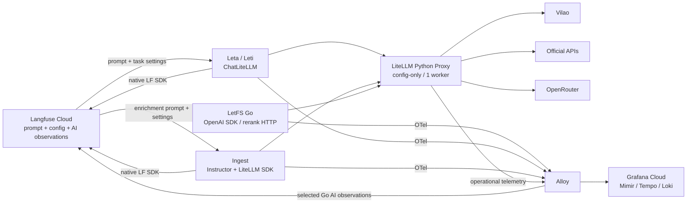

# Thiết kế triển khai chi tiết

Authority và các gate: [plan](plan.md), [decision ledger](decisions.md).
Các đoạn ghi **đề xuất/chưa chốt** không phải permission để tự đổi contract.

## 1. Kiến trúc đích



Proxy là một inference dependency chung, không nằm trong lifecycle từng agent/
tool. API frontend gọi Openlet, không gọi gateway hoặc `/model/info` trực tiếp.
Không đổi Temporal workflows/queues, Mirage lifecycle, SQL domain hay SSE replay.

## 2. Ownership và configuration

| Dữ liệu                                                             | Nơi sở hữu                        | Vì sao cần                                         |
| ------------------------------------------------------------------- | --------------------------------- | -------------------------------------------------- |
| Public groups, deployments, credentials, supported Leta subset      | `infra/config/litellm.yaml`       | Native routing/discovery, không duplicated catalog |
| Actual capabilities/limits và native per-deployment price overrides | LiteLLM metadata/config           | Request compatibility và cost đúng supplier        |
| Prompt + default model/effort/sampling/output parameters            | Langfuse Prompt Config            | Version và rollback cùng instructions              |
| Explicit agent selection / Leti inheritance                         | Existing agents product state     | Lựa chọn người dùng tồn tại qua invocations        |
| Embedding group + dimensions/index identity                         | Existing index settings + gateway | Query và indexed vectors phải cùng space           |
| Optional reranking group                                            | Existing shared search settings   | Tắt rerank không tắt retrieval                     |
| Gateway URL/key/timeouts, hard budgets, image/input limits          | Openlet shared config             | Connectivity và resource policy của application    |
| Upstream secrets / gateway server key / Cloud keys                  | Private root `.env`               | Không xuất vào tracked YAML, model-list hoặc logs  |

Giữ convention hiện tại YAML settings + `${ENV_NAME}` secrets; native LiteLLM
file dùng `os.environ/NAME`. Không tạo config service hoặc converter catalog.
`models.provider` chuyển thành connection **đến Proxy**, không upstream.
Tên section có thể giữ để giảm churn; semantics target phải rõ trong SDK/docs.

Target shape cho phần ứng dụng, không phải file đã triển khai:

```yaml
models:
  provider:
    base_url: http://litellm:4000/v1
    api_key: ${LITELLM_API_KEY}
    timeout_seconds: 90
  embedding:
    model: embedding
    dimensions: 1536
  reranking: null
  enrichment:
    max_input_characters: 24000
    max_image_pixels: 25000000
    image_max_side: 1600
    image_jpeg_quality: 85
```

`embedding` minh họa opaque gateway group/alias, **không tự chọn embedding model
hoặc dimensions cho data hiện hữu**. Các image/evidence budgets giữ hiện có;
không thêm model/effort/prices vào section này. `reranking` khi bật chỉ có
`model`; absent/null đều off, không `enabled` thứ hai.

Xóa `models.leta.default/catalog`, enrichment `model/reasoning_effort` và model
output default khỏi YAML. Desired output budget chuyển Prompt Config; application
vẫn giữ hard context/runtime policy cần để không vượt giới hạn tài nguyên.

Langfuse config ví dụ cho root/enrichment:

```json
{
  "model": "openai/gpt-6.1-sol",
  "reasoning_effort": "low"
}
```

Không bắt kê mọi optional field. Missing effort là không gửi override, **không
tự đổi thành** `"none"`. `temperature`, `top_p`, `top_k`, output budget chỉ truyền
khi task cần và actual deployment hỗ trợ. App parse typed fields ở boundary;
không mù quáng spread toàn bộ JSON config thành kwargs, không duplicate output
validation của Instructor.

## 3. LiteLLM Proxy và deployments

- Stable Python image pin version/digest; research thử1.109.1, phải xác nhận
  image/dependency compatibility khi lock. Không dùng Rust release candidate.
- Một service/worker, config mount read-only; không DB, response cache hoặc Redis
  riêng. Existing Openlet Redis vẫn chỉ giữ chức năng đã duyệt.
- Một server API key cho app/demo; native health/readiness và app connectivity.
  Không virtual-key/per-workspace budgets, spend DB hoặc admin UI infrastructure.
- `credential_list` dùng named credential Vilao. `OPENAI_BASE_URL` và
  `OPENAI_API_KEY` chỉ đi vào upstream gateway. App dùng `LITELLM_API_KEY`.
  Official/OpenRouter secrets chỉ cần khi deployment đó thực sự bật.
- `/model/info` server-side; không publish admin/config routes qua Envoy.
  Operational endpoints/scrapes cho Alloy dùng native mechanism đã verify.
- Không gọi provider trực tiếp khi Proxy down; báo lỗi qua handling hiện có.
  Telemetry outage không rollback effects; inference outage thực sự chặn model call.

Mỗi `model_list` deployment của cùng loại model dùng cùng `model_name`, ví dụ
`openai/gpt-6.1-sol`. Upstream native route có thể là `openai/gpt-6.1-sol` qua
Vilao/official hoặc `openrouter/openai/gpt-6.1-sol` qua OpenRouter. Vilao upstream
name tạm không slash theo endpoint; không parser tách public name trong backend.
Native config ví dụ ở [inference §2](../261111-2010-leta-rewrite/inference.md#2-một-model-group-nhiều-provider).

Mỗi deployment tự có actual capability/limit/price. Không thêm fake deployment
để YAML nhìn đủ ba provider khi thiếu credentials. Provider weights/priority chưa
chốt; config ví dụ không phải quyết định Vilao-first hoặc cheapest-first.

## 4. Model listing và agent selection

### Metadata snapshot

Một typed in-process snapshot từ native `/model/info`, TTL60s; fetch cold/expired
theo nhu cầu tại model-list/admission/invocation. Không Redis/background poll,
không fetch mỗi token/tool. Dùng chung snapshot trong process; không một cache
mỗi agent. Metadata lỗi dùng handling thông thường, không tự list model giả.

Group deployments có `model_info.access_groups: [leta]`; public listing chỉ lấy
subset này, deduplicate theo `model_name`. Preserve enough deployment facts để
kiểm request compatibility; không dùng arbitrary alias với local SDK helper rồi
tin manufacturer capability thay endpoint thực.

**Đề xuất API chi tiết:** `GET /v1/workspaces/{workspace_id}/letas/models`, đăng ký
route trước `/{leta_id}`, auth theo existing workspace access. Response tối thiểu
`items` gồm `id` là opaque group và effort choices **nếu metadata xác thực có**.
Không raw `litellm_params`, upstream URL/key, deployment IDs hoặc giá supplier.
Không thêm endpoint gateway public; cập nhật Envoy/current API docs nếu cần.

Context/output limits dùng server-side. Chỉ expose capability/modality fields
cho client khi selector thực sự dùng; không serialize toàn bộ registry vì có sẵn.
Nếu metadata version không có exact effort choices thì kiểm native override
support trước; không dựng catalog thứ hai trong code để lấp thiếu facts.

### Effort contract — đề xuất cần chốt

Giữ current fields `model_id` và `reasoning_effort`, không thêm field/table:

```json
{
  "model_id": "openai/gpt-6.1-sol",
  "reasoning_effort": "low"
}
```

- `model_id` là group, không supplier. API không parse slash hoặc effort suffix.
- Root không explicit model: default model/effort từ pinned root Prompt Config.
- Leti không explicit model: inherit root effective model/effort. Không lấy
  effort của child áp vào inherited model ngẫu nhiên.
- Explicit model + effort dùng pair đã chọn. Effort thiếu/null nghĩa không
  gửi override cho explicit model; không kéo default effort của model khác sang.
- PATCH omit giữ giá trị, explicit `model_id:null` reset selection về
  default/inheritance và clear explicit effort; effort-only update chỉ hợp lệ
  khi agent có explicit model. Không silently bỏ effort không support.
- Đổi model mà không cung cấp effort cần clear effort cũ để tránh carry sai.
  Validate request theo effective pair, không dựa row cũ không liên quan.

Đây là minimal replacement cho suffix contract đã rút, **chưa tự duyệt thay đổi
API semantics**. Trước implementation boundary phải chốt những quy tắc trên;
không migration SQL destructive theo một proposal cũ.

Runtime áp request settings bằng native client. Per-invocation pinned task
config không đổi giữa tool loop vì production label vừa promote. Giữ current
supported reconfiguration boundary; không dừng activity/đổi workflow để refresh
prompt, cũng không tự đổi product behavior model selection giữa lượt.

## 5. Capabilities và structured output

### Request compatibility

Leta cần text + tool calling, context/output budgets và effort được yêu cầu.
Image enrichment còn cần modality thực. Không lấy capability tốt nhất của một
deployment làm promise chung cho cả group.

**Đề xuất để chốt sau proof:** trước tiên thử native routing chọn đúng deployment
theo required parameters/capabilities. Nếu pinned Proxy không bảo đảm, dùng
common capability/limit của các deployment eligible trong group, không custom
router. Ví dụ Vilao tools-only + official schema: enrichment dùng Instructor
TOOLS cho cả group nếu mọi deployment support tools. Native schema vẫn dùng ở
group mà eligible deployments support nó. Context budget không vượt minimum
eligible deployment limit.

Không tự bỏ official hoặc Vilao, split public model identity theo supplier,
invent priority/weights, hoặc silently `drop_params` để né lỗi. Nếu yêu cầu
không đáp ứng được thì dừng boundary này và trình lựa chọn cụ thể.

### Typed extraction

Ingest giữ existing `Metadata(BaseModel)` là output contract. Dùng
`instructor.from_litellm` với async completion; native mode selection:

| Actual request/deployment support | Instructor mode |
| --------------------------------- | --------------- |
| Native response schema            | `JSON_SCHEMA`   |
| Không schema, có function calling | `TOOLS`         |
| Text-only                         | `MD_JSON`       |

Structured Outputs thường là JSON Schema enforcement; không tạo thêm tầng
"structured output → JSON schema" như hai chuẩn độc lập. Ba mode ở trên là ba
cách thực hiện contract, không ba field cho từng model.

Select mode một lần từ facts. Chỉ explicit unsupported-format error mới cho
bounded downgrade; không xem 401/429/5xx, timeout hoặc malformed response là
bằng chứng native schema không support. `drop_params:false`. Instructor validate
Pydantic và feedback correction, không tự JSON fix/parse/validate lần hai.
Nếu mode downgrade không có facts rõ ràng, fail visible thay thử mò cả model list.

Không ép ordinary agent tool calls qua Instructor. LangGraph native tools vẫn
inferred từ typed `@tool`, không quay lại manual JSON-schema catalog/dispatcher.

## 6. Native clients, retry và RAG

| Caller                 | Client đích                               | Xóa/thay                                           |
| ---------------------- | ----------------------------------------- | -------------------------------------------------- |
| Leta/Leti              | `langchain_litellm.ChatLiteLLM` qua Proxy | Direct `ChatOpenAI` và local model resolver        |
| Ingest enrichment      | `instructor.from_litellm`                 | OpenAI `.parse`, provider-specific reasoning body  |
| Ingest batch embedding | `litellm.aembedding`                      | Direct-provider embedding client                   |
| LetFS query embedding  | Existing OpenAI Go SDK qua Proxy          | Upstream credentials và implicit encoding behavior |
| LetFS rerank           | Native Proxy rerank HTTP endpoint         | Mandatory rerank; không custom rerank framework    |

SDKs/app transport retries **0**. Proxy native bounded retry/backoff giữa eligible
deployments; không app Router/ChatLiteLLMRouter. **Đề xuất tuning khởi đầu**:
một transport retry và Instructor tối đa hai completions cho một validation
attempt chain; verify exact native counter semantics trước ghi config. Đây là
budgets vận hành, không product architecture mới.

| Loại lỗi                                           | Owner / behavior                                                  |
| -------------------------------------------------- | ----------------------------------------------------------------- |
| Transient provider timeout/429/5xx                 | Proxy native bounded retry/failover                               |
| Invalid credentials/unsupported required parameter | Visible/config error; không correction loop                       |
| Schema content không đạt Pydantic                  | Instructor bounded feedback                                       |
| Worker crash/activity failure                      | Existing Temporal durable recovery/checkpoint                     |
| Mutation kết quả chưa rõ                           | Existing receipts/unknown-effect handling, không LLM retry tự chế |

Temporal có thể gọi lại inference sau durable recovery; gateway retry budget
không phải global lifetime request cap. Partial stream errors không được append
lại tokens của full retry vào cùng completion; dùng native streaming semantics,
không tự chế replay/concatenation hoặc fallback sau partial output.

Embedding giữ float encoding, explicit dimensions, count/index/dimension checks
ở response boundary. Query và ingest dùng cùng logical group, actual embedding
space và preprocessing. Cùng dimensions không đủ bảo đảm interchangeability;
đổi upstream cho embedding phải so sánh vectors/behavior trước reuse index.
Không cross-model fallback cho collection hiện hữu. Model/dimensions mới cần
reindex rõ ràng, không reset data trong migration thông thường.

Rerank off: query embedding → dense + BM25/RRF → existing SQL permission/live/
source-version filter → fused top-k. On: rerank sau filter rồi top-k. Không
đổi filters/introduce per-file remote auth cho cached VFS reads. Rerank lỗi
khi bật vẫn visible, không tự silent downgrade khi chưa được duyệt.

## 7. Cost, usage và attribution

### Một nguồn tính giá

LiteLLM native price registry/custom deployment overrides tính cost. Langfuse
nhận actual request cost và tổng hợp. Cùng group có supplier rates khác nhau;
không đồng nhất giá Vilao với OpenAI vì public group có prefix `openai/`.

Override native fields theo deployment khi cần:
`input_cost_per_token`, `output_cost_per_token`, `cache_read_input_token_cost`,
cache creation nếu provider trả được. Đơn vị USD/token. Không tạo custom price
schema/table, fetch OpenRouter định kỳ hoặc sync price definitions sang LF.
Chỉ nhập giá supplier thật; research sample rates không là production values.

### Thu nhận từng request

| Call                    | Nguồn actual cost                                                                                     | Nơi ghi                                                              |
| ----------------------- | ----------------------------------------------------------------------------------------------------- | -------------------------------------------------------------------- |
| Streaming chat          | `stream_options.include_usage:true`; Proxy `include_cost_in_streaming_usage:true`; final `usage.cost` | ChatLiteLLM `response_metadata.response_cost` → active LF generation |
| Nonstreaming completion | Native response cost/header `x-litellm-response-cost`                                                 | Owning LF generation                                                 |
| Embedding               | Native response cost/header, actual usage                                                             | LF embedding observation, không vectors                              |
| Rerank                  | Actual returned cost/usage nếu có                                                                     | Rerank span; không bịa tokens từ document count                      |

Leta giữ native LF callback `run_inline`; một small inline cost callback chạy
trước LF callback tại completion end, cập nhật public generation API
`cost_details={"total": cost}`. Không subclass LF callback, exporter hoặc tạo
duplicate generation. Dùng response metadata typed tại SDK boundary.

Ingest tạo native generation quanh **mỗi raw completion** trước Instructor
cộng usage của attempts. Mỗi correction là paid observation riêng, exact prompt
version. Embedding dùng type embedding. Không bật LiteLLM→Langfuse AI export
thêm lần nữa; gateway chỉ operational telemetry.

Go lấy response header qua native SDK response option/HTTP, annotate existing
embedding/rerank spans bằng LF cost attributes. Không viết calculator khác.
Cached/reasoning tokens là subsets, không cộng hai lần vào totals. Chỉ sum paid
leaf costs; không cộng trace/session aggregates lại vào observations.

Missing/final stream chunk bị mất = unknown, không zero. Kiểm LF UI có tự suy
manufacturer price khi thiếu explicit cost không; inferred estimate không được
báo thành actual supplier cost. Không fake0 để suppress inference. Nếu native
integration không giữ được distinction này, ghi rõ limitation trước acceptance.
HTTP retry upstream mà không có usage có thể phát sinh bill không quan sát được;
không gọi đây là financial reconciliation system.

### Attribution

Existing LF session = agent ID, một trace mỗi graph invocation; Leti session
riêng, root/box/workspace IDs metadata. Ingest ghi file/source-version/stage,
không gán mọi ingestion request vào agent session nếu không có actor thực.
Langfuse quan tâm logical model group; upstream routing/cost source ở gateway
operational details, không đổi tên model theo deployment.

**Khoảng trống đã kiểm source:** Go/Python shared SDK hiện chỉ propagate
TraceContext; Go retrieval nối trace nhưng không tự có session/workspace fields
trên observation. Vì vậy chưa được tuyên bố session totals đã đủ cả RAG costs.

Trước hết kiểm actual LF Cloud có aggregate các Go observations vào session
của trace hiện có hay không. Nếu native trace association đã đủ thì giữ nguyên,
không thêm propagation. Owning LF design trước đó chủ ý không thêm baggage.

**Chỉ nếu proof cho thấy thiếu attribution, đề xuất cần chốt:** dùng standard
W3C Baggage cho đúng internal SemanticSearch call, allowlist workspace/agent/
session IDs từ trusted runtime context. Go chỉ
copy allowlisted values sang native LF metadata/session fields. Không nhận
client-supplied baggage làm identity, không gửi IDs sang external provider,
không add DB ledger hoặc custom RPC identity headers. Verify Cloud aggregation
có gộp đúng trước gọi đây là per-agent cost coverage hoàn chỉnh. Nếu chưa làm,
report rõ RAG costs theo trace/workspace hiện có, không fabricate agent totals.

## 8. Prompt management

| Prompt             | Nội dung / config                                                           |
| ------------------ | --------------------------------------------------------------------------- |
| `leta/common`      | Product concepts/business rules; không task model config inherited          |
| `leta/root`        | Root instructions + pinned common reference; root task default settings     |
| `leta/leti`        | Leti instructions + pinned common reference; giữ root selection inheritance |
| `leta/compaction`  | Summary instruction; không model/effort riêng                               |
| `letfs/enrichment` | Enrichment instructions + own model/settings                                |

Năm text prompts, role-common references dùng numeric version. LF resolve
composition; app không fetch/concat common lần hai. Agent mission vẫn SQL;
tools/Pydantic/output contracts code; messages/checkpoints LangGraph.

Trước invocation fetch role và compaction PromptClient/config qua SDK, compile
và giữ exact objects đến cuối invocation. Ingest resolve enrichment tại owning
call/invocation. Native cache60s/stale-while-revalidate; không Redis cache,
polling/cache invalidation service hoặc refresh mỗi LLM call. Metadata TTL60s
là cache gateway khác, không tái dùng nó để quản prompt versions.

Generations link role version qua `propagate_attributes`; compaction override
prompt trong local scope rồi trở lại role. Không gắn arbitrary prompt object
vào graph metadata hoặc nhầm compaction cost thành normal role prompt metric.

Release: tạo version → thử thực tế qua Openlet → move `production` label →
monitor exact version/errors/usage → rollback label khi cần. `latest` cho dev,
staging chỉ khi có deployment. Prompt/config đổi không cần app redeploy; provider
config đổi là gateway deploy/restart riêng, LF label rollback không rollback nó.

Playground, A/B, evaluation, GitHub sync và webhooks hoãn. Không cần public local
Proxy/LLM connection. Operator CLI/API có thể maintain prompts; agent không tự
edit/promote platform prompts. Không prompt table/release snapshot/fallback copy.
Cold miss + LF prompt API down có thể fail invocation theo accepted demo limit.
Integration được chốt; actual prompt wording còn draft, review trước publish.

## 9. Cache-friendly compaction

Native SummarizationMiddleware vẫn sở hữu trigger, cutoff, tool-pair-safe recent
tail và state replacement. Không custom history slicing/state machine riêng.
Custom summarizer chỉ đổi **request construction** qua public hook.

```text
Main call:
  stable system + ordered tool definitions + native messages prefix + new tail

Compaction call:
  SAME stable system + SAME ordered tool definitions
  + native prefix selected by native middleware
  + final user message containing compaction instruction

After compaction:
  native summary + bounded recent tail → ordinary model/tool loop
```

1. Resolve same executing chat model/group/effort/cache-affecting parameters.
2. Keep compiled role system and agent assignment stable. Current time/live
   representative context đưa vào contextual input ở boundary cần, không rebuild
   system theo clock mỗi loop. Không timestamp chỉ để bust cache.
3. Preserve original structured roles/content/tool calls/call IDs. Không
   `get_buffer_string(..., format="xml")`, replaced summary system hoặc separate
   summarizer model. Giữ tool definition order/model binding như main request.
4. Append compiled compaction instruction cuối native prefix; model trả factual
   continuation summary, không thực thi tool hay tạo side effects trong call này.
5. `trim_tokens_to_summarize=None`: không cắt prefix lần hai bằng cơ chế phụ.
   Budget toàn request: system + tools + messages + instruction + output reserve.
   Trigger đủ sớm và giữ accepted bounded tail; không recursive summary loop.
6. Native replacement state chứa rolling summary + bounded tail. Summary cũ
   được tích hợp vào summary mới; không accumulate summaries/table riêng.
7. Sync native checkpoint → public projection → native `keep_latest` mỗi boundary,
   dưới existing agent writer lock, trước bước tiếp theo. Không đổi saver/lock.
8. Crash/restart giữ pending tools/cursor/summary/tail; không chạy lại effects đã
   confirmed chỉ vì summary không ghi đủ. Domain receipts vẫn authority.

Output summary giữ goals, current decisions, effects confirmed/unknown, pending
work, IDs/paths/recipients và next evidence. Không nhét telemetry/framework
instructions vào product prompt. Compaction không xóa inbox/public activity history.

**Proof bắt buộc:** capture main và summary actual outgoing request; so prefix/
system/tools, complete budget, unresolved tool pairs, checkpoint reopen/pruning.
Đọc actual cached token usage nếu provider trả; không dùng prefix equality để
khẳng định đã có cache hit. After compaction suffix đổi thì cache hit toàn bộ
history không được bảo đảm. Compaction vẫn là một paid inference call.

## 10. Observability/infra và giới hạn demo

Giữ shared OTel TracerProvider/context. Core BatchSpanProcessor/OTLP exporter đi
Alloy → Grafana Cloud; LF SDK thêm processor/exporter riêng trực tiếp LF Cloud.
Không dùng chung một exporter hoặc processor rồi duplicate routing AI observations.
Go AI selected spans đi Alloy → LF OTLP; Python LF spans không forward lần hai.

Native LF filter + đúng SemanticSearch client parent; Tempo strip AI content,
giữ operational timings/models/errors. `gen_ai.*` là semantic attributes chung,
không exporter hay telemetry backend mới. Existing LF-specific attributes chỉ
thêm nơi official ingestion cần; không tự viết semantic convention/framework.

Demo ratio1.0, native finite batching/queue/backoff; không per-token LF event,
DB write hoặc cost counter. Metrics low cardinality, không agent/file/session
ID labels. Alloy/Grafana monitor gateway latency/errors/request pressure theo
native available metrics, không app polls spend API liên tục.

Local chỉ thêm Proxy vào dependency stack; không local Grafana/Tempo/Prometheus/
Loki/ClickHouse. Chưa đo migration memory/latency, không promise proxy nhẹ bao
nhiêu từ isolated numbers. Một Proxy là single point of inference availability,
accepted cho demo. LF/Grafana Free quotas theo native Usage dashboards; không
quota controller hoặc retention daemon. Cloud auth probes có trước không thay
actual app telemetry acceptance của plan này.
