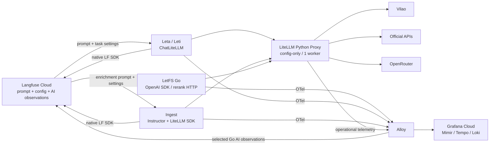

# Thiết kế triển khai chi tiết

Authority và các gate: [plan](plan.md), [decision ledger](decisions.md).
Các đoạn ghi **đề xuất/chưa chốt** không phải permission để tự đổi contract.

## 1. Kiến trúc đích



Proxy là một inference dependency chung, không nằm trong lifecycle từng agent/
tool. API frontend gọi Openlet, không gọi gateway hoặc `/model/info` trực tiếp.
Giữ Temporal workflows/queues, Mirage lifecycle, SQL domain và SSE replay;
runtime result thêm checkpoint inbox cursor theo F04 đã chốt.

## 2. Ownership và configuration

| Dữ liệu                                                             | Nơi sở hữu                        | Vì sao cần                                         |
| ------------------------------------------------------------------- | --------------------------------- | -------------------------------------------------- |
| Public groups, deployments, credentials, supported Leta subset      | `infra/config/litellm.yaml`       | Native routing/discovery, không duplicated catalog |
| Actual capabilities/limits và native per-deployment price overrides | LiteLLM metadata/config           | Request compatibility và cost đúng supplier        |
| Prompt + default model/effort/sampling/output parameters            | Langfuse Prompt Config            | Version và rollback cùng instructions              |
| Explicit agent selection / Leti inheritance                         | Existing agents product state     | Lựa chọn người dùng tồn tại qua invocations        |
| Embedding group + dimensions/index identity                         | Existing index settings + gateway | Query và indexed vectors phải cùng space           |
| Optional reranking group                                            | Existing shared search settings   | Tắt rerank không tắt retrieval                     |
| Gateway URL/key/timeouts, hard budgets, image/input limits          | Openlet shared config             | Connectivity và resource policy của application    |
| Upstream secrets / gateway server key / Cloud keys                  | Private root `.env`               | Không xuất vào tracked YAML, model-list hoặc logs  |

Giữ convention hiện tại YAML settings + `${ENV_NAME}` secrets; native LiteLLM
file dùng `os.environ/NAME`. Không tạo config service hoặc converter catalog.
`models.provider` chuyển thành connection **đến Proxy**, không upstream.
Tên section có thể giữ để giảm churn; semantics target phải rõ trong SDK/docs.

Target shape cho phần ứng dụng, không phải file đã triển khai:

```yaml
models:
  provider:
    base_url: http://litellm:4000/v1
    api_key: ${LITELLM_API_KEY}
    timeout_seconds: 90
  embedding:
    model: embedding
    dimensions: 1536
  reranking: null
  enrichment:
    output_mode: tools
    max_input_characters: 24000
    max_image_pixels: 25000000
    image_max_side: 1600
    image_jpeg_quality: 85
```

`embedding` minh họa opaque gateway group/alias, **không tự chọn embedding model
hoặc dimensions cho data hiện hữu**. Các image/evidence budgets giữ hiện có;
không thêm model/effort/prices vào section này. `reranking` khi bật chỉ có
`model`; absent/null đều off, không `enabled` thứ hai. `output_mode` là transport
cho typed extraction, không provider catalog hoặc mode cho agent tools.

Xóa `models.leta.default/catalog`, enrichment `model/reasoning_effort` và model
output default khỏi YAML. Desired output budget chuyển Prompt Config; application
vẫn giữ hard context/runtime policy cần để không vượt giới hạn tài nguyên.

Langfuse config ví dụ cho root/enrichment:

```json
{
  "model": "openai/gpt-6.1-sol",
  "reasoning_effort": "low"
}
```

Không bắt kê mọi optional field. Missing effort là không gửi override, **không
tự đổi thành** `"none"`. `temperature`, `top_p`, `top_k`, output budget chỉ truyền
khi task cần và actual deployment hỗ trợ. App parse typed fields ở boundary;
không mù quáng spread toàn bộ JSON config thành kwargs, không duplicate output
validation của Instructor.

Config giữ **phẳng**, không `default` wrapper. Root dùng LF model/effort defaults
khi chưa có DB selection; explicit DB pair ghi đè, Leti giữ root inheritance.
Không đổi DB selection chỉ vì publish một prompt config version mới.

## 3. LiteLLM Proxy và deployments

- Stable Python image pin version/digest; research thử1.109.1, phải xác nhận
  image/dependency compatibility khi lock. Không dùng Rust release candidate.
- Một service/worker, config mount read-only; không DB, response cache hoặc Redis
  riêng. Existing Openlet Redis vẫn chỉ giữ chức năng đã duyệt.
- Một server API key cho app/demo; native health/readiness và app connectivity.
  Không virtual-key/per-workspace budgets, spend DB hoặc admin UI infrastructure.
- `credential_list` dùng named credential Vilao. `OPENAI_BASE_URL` và
  `OPENAI_API_KEY` chỉ đi vào upstream gateway. App dùng `LITELLM_API_KEY`.
  Official/OpenRouter secrets chỉ cần khi deployment đó thực sự bật.
- `/model/info` server-side; không publish admin/config routes qua Envoy.
  Operational endpoints/scrapes cho Alloy dùng native mechanism đã verify.
- Không gọi provider trực tiếp khi Proxy down; báo lỗi qua handling hiện có.
  Telemetry outage không rollback effects; inference outage thực sự chặn model call.

Mỗi `model_list` deployment của cùng loại model dùng cùng `model_name`, ví dụ
`openai/gpt-6.1-sol`. Upstream native route có thể là `openai/gpt-6.1-sol` qua
Vilao/official hoặc `openrouter/openai/gpt-6.1-sol` qua OpenRouter. Vilao upstream
name tạm không slash theo endpoint; không parser tách public name trong backend.
Native config ví dụ ở [inference §2](../261111-2010-leta-rewrite/inference.md#2-một-model-group-nhiều-provider).

Mỗi deployment tự có actual capability/limit/price. Không thêm fake deployment
để YAML nhìn đủ ba provider khi thiếu credentials. Provider weights/priority chưa
chốt; config ví dụ không phải quyết định Vilao-first hoặc cheapest-first.

## 4. Model listing và agent selection

### Metadata snapshot

Một typed in-process snapshot từ native `/model/info`, TTL60s; fetch cold/expired
theo nhu cầu tại model-list/admission/invocation. Không Redis/background poll,
không fetch mỗi token/tool. Dùng chung snapshot trong process; không một cache
mỗi agent. Metadata lỗi dùng handling thông thường, không tự list model giả.

Group deployments có `model_info.access_groups: [leta]`; public listing chỉ lấy
subset này, deduplicate theo `model_name`. Preserve enough deployment facts để
kiểm request compatibility; không dùng arbitrary alias với local SDK helper rồi
tin manufacturer capability thay endpoint thực.

**Đề xuất API chi tiết:** `GET /v1/workspaces/{workspace_id}/letas/models`, đăng ký
route trước `/{leta_id}`, auth theo existing workspace access. Response tối thiểu
`items` gồm `id` là opaque group và effort choices **nếu metadata xác thực có**.
Không raw `litellm_params`, upstream URL/key, deployment IDs hoặc giá supplier.
Không thêm endpoint gateway public; cập nhật Envoy/current API docs nếu cần.

Context/output limits dùng server-side. Chỉ expose capability/modality fields
cho client khi selector thực sự dùng; không serialize toàn bộ registry vì có sẵn.
Nếu metadata version không có exact effort choices thì kiểm native override
support trước; không dựng catalog thứ hai trong code để lấp thiếu facts.

### Effort contract đã chốt

Giữ current fields `model_id` và `reasoning_effort`, không thêm field/table:

```json
{
  "model_id": "openai/gpt-6.1-sol",
  "reasoning_effort": "low"
}
```

- `model_id` là group, không supplier. API không parse slash hoặc effort suffix.
- Root không explicit model: default model/effort từ pinned root Prompt Config.
- Leti không explicit model: inherit root effective model/effort. Không lấy
  effort của child áp vào inherited model ngẫu nhiên.
- Explicit model + effort dùng pair đã chọn. Effort thiếu/null nghĩa không
  gửi override cho explicit model; không kéo default effort của model khác sang.
- PATCH omit giữ giá trị, explicit `model_id:null` reset selection về
  default/inheritance và clear explicit effort; effort-only update chỉ hợp lệ
  khi agent có explicit model. Không silently bỏ effort không support.
- Đổi model mà không cung cấp effort cần clear effort cũ để tránh carry sai.
  Validate request theo effective pair, không dựa row cũ không liên quan.

Giữ current fields; PATCH behavior ở trên đã được người dùng chốt sau khi
đối chiếu code. Current code giữ effort cũ khi đổi model bỏ effort và chưa chặn
đầy đủ effort-only khi không có explicit model; sửa theo contract mới này.
Không suffix parser, SQL schema mới hoặc compatibility form.

Runtime áp request settings bằng native client. Per-invocation pinned task
config không đổi giữa tool loop vì production label vừa promote. Giữ current
supported reconfiguration boundary; không dừng activity/đổi workflow để refresh
prompt, cũng không tự đổi product behavior model selection giữa lượt.

## 5. Capabilities và structured output

### Group và deployment

Một group có thể route đến Vilao, official hoặc OpenRouter. Backend không biết
deployment thực trước request; `/model/info` mô tả deployments, không dự đoán
route lần gọi tới. Không capability intersection/filter hoặc auto mode router
trong Openlet. Dùng native LiteLLM config/metadata/routing; required parameters
không bị silently drop. Mọi model hiện dùng cho agent đều có tool calling.

Operator chọn output mode phù hợp với enrichment group đang bật. Vilao tools-only
và official native-schema có thể dùng chung Instructor TOOLS. Không suy native
JSON-schema support từ logical model name hoặc một deployment khác trong group.
Không tự bỏ supplier/split group/chọn weights để né config error. Image/input
limits và embedding-space contracts vẫn phải được kiểm ở owning boundaries.

### Typed extraction

Ingest giữ existing `Metadata(BaseModel)` là output contract. Dùng
`instructor.from_litellm` với async completion. YAML `models.enrichment.output_mode`
chọn đúng một enum đã duyệt:

| YAML enum     | Instructor mode | Cách request                         |
| ------------- | --------------- | ------------------------------------ |
| `tools`       | `TOOLS`         | Function arguments theo typed schema |
| `json_schema` | `JSON_SCHEMA`   | Native response JSON schema          |
| `text`        | `MD_JSON`       | JSON trong text, Instructor parse    |

Structured Outputs thường là JSON Schema enforcement; không tạo thêm tầng
"structured output → JSON schema" như hai chuẩn độc lập. Ba mode ở trên là ba
cách thực hiện contract, không ba field cho từng model.

Vilao dùng `tools`. Không `auto`, capability discovery, mode downgrade hoặc chain
thử ba transports. Mode không phù hợp báo lỗi cấu hình/provider theo handling
thông thường. Instructor sở hữu parsing, Pydantic validation và bounded feedback:
thành công trả validated object, hết budget báo lỗi; không thêm validator/JSON
fixer. Tool mode không phải cam kết mọi request thành công hoặc nội dung đúng sự
thật. Không dựa vào provider strict enforcement để bỏ validation của Instructor.

Không ép ordinary agent tool calls qua Instructor. LangGraph native tools vẫn
inferred từ typed `@tool`, không quay lại manual JSON-schema catalog/dispatcher.
Không tự bật `strict:true` cho mọi deployment; invalid-tool-call recovery hiện
chỉ TODO theo quyết định ở [§11](#11-runtime-optimization-và-box-context).

## 6. Native clients, retry và RAG

| Caller                 | Client đích                               | Xóa/thay                                           |
| ---------------------- | ----------------------------------------- | -------------------------------------------------- |
| Leta/Leti              | `langchain_litellm.ChatLiteLLM` qua Proxy | Direct `ChatOpenAI` và local model resolver        |
| Ingest enrichment      | `instructor.from_litellm`                 | OpenAI `.parse`, provider-specific reasoning body  |
| Ingest batch embedding | `litellm.aembedding`                      | Direct-provider embedding client                   |
| LetFS query embedding  | Existing OpenAI Go SDK qua Proxy          | Upstream credentials và implicit encoding behavior |
| LetFS rerank           | Native Proxy rerank HTTP endpoint         | Mandatory rerank; không custom rerank framework    |

SDKs/app transport retries **0**. Proxy native bounded retry/backoff giữa eligible
deployments; không app Router/ChatLiteLLMRouter. **Đề xuất tuning khởi đầu**:
một transport retry và Instructor tối đa hai completions cho một validation
attempt chain; verify exact native counter semantics trước ghi config. Đây là
budgets vận hành, không product architecture mới.

| Loại lỗi                                           | Owner / behavior                                                  |
| -------------------------------------------------- | ----------------------------------------------------------------- |
| Transient provider timeout/429/5xx                 | Proxy native bounded retry/failover                               |
| Invalid credentials/unsupported required parameter | Visible/config error; không correction loop                       |
| Schema content không đạt Pydantic                  | Instructor bounded feedback                                       |
| Worker crash/activity failure                      | Existing Temporal durable recovery/checkpoint                     |
| Mutation kết quả chưa rõ                           | Existing receipts/unknown-effect handling, không LLM retry tự chế |

Temporal có thể gọi lại inference sau durable recovery; gateway retry budget
không phải global lifetime request cap. Partial stream errors không được append
lại tokens của full retry vào cùng completion; dùng native streaming semantics,
không tự chế replay/concatenation hoặc fallback sau partial output.

Embedding giữ float encoding, explicit dimensions, count/index/dimension checks
ở response boundary. Query và ingest dùng cùng logical group, actual embedding
space và preprocessing. Cùng dimensions không đủ bảo đảm interchangeability;
đổi upstream cho embedding phải so sánh vectors/behavior trước reuse index.
Không cross-model fallback cho collection hiện hữu. Model/dimensions mới cần
reindex rõ ràng, không reset data trong migration thông thường.

Rerank off: query embedding → dense + BM25/RRF → existing SQL permission/live/
source-version filter → fused top-k. On: rerank sau filter rồi top-k. Không
đổi filters/introduce per-file remote auth cho cached VFS reads. Rerank lỗi
khi bật vẫn visible, không tự silent downgrade khi chưa được duyệt.

## 7. Cost, usage và attribution

### Một nguồn tính giá

LiteLLM native price registry/custom deployment overrides tính cost. Langfuse
nhận actual request cost và tổng hợp. Cùng group có supplier rates khác nhau;
không đồng nhất giá Vilao với OpenAI vì public group có prefix `openai/`.

Override native fields theo deployment khi cần:
`input_cost_per_token`, `output_cost_per_token`, `cache_read_input_token_cost`,
cache creation nếu provider trả được. Đơn vị USD/token. Không tạo custom price
schema/table, fetch OpenRouter định kỳ hoặc sync price definitions sang LF.
Chỉ nhập giá supplier thật; research sample rates không là production values.
Rerank dùng native pricing/returned billed units thích hợp với deployment,
kể cả per-query/search-unit; không ép mọi reranker vào token arithmetic.

### Thu nhận từng request

| Call                    | Nguồn actual cost                                                                                     | Nơi ghi                                                              |
| ----------------------- | ----------------------------------------------------------------------------------------------------- | -------------------------------------------------------------------- |
| Streaming chat          | `stream_options.include_usage:true`; Proxy `include_cost_in_streaming_usage:true`; final `usage.cost` | ChatLiteLLM `response_metadata.response_cost` → active LF generation |
| Nonstreaming completion | Native response cost/header `x-litellm-response-cost`                                                 | Owning LF generation                                                 |
| Embedding               | Native response cost/header, actual usage                                                             | LF embedding observation, không vectors                              |
| Rerank                  | Actual returned cost/usage nếu có                                                                     | Rerank span; không bịa tokens từ document count                      |

Leta giữ native LF callback `run_inline`; một small inline cost callback chạy
trước LF callback tại completion end, cập nhật public generation API
`cost_details={"total": cost}`. Không subclass LF callback, exporter hoặc tạo
duplicate generation. Dùng response metadata typed tại SDK boundary.

Ingest tạo native generation quanh **mỗi raw completion** trước Instructor
cộng usage của attempts. Mỗi correction là paid observation riêng, exact prompt
version. Embedding dùng type embedding. Không bật LiteLLM→Langfuse AI export
thêm lần nữa; gateway chỉ operational telemetry.

Go lấy response header qua native SDK response option/HTTP, annotate existing
embedding/rerank spans bằng LF cost attributes. Không viết calculator khác.
Cached/reasoning tokens là subsets, không cộng hai lần vào totals. Chỉ sum paid
leaf costs; không cộng trace/session aggregates lại vào observations.

Missing/final stream chunk bị mất = unknown, không zero. Kiểm LF UI có tự suy
manufacturer price khi thiếu explicit cost không; inferred estimate không được
báo thành actual supplier cost. Không fake0 để suppress inference. Nếu native
integration không giữ được distinction này, ghi rõ limitation trước acceptance.
HTTP retry upstream mà không có usage có thể phát sinh bill không quan sát được;
không gọi đây là financial reconciliation system.

Coverage bắt buộc: **file processing = enrichment LLM attempts + batch embedding**;
**semantic search = query embedding + rerank khi bật**; agent calls và compaction
là các paid LLM observations riêng. Trace/stage spans chỉ tổng hợp leaf costs,
không cộng lại parent aggregates. Zero do thiếu billed units không được báo là
miễn phí; giữ unknown/limitation và dùng native gateway facts.

### Attribution

Existing LF session = agent ID, một trace mỗi graph invocation; Leti session
riêng, root/box/workspace IDs metadata. Ingest ghi file/source-version/stage,
không gán mọi ingestion request vào agent session nếu không có actor thực.
Langfuse quan tâm logical model group; upstream routing/cost source ở gateway
operational details, không đổi tên model theo deployment.

**Khoảng trống đã kiểm source:** Go/Python shared SDK hiện chỉ propagate
TraceContext; Go retrieval nối trace nhưng không tự có session/workspace fields
trên observation. Vì vậy chưa được tuyên bố session totals đã đủ cả RAG costs.

Trước hết kiểm actual LF Cloud có aggregate các Go observations vào session
của trace hiện có hay không. Nếu native trace association đã đủ thì giữ nguyên,
không thêm propagation. Owning LF design trước đó chủ ý không thêm baggage.

**Chỉ nếu proof cho thấy thiếu attribution, đề xuất cần chốt:** dùng standard
W3C Baggage cho đúng internal SemanticSearch call, allowlist workspace/agent/
session IDs từ trusted runtime context. Go chỉ
copy allowlisted values sang native LF metadata/session fields. Không nhận
client-supplied baggage làm identity, không gửi IDs sang external provider,
không add DB ledger hoặc custom RPC identity headers. Verify Cloud aggregation
có gộp đúng trước gọi đây là per-agent cost coverage hoàn chỉnh. Nếu chưa làm,
report rõ RAG costs theo trace/workspace hiện có, không fabricate agent totals.

## 8. Prompt management

| Prompt             | Nội dung / config                                                           |
| ------------------ | --------------------------------------------------------------------------- |
| `leta/common`      | Product concepts/business rules; không task model config inherited          |
| `leta/root`        | Root instructions + pinned common reference; root task default settings     |
| `leta/leti`        | Leti instructions + pinned common reference; giữ root selection inheritance |
| `leta/compaction`  | Summary instruction; không model/effort riêng                               |
| `letfs/enrichment` | Enrichment instructions + own model/settings                                |

Năm text prompts, role-common references dùng numeric version. LF resolve
composition; app không fetch/concat common lần hai. Agent mission vẫn SQL;
tools/Pydantic/output contracts code; messages/checkpoints LangGraph.

Role templates chứa heading **`Your instructions`** và `{{agent_instructions}}`
từ `agents.system_prompt`. Leti thêm heading `Box context` và `{{box_context}}`
theo [§11](#11-runtime-optimization-và-box-context); root không có box block.
Dùng native PromptClient.compile với variables; không concat common/role/mission
instructions trong runtime. Box renderer chỉ chuyển dữ kiện thành text, không
chứa một bộ system instructions khác. Bỏ time/timezone context khỏi cả root và
Leti, không chuyển clock sang user message hoặc placeholder khác.

Trước invocation fetch role và compaction PromptClient/config qua SDK, compile
và giữ exact objects đến cuối invocation. Ingest resolve enrichment tại owning
call/invocation. Native cache60s/stale-while-revalidate; không Redis cache,
polling/cache invalidation service hoặc refresh mỗi LLM call. Metadata TTL60s
là cache gateway khác, không tái dùng nó để quản prompt versions.

Generations link role version qua `propagate_attributes`; compaction override
prompt trong local scope rồi trở lại role. Không gắn arbitrary prompt object
vào graph metadata hoặc nhầm compaction cost thành normal role prompt metric.

Release: tạo version → thử thực tế qua Openlet → move `production` label →
monitor exact version/errors/usage → rollback label khi cần. `latest` cho dev,
staging chỉ khi có deployment. Prompt/config đổi không cần app redeploy; provider
config đổi là gateway deploy/restart riêng, LF label rollback không rollback nó.

Implementation gồm **cập nhật LF Cloud thật**: hoàn thiện/review nội dung năm
prompts, tạo common version trước, role references pin đúng numeric version,
upload template/config, kiểm resolved text và compile đủ variables, chạy root/
Leti/enrichment/compaction qua Openlet, xác nhận observation link/version rồi
kiểm production label/cache/rollback. Không coi sửa Markdown, fixtures hoặc
SDK export tới local sink là publication acceptance. Không overwrite versions;
dùng native immutable versions/labels, không prompt-sync/release service mới.

Playground, A/B, evaluation, GitHub sync và webhooks hoãn. Không cần public local
Proxy/LLM connection. Operator CLI/API có thể maintain prompts; agent không tự
edit/promote platform prompts. Không prompt table/release snapshot/fallback copy.
Cold miss + LF prompt API down có thể fail invocation theo accepted demo limit.
Integration được chốt; actual prompt wording còn draft, review trước publish.

## 9. Cache-friendly compaction

Native SummarizationMiddleware vẫn sở hữu trigger, cutoff, tool-pair-safe recent
tail và state replacement. Không custom history slicing/state machine riêng.
Custom summarizer chỉ đổi **request construction** qua public hook.

### Thresholds cấu hình được

Giữ initial defaults 80% trigger và 30% recent tail; không gọi đây là kết quả
benchmark tối ưu cho Openlet. [LangChain reference](https://reference.langchain.com/python/langchain/agents/middleware/summarization/SummarizationMiddleware)
có cả ví dụ trigger fraction 0.8 và keep fraction 0.3, nhưng default keep thật
của thư viện là 20 messages. [OpenCode source](https://github.com/anomalyco/opencode/blob/f91b88efac039856f284979984ac43cd93bce8f5/packages/core/src/session/compaction.ts#L128)
giữ reserve 15% với minimum 16k; không có một ratio tối ưu chung cho mọi model.

```yaml
services:
  leta:
    compaction:
      trigger_fraction: 0.8
      keep_fraction: 0.3
```

Đây là service resource policy trong shared YAML, không model catalog/default
hoặc field DB mỗi agent. Validate `0 < keep_fraction < trigger_fraction < 1`
một lần ở config boundary. Gọi H là history-token budget sau khi chừa chỗ cho
system, ordered tools, appended compaction instruction và model output. Truyền
native `trigger=("tokens", floor(H * trigger_fraction))` và
`keep=("tokens", floor(H * keep_fraction))`; không nhầm H với toàn context
window hoặc đổi sang native fraction trên model profile mà không trừ overhead.
Native cutoff vẫn ưu tiên tool-call/result integrity, nên tail không là hard
exact token count. Sau implementation mới tune dựa trên usage/errors/latency và
chất lượng continuation; không thêm adaptive tuning engine.

```text
Main call:
  stable system + ordered tool definitions + native messages prefix + new tail

Compaction call:
  SAME stable system + SAME ordered tool definitions
  + native prefix selected by native middleware
  + final user message containing compaction instruction

After compaction:
  native summary + bounded recent tail → ordinary model/tool loop
```

1. Resolve same executing chat model/group/effort/cache-affecting parameters.
2. Keep compiled role system, agent instructions và box context ổn định khi
   dữ liệu không đổi; không inject time/timezone ở bất kỳ prompt block nào.
   Required agent configuration update vẫn áp dụng ở safe boundary hiện có.
3. Preserve original structured roles/content/tool calls/call IDs. Không
   `get_buffer_string(..., format="xml")`, replaced summary system hoặc separate
   summarizer model. Giữ tool definition order/model binding như main request.
4. Append compiled compaction instruction cuối native prefix; model trả factual
   continuation summary, không thực thi tool hay tạo side effects trong call này.
5. `trim_tokens_to_summarize=None`: không cắt prefix lần hai bằng cơ chế phụ.
   Budget toàn request: system + tools + messages + instruction + output reserve.
   Trigger đủ sớm và giữ accepted bounded tail; không recursive summary loop.
6. Native replacement state chứa rolling summary + bounded tail. Summary cũ
   được tích hợp vào summary mới; không accumulate summaries/table riêng.
7. Sync native checkpoint → public projection → native `keep_latest` mỗi boundary,
   dưới existing agent writer lock, trước bước tiếp theo. Không đổi saver/lock.
8. Crash/restart giữ pending tools/cursor/summary/tail; không chạy lại effects đã
   confirmed chỉ vì summary không ghi đủ. Domain receipts vẫn authority.

Output summary giữ goals, current decisions, effects confirmed/unknown, pending
work, IDs/paths/recipients và next evidence. Không nhét telemetry/framework
instructions vào product prompt. Compaction không xóa inbox/public activity history.

Public history append summary tại thời điểm compact, không renumber/chèn ngược
vào seq đã công bố. Checkpoint đặt summary trước preserved tail; đó là thứ tự
working context khác với timeline sự kiện. Current compaction payload chỉ có
text; không claim client đã biết exact coverage range hoặc thêm coverage field
khi chưa có nhu cầu đã duyệt.

**Proof bắt buộc:** capture main và summary actual outgoing request; so prefix/
system/tools, complete budget, unresolved tool pairs, checkpoint reopen/pruning.
Đọc actual cached token usage nếu provider trả; không dùng prefix equality để
khẳng định đã có cache hit. After compaction suffix đổi thì cache hit toàn bộ
history không được bảo đảm. Compaction vẫn là một paid inference call.

## 10. Observability/infra và giới hạn demo

Giữ shared OTel TracerProvider/context. Core BatchSpanProcessor/OTLP exporter đi
Alloy → Grafana Cloud; LF SDK thêm processor/exporter riêng trực tiếp LF Cloud.
Không dùng chung một exporter hoặc processor rồi duplicate routing AI observations.
Go AI selected spans đi Alloy → LF OTLP; Python LF spans không forward lần hai.

Native LF filter + đúng SemanticSearch client parent; Tempo strip AI content,
giữ operational timings/models/errors. `gen_ai.*` là semantic attributes chung,
không exporter hay telemetry backend mới. Existing LF-specific attributes chỉ
thêm nơi official ingestion cần; không tự viết semantic convention/framework.

Demo ratio1.0, native finite batching/queue/backoff; không per-token LF event,
DB write hoặc cost counter. Metrics low cardinality, không agent/file/session
ID labels. Alloy/Grafana monitor gateway latency/errors/request pressure theo
native available metrics, không app polls spend API liên tục.

Local chỉ thêm Proxy vào dependency stack; không local Grafana/Tempo/Prometheus/
Loki/ClickHouse. Chưa đo migration memory/latency, không promise proxy nhẹ bao
nhiêu từ isolated numbers. Một Proxy là single point of inference availability,
accepted cho demo. LF/Grafana Free quotas theo native Usage dashboards; không
quota controller hoặc retention daemon. Cloud auth probes có trước không thay
actual app telemetry acceptance của plan này.

## 11. Runtime optimization và box context

Full-service findings ngoài runtime được ghi tại
[whole-Leta review F01–F19](../reports/review-261114-leta-efficiency.md).
Người dùng đã chốt F04/F07/F18 cùng PATCH model/effort semantics; chi tiết và
verification limits ở [plan](plan.md#quyết-định-cuối-và-verification-còn-lại).

### Inbox wake handoff đã chốt

Admission đã trả recipient seq; graph checkpoint đã có inbox_cursor. Runtime
result trả status cùng durable inbox_cursor. Workflow ghi nhớ highest admitted
seq và last returned cursor bằng max, chỉ wake do inbox khi còn seq mới hơn.
Receive handler hoàn tất sau activity cũng so với returned cursor, không đánh
thức lại vì tin đã nạp. Không clear wake vô điều kiện khi activity xong vì tin
có thể đến sau idle check cuối. Cursor nói đã đưa input vào context/checkpoint,
không khẳng định yêu cầu nghiệp vụ trong tin đã được giải quyết.

Start/resume/pause/cancel giữ ý nghĩa riêng; không để inbox comparison xóa control
wake hoặc tự khởi động lại lượt vừa bị user cancel vì backlog cũ. Không thêm
DB cursor, polling, RPC/activity hoặc đọc saver từ workflow. Kiểm late admission,
out-of-order handlers, duplicate delivery, pause/resume và cancel bằng focused
workflow tests. Kiểm histories thực trước rollout; không tự reset histories,
thêm legacy decoder hoặc versioning framework khi chưa có nhu cầu được duyệt.

### Kết quả đọc toàn bộ agent.py

Rà soát đủ 552 dòng của `apps/leta/src/leta/runtime/agent.py`, đối chiếu các
callers trong tools/filesystem, history writer, inbox và worker. Line numbers
dưới đây là baseline trước implementation, không phải code đã sửa.

| Vị trí hiện tại                      | Việc cần sửa                                                                                              | Kết quả cần đạt                                                                                                               |
| ------------------------------------ | --------------------------------------------------------------------------------------------------------- | ----------------------------------------------------------------------------------------------------------------------------- |
| `run:389–479`                        | Model client, tool list, graph và middleware dựng lại mỗi boundary, kể cả tool-only step                  | Graph/tool list/hooks dựng một lần/activity; client và native summarizer chỉ đổi khi effective settings/budget đổi            |
| `run:379–420`                        | Leti đọc current agent, root rồi representative bằng các query riêng mỗi bước                             | Một runtime query cho current control/profile + inherited root selection; box facts snapshot một lần/activity                 |
| `run:480–485`, `Inbox`               | Khi graph idle, `pending` tải tối đa 20 rows/nội dung/source names chỉ để kiểm boolean, rồi Inbox tải lại | Idle admission dùng SQL `EXISTS`; Inbox vẫn là nơi duy nhất nạp batch và cập nhật checkpoint cursor                           |
| `run:413–429`                        | Compile/concat instructions và clock mỗi bước; box chỉ có representative flag                             | LF variables/composition; compile lại chỉ khi instructions đổi; bỏ clock, thêm box context đã duyệt                           |
| `run:430–439`, `InputBudget`         | Tính lại static prompt/tool overhead mỗi bước                                                             | Cache overhead trong activity theo effective inputs; vẫn kiểm đầy đủ outgoing request trước mỗi inference                     |
| `summarize:441–451`                  | Thay system prompt và flatten history thành XML, mất native prefix                                        | Same executing model/settings/system/ordered tools + native message prefix + appended compaction instruction                  |
| `advance:494–500`, `Context.session` | Mở filesystem dựa vào node name/prefix tool; giữ session ở cả Context lẫn Filesystem                      | File tools tự lấy lazy session từ Filesystem, có một nơi sở hữu session; bỏ scan pending calls và Context.session             |
| `project:103–183`, `agents.record`   | Một transaction/lock/existence query/counter update cho mỗi entry                                         | Dedupe identities trong batch, lookup một lần, một agent lock/counter allocation và transaction/boundary; giữ entry order/IDs |
| `Live.chunk:201–210`                 | Text ID dùng `stable(agent,id)` nhưng history dùng `uuid5(NAMESPACE_URL, agent/id)`                       | Stream dùng canonical history identity hiện hữu; không migration hoặc mapping table                                           |
| `ToolEffects:63–78`                  | Handler trả `ToolMessage(status="error")` vẫn bị metric gắn `ok`                                          | Outcome phản ánh native error response; giữ expected business errors thành model feedback                                     |
| `advance:501–508`                    | Lặp session/trace/metadata/tags đã có ở outer propagation scope                                           | Inner scope chỉ thêm role prompt link; summary override prompt trong scope riêng, giữ native callback/cost integration        |
| Imports/helpers bị thay thế          | Direct ChatOpenAI/local catalog, XML formatter, per-entry writer, duplicate session ownership             | Xóa code/import/caller đã hết dùng cùng boundary; không wrapper giữ API cũ                                                    |

Không tối ưu bằng cách bỏ validation, durability hoặc domain checks. Không đổi
batching/replay contract của Redis để lấy benchmark đẹp. Existing rows có thể
được projection recovery gặp lại; stable IDs/order và notification recovery
phải giữ đúng, không tự bỏ publish vì row đã tồn tại. Không full-history scan,
outbox hoặc reconciliation worker mới.

### Activity lifecycle

Giữ native create_agent/saver và một graph writer mỗi agent. Dựng graph/catalog/
hooks một lần cho mỗi activity, reuse qua các model/tools boundaries. Giữ client
hiện tại, chỉ resolve/thay khi effective settings đổi; native model/prompt hooks
cập nhật request, không compile graph lại mỗi bước hoặc tạo router/session
manager riêng. LF prompt/config pinned mỗi invocation không đổi vì label vừa
move; DB overrides vẫn có hiệu lực ở safe boundary. Recompile role text chỉ khi
agent instructions đổi; box snapshot và resolved LF template vẫn giữ nguyên.

Selected model/effort, generation parameters, compiled system, input guard và
compaction budget phải áp dụng cùng một effective settings ở boundary. Native
SummarizationMiddleware normalize trigger trong constructor; gán lại public
`trigger` đơn thuần không cập nhật internal conditions. Khi model hoặc budget
đổi, existing budget middleware hook gọi instance SummarizationMiddleware mới bằng
native constructor. Graph/hooks giữ nguyên; không sửa private fields, subclass
native summarizer hoặc tự viết trigger/cutoff logic. Probe in-memory trên pinned
framework đã xác nhận graph giữ nguyên vẫn áp dụng native summarizer mới qua
hook này; chưa phải benchmark hoặc application integration proof.

Vòng ngoài chỉ kiểm control, resume graph, hoàn tất projection/prune rồi tiếp
tục. Giữ interrupt_after model/tools, sync checkpoint → committed history →
native keep_latest và cooperative cancellation/shield hiện có. Không đổi thành
workflow từng LLM/tool, soft slices, timer polling hoặc xóa boundary vì giảm LoC.

Gộp SQL cho current control/profile/root thay repeated queries khi có thể. Box
membership/edges/representative đọc một lần/activity vì bất biến. Tên/description
là snapshot trong activity; invocation mới đọc lại, không notification/cache
invalidation service. Không lưu resolved model hoặc box snapshot vào SQL.
Query đặc thù runtime không mở rộng `get_agent` cho mọi caller chỉ để tối ưu
loop. `EXISTS` chỉ kiểm có inbox mới; không prefetch/buffer batch ngoài native
Inbox middleware hoặc thêm cursor/cache thứ hai.

Filesystem chuẩn bị tại file-tool execution path, không đoán tên node trong
state.next. Một lazy Workspace/Session mỗi activity, reuse qua batches, refresh
mounts theo policy hiện có, đóng khi activity thoát. Khởi tạo/refresh không chạy
trùng khi native tool batch song song; dùng primitive async hiện có, không một
filesystem coordinator mới. Recovery khi pending tool step phải mở lại resource
ephemeral đúng, không giả checkpoint persist Mirage objects.

Ghi history entries của một completed boundary trong một transaction, giữ stable
IDs/sequence/upsert/recovery và native checkpoint là continuation authority.
Public Redis events vẫn theo contract hiện có. Metric tool duration đọc cả
ToolMessage.status để native validation/unknown-tool error không bị gắn outcome=ok.

Giữ heartbeat, writer lock, native state.next/read, receipt-expiry guard,
cooperative cancellation và InputBudget. `while` ngoài điều phối completed
boundaries, không tự thay agent loop của create_agent. Không thêm yield/timer,
custom incremental token accounting, bỏ prune mỗi boundary hoặc mở transaction
qua inference để rút ngắn file. Datetime vẫn cần cho receipt age dù bỏ prompt clock.

### Checkpoint và history commit

Giữ native saver độc lập; không wrap graph/model/tool execution trong một SQL
transaction dài hoặc custom saver để gom checkpoint/history. `durability="sync"`
giữ native checkpoint writes; history của model step hoặc completed tool batch
được batch riêng, không SQL update theo token hoặc một transaction mỗi entry.
Một model response gọi ba tools có một history batch cho response/tool calls,
sau đó một history batch cho ba results khi ToolNode hoàn tất. Framework có thể
có nhiều internal checkpoints/pending writes, không hứa một SQL write/tool.

Batch projection dùng một connection/transaction, lock agent một lần, lookup
existing stable IDs cùng batch, cấp seq cho entries mới cùng một counter update
và insert theo thứ tự. Chỉ publish Redis references sau SQL commit; stream text
message ID phải khớp persisted history ID, sửa current namespace mismatch trong
Live.chunk mà không đổi IDs đã lưu hoặc thêm identity mapping table.

Writer hiện tại chạy bốn data statements cho mỗi entry mới: lock agent, SELECT
history ID, UPDATE counter, INSERT; mỗi entry còn có BEGIN/COMMIT riêng. Ba tool
results mới tạo 3 transactions/12 data statements. Không giữ record-per-entry
trong vòng lặp rồi chỉ bọc thêm outer transaction: phải thay owning writer bằng
batch thực sự, cập nhật cả normal projection lẫn startup recovery callers.

Các vòng lặp chỉ chuyển messages thành ordered entries/events trong RAM. I/O
thực hiện theo batch của completed boundary:

1. Một PostgreSQL transaction: lock agent một lần; SELECT existing IDs bằng
   batch; tăng counter một lần theo số entries mới; multi-row INSERT bằng driver
   hiện có. Chỉ cấp seq cho entries mới, không tạo seq gaps do duplicate replay.
2. Sau SQL commit, queue toàn bộ projection events vào **một Redis pipeline**
   `transaction=False`: một XADD cho mỗi event theo đúng thứ tự, một EXPIRE cho
   stream ở cuối batch; execute một lần. Reuse owning events publisher, không
   tạo Redis client hoặc publish loop có await riêng cho mỗi entry.
3. Giữ individual CUSTOM history/TOOL_CALL_RESULT events, stream IDs, maxlen,
   TTL và best-effort failure behavior hiện có. Batch network writes không đổi
   event schema, không gộp mất events hoặc bảo đảm atomic PostgreSQL+Redis.

Ví dụ ba tool results vẫn có sáu events, nhưng dùng một history transaction và
một Redis pipeline thay cho ba transactions/sáu pipeline executions. Đây chỉ là
projection lúc boundary hoàn tất; token chunks từ provider vẫn stream live theo
contract hiện có. Không thêm timer/buffer worker, queue hoặc outbox.

Checkpoint commit có thể đi trước history commit trong một khoảng ngắn: đây
không phải atomic dual-write. Khi projection lỗi, không resume model/tool step
mới và không prune. Khi restart, project missing committed messages từ native
checkpoint theo stable IDs trước resume/prune; không gọi lại model/tool để dựng
history. Chỉ `keep_latest` sau projection thành công; pending writes/blobs theo
native policy vẫn giữ. Không thêm outbox/recovery daemon hoặc projection cursor
table. Acceptance phải kill ở đúng khoảng checkpoint-durable/history-not-yet-
committed, gồm boundary compaction, thay vì dùng existing crash-next-model proof
để suy ra gap này đã được kiểm.

`propagate_attributes` chỉ gắn correlation/prompt name+version vào OTel context,
không snapshot/copy prompt content hay fetch LF mỗi boundary. Existing LLM input
observations vẫn có thể lưu actual prompt/messages theo SDK logging; đó là
generation input, khác prompt-version linking. Giữ prompt fetch/pin một lần
invocation và native LF batching; không thêm prompt snapshot cache.

### Known upstream behavior chỉ ghi TODO

Gần create_agent thêm comment ngắn: chỉ-invalid_tool_calls có thể kết thúc turn;
reference [LangChain issue33504](https://github.com/langchain-ai/langchain/issues/33504).
Không implement after_model recovery hook, custom parser, JSON repair hoặc retry
middleware. Normal typed validation/unknown-tool/business errors vẫn dùng native
handling/ToolEffects hiện có. Đây là defer có chủ ý; tần suất production chưa đo.

### Box context tối thiểu

Box description đã có trong DTO/SQL, không field/table/migration mới. Leti nhận:

- Box name và purpose từ description; bỏ purpose line khi rỗng.
- Own name để biết vai trò của mình.
- Teammate names/descriptions và representative marker.
- Recipient ID chỉ cho direct neighbors được phép gửi; representative thêm root.

Không teammate system prompts, model/effort, storage/workspace IDs, runtime
status hoặc full edge matrix. Không lặp own prompt/own UUID/home trong box block.
Danh sách teammate/recipient phản ánh cùng graph quyền đã có; backend admission
vẫn authority, context không mở route mới. workspace_get vẫn là discovery tool.

```text
Box: Research
Purpose: Research the topic and prepare a verified report.
You are: Analyst

Teammates:
- Coordinator (representative; recipient: <id>) — Coordinates the work.
- Reviewer (recipient: <id>) — Checks evidence and conclusions.
- Writer — Prepares the final report.

Only teammates with a recipient ID can be messaged directly.
```

Representative thêm root recipient ở dòng riêng, phân biệt root với teammate.
Giữ text English tự nhiên; không tạo JSON schema/context protocol hoặc prompt
riêng cho mỗi box. Agent instructions ở placeholder riêng, không biến description
của teammate thành instruction của Leti hiện tại.

### Benchmark và checks

Capture baseline trước refactor, so sau với cùng model fixture, tool sequence,
history/input sizes và boundary count. Warm-up, lặp đủ để báo median/p95 và
setup/runs rõ; đo graph setup, runtime boundary, DB round trips/transaction count
và elapsed riêng với provider latency. Chỉ claim overhead thực đã đo, không suy
fixture speedup thành LLM/provider speedup hoặc giảm chi phí token.

Script và raw results chỉ ở thư mục tạm, không source/CI/dependency mới; lưu
kết quả/setup ngắn vào execution record khi thực sự có số đo. Live smoke chỉ
kiểm integration/provider behavior, không paid load benchmark.

Focused checks: graph/client reuse, config override, box context/variables,
parallel lazy filesystem/recovery, history ordering/idempotency/cancellation,
metric outcomes và checkpoint reopen/keep_latest. Reuse existing tests/E2E;
không test từng câu prompt hoặc thêm lại suite Leta riêng.
