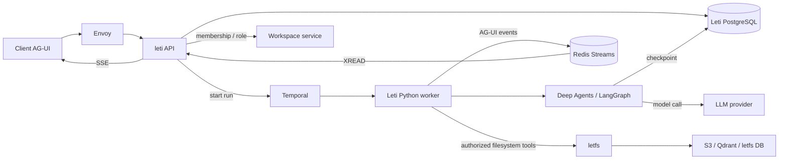

# Brainstorm: Leti service và agent runtime

**Dependency mới 2026-11-02:** User yêu cầu hoàn tất [nền tảng Go/gRPC/filesystem/SpiceDB](brainstorm-261102-1032-go-grpc-filesystem-authorization.md) trước plan triển khai AI agent. PostgreSQL canonical, SpiceDB projection qua Temporal; target không còn Rust hoặc Workspace filesystem proxy. Các quyết định sản phẩm Leti bên dưới vẫn giữ; integration phải cập nhật theo foundation đã hoàn tất.

**Filesystem design đang được review lại:** User mở rộng scope sang filesystem platform dùng chung cho nhiều service/resource, không chốt giữ Workspace/Leti file facade. Xem [đề xuất redesign](research-261101-2337-filesystem-platform-redesign.md). Các quyết định sản phẩm về mỗi conversation một `/chat` và quyền hiện tại của caller vẫn giữ; đường authorization/provisioning bên dưới là bằng chứng hiện trạng hoặc đề xuất cũ.

Ngày nghiên cứu: 2026-11-01, Asia/Saigon. Cập nhật lúc 22:47: user đã chốt bốn lựa chọn còn lại về provider, một active run/conversation, `/chat` trong letfs và quyền Viewer. Hướng sản phẩm đã chốt; chi tiết cancellation/concurrency bên dưới là đề xuất kỹ thuật cần kiểm chứng trước implementation plan cuối.

Đề xuất dùng một ứng dụng Python `leti` với hai entrypoint API và Temporal worker. Tên app/package/service theo convention các ứng dụng `account`, `workspace`, `letfs` hiện có; không tự thêm hậu tố `-service`. API quản lý bot/conversation/run và stream AG-UI từ Redis Streams. Worker chạy một activity bao trọn Deep Agents, dùng PostgreSQL checkpointer của LangGraph. Filesystem và search tiếp tục do letfs sở hữu.

## 1. Contract và quyết định của người dùng

**Outcome:** User tạo bot Leti của mình trong workspace, cấu hình tên/mô tả/instructions, mở danh sách conversation của từng bot, chọn model/effort cho conversation, trò chuyện theo AG-UI và yêu cầu agent đọc/tìm/quản lý file. Run có thể phục hồi sau lỗi worker mà không mù quáng lặp thao tác ghi file.

**Constraints:** LangGraph + Deep Agents; nghiên cứu và ưu tiên Temporal đang có; một activity gọi toàn bộ agent; stream qua Redis; PostgreSQL checkpointer chính thức; tái sử dụng letfs và phân quyền workspace. Không tự xây agent loop, checkpoint engine hay event protocol.

**Non-goals:** Public/private bot, Slack/Discord/group chat integration, AI quota/usage accounting, viết system prompt hoàn chỉnh, shell/code sandbox, framework orchestration mới, E2E gọi LLM thật hoặc xây evaluation suite. User sẽ bổ sung evaluation riêng sau. Storage quota hiện hữu của letfs vẫn áp dụng cho file; đây là vấn đề khác AI quota.

**Acceptance criteria cho thiết kế và triển khai tiếp theo:**

- Bot thuộc user trong workspace; user khác không truy cập được bot, conversation hoặc `/chat` của conversation đó.
- Mỗi bot có conversation list riêng. Conversation có thread/checkpoint độc lập.
- `/drive` là filesystem workspace; mỗi conversation có `/chat` riêng, kể cả hai conversation thuộc cùng bot.
- Model và reasoning effort lưu ở conversation, cập nhật qua request riêng, được chọn theo capability thực tế, được chụp lại khi nhận run và không đổi giữa các retry.
- Client nhận event AG-UI hợp lệ, nhận biết failure, reconnect được theo contract của ứng dụng mà không tạo thêm agent job ngoài ý muốn.
- Worker restart khôi phục đúng run; duplicate admission và mất acknowledgment không tạo thao tác filesystem trùng hoặc ghi đè thay đổi mới.
- Agent đọc ảnh bằng native multimodal path; system test xác nhận payload qua adapter đúng contract. Khả năng hiểu ảnh của model/provider thật chưa được xác minh trong phạm vi này.
- E2E kiểm tra hệ thống với provider responses có kiểm soát. Chất lượng LLM thuộc evaluation riêng về sau.

**Đã được người dùng xác nhận trong trao đổi:**

1. Mỗi conversation có `/chat` riêng. Quyết định này thay thế lựa chọn `/chat` chung theo bot ở vòng trước.
2. Bot thuộc user trong workspace; sau này có thể chia sẻ bot trong workspace. Conversation thuộc bot; chưa chốt loại kênh, có thể mở rộng Slack/Discord/group chat về sau.
3. Tool thực thi trực tiếp theo quyền hiện tại của người gọi; chưa cần approval trước thao tác ghi/xóa.
4. `leti` quản lý bot/conversation và gửi job; service không chạy agent loop. Worker chạy Deep Agents. Tên theo format các service có sẵn.
5. Model/effort đặt ở conversation; endpoint cấu hình riêng được đề xuất để cập nhật, không gửi override trong mỗi request chat.
6. Hiện tại không làm E2E với LLM thật. User sẽ thêm evaluation riêng sau; không coi evaluation là điều kiện hoàn tất implementation hiện tại.
7. Dùng OpenRouter hiện có, server cấu hình model allowlist và effort được hỗ trợ.
8. Mỗi conversation chỉ có một active run; chặn gửi lượt mới trong khi đang chạy hoặc đang dừng. Có nút Stop; chưa queue message hoặc chen ngang run.
9. `/chat` là filesystem letfs bền vững, cho xem/download file; cleanup khi xóa conversation.
10. Viewer được trò chuyện và tạo file trong `/chat` riêng; `/drive` vẫn read-only. Editor/Owner truy cập Drive theo role hiện có.

## 2. Bằng chứng từ repo

Đã dùng CodeGraph trước khi tìm/đọc code. Working tree sạch trước nghiên cứu.

| Hiện trạng xác nhận | Hệ quả cho Leti |
|---|---|
| [Architecture](../../docs/architecture.md) dùng Go Account/Workspace, Rust letfs, Python processing, Temporal và PostgreSQL. Redis/agent runtime chưa thuộc hệ thống hiện tại. | Redis là dependency mới có chủ đích; không phải thành phần đang có để chỉ cấu hình lại. |
| [Workspace file facade](../../apps/workspace/internal/http/files.go) kiểm soát file API, truyền identity và precondition xuống letfs. [Search facade](../../apps/workspace/internal/http/search.go) authorize membership rồi dựng mount `/drive`. | Tái sử dụng nghiệp vụ/quyền; không cho model tự chọn actor, filesystem ID hoặc mount table. |
| [Path scope](../../apps/letfs/src/fs/paths.rs) hỗ trợ nhiều mount và expected target/parent ID. [Generic filesystem provisioning](../../apps/letfs/src/fs/mod.rs) hỗ trợ nhiều filesystem. | Có nền tảng cho `/chat` riêng từng conversation; chưa có provisioning hoặc authorization dành riêng Leti. |
| [Semantic search](../../apps/letfs/src/fs/search.rs) đã dùng OpenRouter embeddings/rerank và Qdrant, lọc scope và generation/readiness. | Gọi search hiện hữu; không tạo vector store/RAG pipeline thứ hai cho agent. |
| [Workflow contract](../../docs/workflows.md) đã có admission, reconciliation, retry và attempt fencing cho processing. | Dùng lại các nguyên tắc và SDK; không giả định processing endpoint nhận được agent run. |
| [Testing](../../docs/testing.md) và [boundary fixtures](../../e2e/fixtures/boundary-server.ts) dùng hạ tầng thật cùng controlled provider responses; paid quality evaluation tách riêng. | Chiến lược test Leti có thể tiếp nối cách repo đang làm. |

Internal letfs hiện phân biệt Workspace credential và processing credential. Leti cần credential/allowlist và integration contract phù hợp; không lấy lại secret quyền rộng của Workspace để tránh bổ sung API.

## 3. Kiến trúc đề xuất



Đây là một codebase ứng dụng với API/worker tách process và scale độc lập, tương tự cách processing hiện có các worker entrypoint. Mỗi bot là bản ghi cấu hình; không tạo deployment hoặc worker riêng cho mỗi bot.

| Thành phần | Trách nhiệm |
|---|---|
| Leti API | CRUD bot/conversation, kiểm tra quyền, admission/idempotency run, gửi Temporal, đọc status/history, stream Redis, yêu cầu cancellation. |
| Temporal workflow | Điều phối một activity agent theo retry policy/timeouts; không gọi LLM hoặc Redis trực tiếp trong workflow code. |
| Leti worker | Dựng Deep Agent với cấu hình run đã nhận, gọi agent, heartbeat/cancel, persist kết quả, phát AG-UI vào Redis. |
| LangGraph PostgreSQL checkpointer | Execution state, pending work, conversation continuity và checkpoint recovery. |
| Redis Streams | Nhật ký event phục vụ live delivery và replay trong thời gian giữ stream. Không là nguồn duy nhất của conversation hoặc kết quả cuối. |
| Workspace | Current membership, role, active/deleting state và workspace storage mapping. |
| letfs | File bytes/metadata, revision, mounts, quota, trash, uploads, artifacts và search. |

API/worker có thể dùng cùng Leti database vì cùng owner ứng dụng. Không đọc SQL database của Workspace/letfs. Tích hợp role/scope qua internal HTTP có authentication, với identity được bind từ admission; không lưu user JWT dài hạn trong job.

## 4. Bot, conversation và dữ liệu

Mô hình tối thiểu đề xuất:

- **Bot:** `id`, `workspace_id`, `owner_user_id`, `name`, `description`, `instructions`, revision và lifecycle timestamps/state.
- **Conversation:** `id`, `bot_id`, `created_by_user_id`, title, `model`, `reasoning_effort`, `chat_filesystem_id`, revision và timestamps. `created_by_user_id` ghi người tạo hiện tại; không biến nó thành contract rằng conversation luôn là hội thoại 1–1 với user đó.
- **Run:** `id`, `conversation_id`, actor, input đã validate, bot/config snapshot cần cho execution, resolved model/effort, workflow identity, status, kết quả/lỗi và timestamps. Đây là agent run/admission nghiệp vụ, không phải bảng generic operations.
- **Public conversation history:** Lưu user/assistant messages cần hiển thị bền vững trong Leti DB, dùng ID và message shape AG-UI. Không coi checkpoint sau summarization hoặc Redis có TTL là bản lưu toàn bộ lịch sử giao diện.

Không thêm visibility enum, channel provider, external channel ID, participant model hay connector registry ngay lúc này. Giữ conversation entity độc lập để bổ sung các quan hệ ấy khi có yêu cầu cụ thể.

LangGraph `thread_id` được server map từ conversation ID đã authorize. Thread ID và run ID từ client không phải quyền truy cập. Trong một conversation chỉ nhận một run đang thực thi; conversation khác có thể chạy song song. Bot instructions và conversation model/effort được chụp khi admission để retry không lấy cấu hình vừa được user sửa.

Conversation deletion cần chặn run mới, cancel/drain run hiện tại và cleanup filesystem `/chat`, checkpoint/history của conversation đó. Bot deletion áp dụng cho mọi conversation thuộc bot. Workspace deletion hiện xóa mọi filesystem trong bucket, nhưng chưa xóa dữ liệu Leti: phải bổ sung lifecycle integration trước khi release, không chỉ thêm route chat.

### Attachment và file mention trong message — đang thảo luận

Outcome bổ sung: user upload file vào chat hoặc chọn file hiện có bằng picker/`@mention`, message hiển thị đúng file đã chọn và agent đọc được file đó theo quyền hiện tại. Giữ letfs làm owner của bytes, upload lifecycle và processing; không tạo kho attachment hoặc vector store thứ hai. Acceptance cần gồm file trùng tên, đổi tên/xóa/thay nội dung, draft chưa gửi, quyền bị thu hồi và tài liệu chưa parse xong. Chính sách phiên bản và thời điểm cho gửi message vẫn chưa được user chốt.

Đề xuất một file reference có cấu trúc trên message, tách biệt với nơi lưu file:

- Upload mới tạo file trong filesystem `/chat` của conversation, ví dụ `/chat/uploads/<upload-group-id>/<filename>`, dùng signed upload/completion hiện có của letfs qua API được Leti authorize. Chỉ file đã finalize mới được bind vào message; không coi upload ID là file node ID.
- Chọn file `/drive` hoặc `/chat` đã có chỉ thêm reference; không tự copy file. Picker attachment và inline mention khác cách hiển thị, cùng dùng stable letfs node ID.
- Message history lưu reference cùng filename/path/revision đã resolve tại thời điểm gửi. Filename/path phục vụ hiển thị; node ID là identity. Server kiểm tra tenant/conversation scope, quyền và MIME/size thực tế, không tin metadata client khai báo. Reference không cấp thêm quyền truy cập.
- Dùng `TextPart.metadata` hoặc message metadata chuẩn AG-UI để chứa namespace `leti` với file reference; đây là application contract, không gọi là chuẩn mention của AG-UI. Nếu cần inline chips, mỗi mention là một text part riêng có metadata, xen với các text part thường; không suy ra identity chỉ từ chuỗi `@filename`.
- Runtime phải resolve reference rồi đưa đường dẫn/entrypoint artifacts có thể đọc vào model input. Metadata không tự trở thành LLM context. Với image muốn nhìn ngay, resolve thành native image part theo capability; tài liệu dùng artifacts Markdown/CSV/PNG đã có. Không đẩy toàn bộ filesystem hoặc toàn bộ bytes của mọi attachment vào mỗi model request.
- Không dùng AG-UI `FileSource.value` để chứa letfs node ID: theo spec 1.0 nó là opaque handle do provider cấp. `ImagePart`/`DocumentPart` có sẵn khi thực sự truyền media bằng data/URL/provider handle. Signed URL chỉ là transport tạm thời, không là định danh bền vững của file.

Các lựa chọn còn cần chốt:

| Lựa chọn | Giả định và điểm hỏng đầu tiên | Đề xuất ban đầu |
|---|---|---|
| Reference tới file hiện có | User chấp nhận nội dung file có thể đổi; node ID sống qua rename nhưng không giữ bytes cũ sau overwrite/delete. | Ít thay đổi nhất. Capture revision cho run và báo thay đổi thay vì retry âm thầm đọc bytes mới. Chưa coi đây là snapshot bất biến. |
| Snapshot attachment tại lúc gửi | User cần giữ đúng bytes để đọc lại lịch sử. Cần copy/retention/quota và contract bản cũ; cross-filesystem copy hiện chưa có. | Chỉ chọn nếu user yêu cầu tính bất biến; không giả lưu revision đã đủ để giữ bản cũ. |
| Cho gửi tài liệu khi còn processing | Run phải chờ hoặc trả trạng thái chưa sẵn sàng; không được trả lời như đã đọc tài liệu. | Đề xuất chờ parse sẵn sàng trước khi chạy yêu cầu cần tài liệu; không bắt chờ semantic index nếu có thể đọc artifacts trực tiếp. Chi tiết UX chưa chốt. |

Better approaches: dùng letfs node reference trong metadata thay vì upload lại một bản chỉ để attach hoặc dùng provider-owned file ID làm identity chính. Giảm duplication và giữ khả năng đổi model/provider; đổi lại cần resolve/authorize và chiếu reference thành model context trong Leti. Đây là đề xuất mới, chưa thay thế quyết định của user về attachment semantics.

Nguồn đối chiếu: [OpenAI file inputs](https://developers.openai.com/api/docs/guides/file-inputs), [Claude Files API](https://platform.claude.com/docs/en/build-with-claude/files), [AG-UI content/source schema](https://docs.ag-ui.com/spec/1.0/schema). Hai provider API có pattern upload một lần rồi reference trong message; không suy từ đó ra storage nội bộ của ứng dụng ChatGPT/Claude.

## 5. Filesystem và tool

### API chung và boundary — chưa chốt

User yêu cầu tra cứu pattern trước khi chốt cách giảm trùng proxy Workspace/Leti. Đề xuất callback trực tiếp từ letfs về từng domain trong trao đổi chưa được chấp nhận. [Nghiên cứu authorization boundary](research-261101-2317-filesystem-authorization-boundaries.md) đối chiếu domain facade, MinIO external authorization, Envoy `ext_authz`, Valet Key và scoped credentials. Hướng ưu tiên để review là contract filesystem chung cùng domain facade mỏng; gateway enforcement là candidate nếu cần bỏ forwarding. Không tự chuyển sang access-token TTL làm yếu yêu cầu quyền hiện tại. Các đoạn API Leti file integration trong báo cáo này chưa quyết định public route/transport cuối.

### Mount và quyền

```text
/drive/  -> filesystem workspace hiện có
/chat/   -> filesystem riêng của conversation hiện tại
```

Đề xuất provision `/chat` bằng generic letfs filesystem trong quota bucket workspace, với provisioning identity ổn định theo conversation. Client và model chỉ thấy prefix `/chat`; server map prefix này sang filesystem đúng conversation. Cùng path `/chat/result.md` ở hai conversation là hai file độc lập.

Deep Agents có `CompositeBackend` để route theo prefix và `BackendProtocol` để nối remote filesystem. Dùng một adapter letfs đáp ứng protocol rồi mount `/drive` và `/chat`; không viết filesystem engine. Default state backend chỉ nên giữ dữ liệu nội bộ theo thread của harness, nếu harness cần offload/scratch riêng. Không cần shared filesystem hoặc memory store xuyên conversation trong scope hiện tại. [Deep Agents backends](https://docs.langchain.com/oss/python/deepagents/backends).

Quyền `/drive` luôn dựa trên actor hiện tại: Viewer đọc, Editor/Owner ghi theo contract hiện hữu. Backend giữ nguyên read-only artifacts, expected node ID và revision. `/chat` kiểm tra quyền conversation, bot ownership cùng membership workspace. Viewer được tạo/ghi file trong `/chat` riêng theo quyết định đã chốt; quyền này không cấp thêm quyền ghi Drive.

Hai conversation không truy cập `/chat` của nhau, kể cả bằng raw node ID hoặc filesystem ID. Với file `/drive` dùng chung, vẫn dùng revision/precondition hiện hữu và trả conflict nếu stale. Không tự fetch revision mới rồi thử ghi lại vì hành vi đó có thể đè thay đổi của conversation kia.

### Bộ tool đề xuất

| Tool | Cách cung cấp |
|---|---|
| `ls`, `read_file`, `write_file`, `edit_file` | Giữ tool chuẩn Deep Agents; backend map vào letfs list/read/create/conditional replace. `edit_file` giữ exact replacement semantics của harness. |
| `glob`, `grep` | Giữ tool chuẩn khi backend đáp ứng đúng semantics. `glob` tìm path; `grep` tìm nội dung. Không giả filename search là content grep. Mọi traversal/read phải có bound và báo truncation. |
| `delete` | Backend đưa node vào trash; mô tả tool nói rõ điều này. Không mặc định hard purge và không bỏ qua role/revision. |
| `stat` | Metadata, node ID, type, revision, size và trạng thái xử lý khi cần. |
| `mkdir`, `move`, `copy` | Dùng API nodes/copy hiện hữu, không shell. Move bao gồm đổi tên; copy trả job/status nếu API đang asynchronous. |
| `list_trash`, `restore_file` | Tái sử dụng trash/restore contract; phục hồi theo trash entry identity. |
| `file_search` | Filename/metadata search có filter, pagination và scope. |
| `semantic_search` | Gọi semantic search hiện có, trả evidence/path/source identity để agent trích dẫn và đọc sâu. |

Planning/context tools vốn có của Deep Agents có thể dùng theo harness, không cần tự viết todo loop. Không bật `execute`, shell hay dynamic tool registration do client gửi trong vòng này.

letfs hiện không hỗ trợ copy/move xuyên filesystem. Vì `/chat` và `/drive` khác filesystem, không hứa `move('/chat/a', '/drive/a')` hoạt động. Agent có thể tạo output trực tiếp trong `/drive`; nếu cần export xuyên mount thành feature, phải chốt riêng copy-bytes + upload/finalize, không giả nó là atomic move.

## 6. Temporal, checkpoint và retry

Temporal phù hợp với kiến trúc này vì repo đã vận hành worker/queue/reconciliation. Temporal Server điều phối; process worker Python chạy code bằng SDK, và activity gọi Deep Agents. Không đặt agent loop hoặc provider I/O trong workflow deterministic. [Temporal failure detection](https://docs.temporal.io/encyclopedia/detecting-activity-failures).

Đề xuất một workflow cho mỗi admitted run, dùng một activity bao trọn agent execution. Activity input/output chứa identity và dữ liệu bounded; không mang file bytes, credential, token stream hoặc toàn bộ conversation vào Temporal history. Worker lấy input đã lưu từ Leti DB và file từ letfs.

### Ba cơ chế riêng biệt

| Cơ chế | Điều nó giải quyết |
|---|---|
| Temporal retry | Schedule lại activity khi thất bại hoặc timeout. |
| LangGraph resume | Tiếp tục graph từ checkpoint/pending work trong cùng thread. |
| AG-UI replay/attach | Khôi phục trạng thái hiển thị và nhận event đang chạy. Không tự resume graph. |

Không dùng LLM để quyết định message có phải retry. Runtime biết admission/run identity và Temporal attempt; checkpoint cho biết phần nào đã được graph nhận và hoàn tất.

### Quy tắc khôi phục đề xuất

1. API lưu accepted input/config và identity trước khi dispatch. Dùng workflow identity ổn định và reconciliation cho khoảng trống DB commit → Temporal start, theo pattern repo.
2. Khi activity bắt đầu, phân biệt checkpoint thuộc lượt cũ với checkpoint đã nhận lượt hiện tại. Chỉ thấy thread tồn tại hoặc `attempt > 1` là chưa đủ.
3. Chưa có checkpoint nhận input hiện tại: đưa accepted input vào graph với message ID ổn định. Đã nhận và còn pending work: resume cùng thread bằng input `None`. Đã hoàn tất nhưng mất acknowledgment: lấy kết quả đã lưu/checkpoint để hoàn tất delivery, không chạy LLM lại.
4. Dùng `AsyncPostgresSaver` chính thức. Đề xuất `durability="sync"` để checkpoint được ghi trước bước tiếp theo; benchmark sau nếu latency thực tế có vấn đề. Không tự viết checkpointer.
5. Heartbeat theo timer độc lập với token, vì provider có thể im lặng lâu. Timeouts/cancellation/retry có bound; không nhân nhiều tầng retry vô hạn. Lỗi quyền/config/input là permanent; lỗi dependency được phân loại trước khi retry.
6. Tool mutation giữ target identity, original precondition và input ổn định qua retry. Tái sử dụng receipt/idempotency của operation nào đã có. Với response không rõ kết quả, reconcile theo contract resource; không coi mọi 404/409/412 là thành công, và không tự đổi precondition.

Checkpoint được lưu ở ranh giới bước và pending writes; node/tool chưa lưu kết quả có thể chạy lại. Model đang generate dở cũng có thể phải gọi lại, không tiếp tục chính xác từ token cuối. `durability="sync"` không biến external effect + checkpoint thành một transaction. [LangGraph checkpointers](https://docs.langchain.com/oss/python/langgraph/checkpointers), [graph testing/resume](https://docs.langchain.com/oss/python/langgraph/test).

Timeout không bảo đảm process cũ dừng ngay. Admission một active run/conversation ngăn hai yêu cầu mới cùng chạy nhưng không tự fence hai activity attempt bị chồng nhau. Cần kiểm chứng cancellation, stale attempts và concurrent checkpoint writes với PostgreSQL/Temporal thật trước khi khẳng định fault tolerance. Không thêm lease framework theo suy đoán; nếu thử nghiệm chứng minh cần fence, đặt guard ở nơi sở hữu mutation và checkpoint execution.

### Concurrent agent runs trong một worker instance

Temporal Python hỗ trợ async Activities; một worker process chạy nhiều activity coroutine trên event loop khi các thao tác nhường quyền qua `await`. Với Leti, một activity tương ứng một agent run; nhiều conversation có thể chạy đồng thời trong cùng instance. Concurrency theo conversation khác với capacity của worker: admission chặn hai lượt cùng conversation, còn worker xử lý nhiều conversation độc lập.

Repo đã dùng pattern này ở [Python worker](../../apps/letfs-processing/src/openlet_processor/worker.py): I/O worker đặt `max_concurrent_activities=4`, CPU worker đặt 1. `temporalio==1.35.0` trong manifest hiện tại có các API cần thiết, đã kiểm tra bằng introspection.

Đề xuất worker Leti dùng queue `openlet-leti`, activity `async def`, graph async streaming, async provider/letfs HTTP, Redis và PostgreSQL clients. Dùng `max_concurrent_activities` để giới hạn số run trên instance; ví dụ 32 chỉ minh họa cấu hình, chưa phải capacity đã đo. Thêm replica cùng queue để chia tải. `max_concurrent_activity_task_polls` điều chỉnh polling, không phải số agent tối đa; `max_concurrent_workflow_tasks` cũng không phải giới hạn số workflow đang chờ activity.

Không thêm semaphore hoặc worker framework thứ hai chỉ để lặp lại Activity slot limit. Bound riêng các nguồn lực thật: provider connections/rate limits, Redis/PG pools, RAM/context và subagent/tool fan-out. Một run có thể tạo nhiều provider calls nên Activity concurrency không phải global LLM-call limit. Pool clients được chia sẻ ở process; graph state, adapter active-run state và stream identity phải được isolate theo run.

Blocking HTTP, `time.sleep`, parse/OCR nặng hoặc filesystem sync chạy trực tiếp trong async Activity có thể chặn event loop, làm hỏng concurrency và chậm cancellation/heartbeat. Giữ CPU processing ở worker hiện có; kiểm tra async safety của toàn bộ tool path. [Temporal sync/async architecture](https://docs.temporal.io/develop/python/best-practices/python-sdk-sync-vs-async), [Worker options](https://python.temporal.io/temporalio.worker.Worker.html).

### Cancellation end-to-end đề xuất

Kiểm chứng bổ sung về native cancellation:

| Lớp | Hành vi có sẵn | Giới hạn thực tế |
|---|---|---|
| OpenRouter streaming request | Abort/đóng kết nối upstream; provider hỗ trợ sẽ ngừng generation. Docs hiện liệt kê OpenAI, Azure, Anthropic, DeepSeek và nhiều provider khác là supported. | Không áp dụng đồng loạt: Google/Google AI Studio, AWS Bedrock, Groq, Mistral và các provider khác đang không hỗ trợ; non-streaming cũng không bảo đảm dừng generation. Provider route thực nhận request quyết định, không chỉ tên model. |
| Deep Agents in-process trên LangGraph | Cancel task đang consume `agent.astream()` truyền `asyncio.CancelledError` tới model/tool async đang await, cho phép `finally` cleanup. | Không là OS kill; sync tool/thread hoặc remote operation đã gửi không tự bị thu hồi. Runtime phải đóng generator/HTTP stream và quản lý các child task mà nó tạo. |
| LangGraph `RunControl.request_drain()` | Native cooperative drain từ LangGraph >=1.2: chờ superstep hiện tại hoàn tất, checkpoint rồi dừng bằng `GraphDrained` nếu còn công việc. | Không ngắt LLM/node đang chạy hoặc retry loop hiện tại. Dùng cho shutdown có chủ đích resume; không thay task cancellation của nút Stop. |
| Temporal `WorkflowHandle.cancel()` | Cooperative cancellation request; workflow có cơ hội cleanup, activity nhận cancellation qua heartbeat. | RPC trả về không có nghĩa activity/provider đã dừng. Cần activity cancellation policy và xử lý task cancellation đúng. |
| Temporal `WorkflowHandle.terminate()` | Đóng workflow execution ngay, workflow không chạy cleanup. | Không kill process worker dùng chung; không bảo đảm remote activity, HTTP request hay subprocess đang chạy đã dừng. Không dùng làm nút Stop. |

[OpenRouter streaming cancellation](https://openrouter.ai/docs/api_reference/streaming#stream-cancellation), [LangGraph graceful shutdown](https://docs.langchain.com/oss/python/langgraph/fault-tolerance#graceful-shutdown), [Temporal cancel/terminate](https://docs.temporal.io/encyclopedia/workflow/cancellation-and-termination). Danh sách provider là hiện trạng docs lúc nghiên cứu; không hard-code thành một bảo đảm vĩnh viễn. Đóng request phía worker và dừng inference tại provider là hai kết quả khác nhau. Không giả định có một cancel-by-ID endpoint thống nhất cho mọi model qua OpenRouter.

1. User bấm Stop, UI giữ stream để nhận trạng thái cuối và gửi request cancellation riêng đến Leti API. API authorize run/conversation, lưu cancel intent bền vững nếu run chưa terminal và trả trạng thái đang dừng. Retry request Stop không tạo intent khác.
2. API gọi `await temporal_client.get_workflow_handle(workflow_id).cancel()`. Không gửi Redis Pub/Sub command đến một process worker cụ thể. Cancel intent còn được reconciliation xử lý nếu mất kết nối Temporal hoặc API chết giữa DB commit và gửi cancel. Nếu run chưa dispatch, không khởi động agent cho intent đã cancel.
3. Workflow chờ activity với `ActivityCancellationType.WAIT_CANCELLATION_COMPLETED`, thay vì coi gửi cancel là activity đã dừng. Async Activity có heartbeat timer độc lập token và heartbeat timeout. SDK nhận cancellation qua heartbeat response rồi cancel activity task bằng `asyncio.CancelledError`.
4. Activity cleanup agent stream, child tasks/subagents, provider/HTTP streams và heartbeat task bằng structured cleanup. Không đổi cancellation thành lỗi retryable; sau bounded cleanup phải re-raise cancellation để Temporal ghi đúng outcome. Không dựa vào cancel coroutine để khẳng định thread hoặc remote request đã bị dừng.
5. Persist partial public history và trạng thái cancelled sau khi runtime đã dừng, rồi append terminal AG-UI event vào Redis qua cleanup có deadline. Nếu worker chết hoặc Redis không sẵn sàng, reconciliation hoàn tất trạng thái/delivery từ durable evidence; không báo đã stop chỉ từ cancel request được nhận. File đã commit giữ nguyên, không rollback tự động.
6. Chỉ mở admission cho lượt tiếp theo khi run trước đã terminal theo evidence đáng tin cậy. Lượt sau là run mới với input mới; không tự `invoke(None)` để chạy tiếp pending tools của lượt user đã hủy. Cần xử lý truthful cancelled/unknown tool outcomes trong state để không báo thành công giả hoặc replay tool cũ.

Heartbeat/cancel delivery có latency và SDK có heartbeat throttling. Ví dụ ban đầu để thử nghiệm: heartbeat mỗi 2 giây, heartbeat timeout 10 giây, `max_heartbeat_throttle_interval` 2 giây; đây không phải cam kết Stop hoàn tất trong 2 giây. Mất kết nối, blocking code hoặc remote write đang xử lý có thể kéo dài hơn. UI giữ trạng thái đang dừng; không dùng workflow termination như cách kill riêng coroutine hay process dùng chung.

Race completion/Stop phải giữ một terminal outcome: nếu completion đã commit trước, giữ success; không ghi đè thành cancelled sau đó. Tool request đã gửi có thể commit trong khi Stop đang truyền tới worker. Guard trước tool call ngăn công việc mới sau khi quan sát cancel, nhưng không thu hồi được effect đã gửi. Tests phải kiểm tra ranh giới này. [Temporal cancellation](https://docs.temporal.io/develop/python/workflows/cancellation).

## 7. AG-UI và Redis

### Ranh giới của protocol

AG-UI chuẩn hóa trao đổi giữa client và agent trong một lượt chạy: input, typed event stream, message/tool/state/reasoning lifecycle và interrupt/resume. SDK cung cấp types, encoding/parsing, event processing và framework adapters tương ứng. Runtime/backend vẫn thực hiện LLM calls, tools, persistence và durable execution.

Đổi model là tính năng ứng dụng chat. AG-UI không định nghĩa CRUD bot/conversation, endpoint lưu model/effort, model catalog, workspace permissions hoặc credential policy. Một agent có thể dùng nhiều model qua router/subagents, nên ứng dụng phải xác định lựa chọn model tác động đến thành phần nào và từ lượt nào. `leti` định nghĩa lựa chọn ở conversation và chụp cấu hình cho từng run, còn message/tool/state events vẫn dùng nguyên chuẩn AG-UI. [Protocol architecture](https://docs.ag-ui.com/spec/1.0/architecture), [run input](https://docs.ag-ui.com/spec/1.0/basic/run-input).

### Phần dùng chuẩn sẵn có

| Nhu cầu | AG-UI |
|---|---|
| Run/conversation identity | `runId`, `threadId` |
| Lifecycle | `RUN_STARTED`, `RUN_FINISHED`, `RUN_ERROR` |
| Text và tool execution | `TEXT_MESSAGE_*`, `TOOL_CALL_*` |
| Shared state và history sync | `STATE_SNAPSHOT`, `STATE_DELTA`, `MESSAGES_SNAPSHOT` |
| Reasoning visibility/continuity | `REASONING_*` và opaque reasoning data do provider hỗ trợ |
| Image attachment/tool result | Standard multimodal content parts |
| Human interrupt/resume nếu bổ sung sau này | Structured interrupt outcome + `RunAgentInput.resume` |

Không tạo event riêng cho token, todo, tool result, image hoặc reasoning khi các type chuẩn đã đáp ứng. AG-UI `tools` là tool do client cung cấp cho run, không phải nơi client tự cấp backend filesystem permissions. [Run input](https://docs.ag-ui.com/spec/1.0/basic/run-input), [events](https://docs.ag-ui.com/concepts/events).

Python `ag-ui-langgraph` nối trực tiếp compiled graph, phù hợp worker in-process. Tài liệu Deep Agents còn mô tả TypeScript adapter nối LangGraph server; không cần dựng thêm server chỉ để dùng ví dụ ấy. [Deep Agents AG-UI integration](https://docs.langchain.com/oss/python/deepagents/ag-ui), [Python adapter source](https://github.com/ag-ui-protocol/ag-ui/blob/main/integrations/langgraph/python/ag_ui_langgraph/agent.py).

Đề xuất tắt raw LangGraph events bằng option sẵn có để tránh gửi state nội bộ quá lớn hoặc nhạy cảm. Snapshot chỉ xuất phần state phù hợp UI. Không dùng một instance adapter có mutable active-run state cho nhiều run đồng thời.

### Model và reasoning effort

Đề xuất lưu `model` và `reasoning_effort` trực tiếp ở conversation. Request tạo conversation xác lập cặp cấu hình hợp lệ; request chat không cần mang lựa chọn model. Khi user đổi lựa chọn trên UI, gửi request cập nhật conversation riêng. Route dưới đây là đề xuất, chưa phải contract đã triển khai:

```http
PATCH /v1/workspaces/{ws}/bots/{bot}/conversations/{conversation}
Content-Type: application/json

{"model":"<allowed-model-id>","reasoning_effort":"<supported-effort>"}
```

API authorize conversation, validate cặp model/effort theo capability, cập nhật atomically và dùng revision theo convention repo. Khi admission run, server đọc cấu hình conversation đã lưu và chụp effective config vào run. Cập nhật sau đó áp dụng cho lượt tiếp theo; run đang chạy hoặc đang retry giữ cấu hình cũ. Không lấy model override từ `forwardedProps` trong request chat. Vì API config riêng đã đủ, chưa cần thêm bot-level model defaults hoặc cơ chế override thứ hai.

AG-UI 1.0 không chuẩn hóa API `changeModel`, CRUD conversation hoặc model-setting endpoint. `RunAgentInput` cũng không có field chuẩn `model`/`reasoningEffort`; `forwardedProps` chỉ là extension point nếu ứng dụng cần dữ liệu tùy chọn theo run. Vì vậy dùng PATCH ở application API là phù hợp, không phải tự chế lại một API AG-UI đã có. Việc user chọn model vẫn bắt đầu từ UI, nhưng được lưu bằng request cấu hình riêng thay vì gửi kèm từng message.

Đổi model không xóa conversation history hoặc tạo thread mới. Tuy nhiên cần test việc đổi provider: opaque reasoning hoặc provider file handles không tự chuyển đổi sang provider khác. Chỉ chuyển phần history/content mà provider mới hỗ trợ, tuân theo quy tắc AG-UI và nói rõ nếu một phần nội dung không dùng được; không hứa mọi cặp model đều chuyển đổi liền mạch.

OpenRouter đang có trong repo nên là provider đầu tiên hợp lý. Nó có reasoning configuration thống nhất, nhưng mức effort vẫn phụ thuộc model/provider; UI chỉ hiện lựa chọn thực sự hỗ trợ. Chọn effort khác với stream reasoning, và không hứa provider sẽ trả nội dung reasoning. [AG-UI input schema](https://docs.ag-ui.com/spec/1.0/basic/run-input), [OpenRouter reasoning](https://openrouter.ai/docs/guides/best-practices/reasoning-tokens).

### Redis Streams và reconnect

Worker ghi event AG-UI vào stream theo run; API đọc bằng `XREAD` và encode SSE bằng SDK. Dùng independent reader cho mỗi kết nối để nhiều client/tab đều nhận được event; không dùng một consumer group chia event giữa các viewer. Pub/Sub có at-most-once delivery và không có history cho client vắng mặt. [Redis Pub/Sub](https://redis.io/docs/latest/develop/pubsub/), [XREAD](https://redis.io/docs/latest/commands/xread/).

Stream có retention, byte/event limits và Redis persistence phù hợp. Không silently trim active stream rồi replay từ giữa một chuỗi event. Redis mất dữ liệu không được làm mất bot, accepted input, checkpoint hoặc final result trong PostgreSQL. Không lưu mọi token lâu dài ở PostgreSQL chỉ để có chat history.

**AG-UI 1.0 HTTP/SSE không hỗ trợ stream resumption bằng `Last-Event-ID`.** SDK có `connectAgent()`, nhưng implementation phải cung cấp `connect()`; `HttpAgent` không tự tạo durable attach endpoint. [HTTP/SSE specification](https://docs.ag-ui.com/spec/1.0/basic/transports/http-sse), [AbstractAgent](https://docs.ag-ui.com/sdk/js/client/abstract-agent), [serialization](https://docs.ag-ui.com/concepts/serialization).

Đề xuất app có attach endpoint theo run, authorize lại, replay từ đầu stream vào client state mới rồi tail bằng `XREAD`. Cách đầu tiên này không cần cursor protocol riêng. Đây là application transport integration dùng event AG-UI, không được gọi là cơ chế reconnect chuẩn HTTP/SSE của AG-UI. Khi stream hết retention, trả trạng thái rõ ràng và load durable history/result; không chạy lại LLM chỉ để render lịch sử.

Abort HTTP chỉ ngắt subscription; nút Stop phải gửi yêu cầu cancel job riêng. Nếu không tách hai hành vi, refresh trang có thể vô tình cancel agent hoặc Stop chỉ đóng UI trong khi agent tiếp tục ghi file.

### Streaming khi chạy đồng thời và khi Stop

Luồng dữ liệu: activity → AG-UI adapter → async `XADD leti:run:{run_id}:events` → bất kỳ Leti API replica nào `XREAD` → SSE client. Mỗi run có stream riêng; không trộn event hai conversation. API subscriber chậm không trực tiếp giữ agent coroutine chờ client; Redis lưu event trong retention đã cấu hình. Redis network I/O có deadline và lỗi được xử lý rõ ràng.

Khi Stop, stream vẫn mở đến terminal event. AG-UI 1.0 có sẵn `RUN_FINISHED` với `outcome: {"type":"cancelled"}`. Trước event ấy producer phải đóng đúng các message/tool-call/step/subagent đang mở. Nếu không thể đóng stream theo thứ tự hợp lệ, dùng `RUN_ERROR` đúng contract; không phát success và không tự tạo `AGENT_CANCELLED` event. Stream không có thêm token sau terminal. Cancelled outcome không phải HITL interrupt; lượt chat tiếp theo không dùng `resume` để trả lời Stop. [AG-UI cancelled runs](https://docs.ag-ui.com/spec/1.0/events/lifecycle).

Không cần worker affinity/sticky API session: state/control ở Temporal/PG, event stream ở Redis. Reconnect authorize lại và replay/attach theo contract ứng dụng đã nêu; đóng một subscription không ảnh hưởng các viewer khác hoặc agent run.

### Adapter và retry có hai điểm cần xử lý

- Adapter Python đã kiểm tra chuyển graph exception thành `RUN_ERROR`, không nhất thiết raise ra activity caller. Không coi hết iterator là thành công. Cần giữ error classification/cause trong runtime để Temporal retry đúng; không parse chuỗi lỗi để quyết định retry.
- Adapter không tự đặt `durability="sync"` trong stream kwargs. Cần dùng extension hook/integration nhỏ phù hợp phiên bản đã pin, không giả thêm option constructor chưa tồn tại.

Public run chỉ phát terminal event khi đã success hoặc failure cuối cùng. Không phát `RUN_ERROR` rồi tiếp tục cùng run như chưa có lỗi. Worker chết giữa token có thể để lại partial message chưa checkpoint; recovery phải đồng bộ lại message/state bằng chuẩn snapshot và giữ lifecycle hợp lệ. Test với SDK reducer/enforcer trước khi chốt chi tiết adapter; chưa chứng minh token replay chính xác một lần.

## 8. Đọc image trực tiếp

Deep Agents `read_file` đã trả native multimodal content cho image. Custom letfs backend cần trả đúng binary/base64 file data và MIME; harness tạo image content block. Không cần `describe_image` tool dùng một LLM khác, OCR bắt buộc hoặc chuyển ảnh thành mô tả trước khi agent nhìn. [Multimodal support](https://docs.langchain.com/oss/python/deepagents/multimodal).

User attachment cũng dùng AG-UI multimodal part. Backend resolve file đã authorize và cấp bytes/reference phù hợp; không để model tự fetch URL nội bộ tùy ý. Với signed URL, cấp mới khi cần thay vì lưu URL đã hết hạn làm định danh bền vững. Giới hạn kích thước/MIME và kiểm tra model có vision/tool-result support. Nếu model không đọc được image part, xử lý theo capability/AG-UI và nói rõ nội dung bị bỏ qua, không giả đã nhìn thấy ảnh.

Summarization có thể loại media cũ khỏi active context. Giữ file ID/path trong history để đọc lại ảnh khi cần; không nhồi base64 vào toàn bộ history lâu dài. Probe đã xác nhận content block, chưa xác nhận vision của provider thật.

## 9. E2E hệ thống; evaluation để sau

Theo quyết định mới của user, hiện tại chỉ làm E2E hệ thống với controlled LLM provider. Không tạo suite E2E gọi LLM thật hoặc evaluation framework. Repo hiện là backend, nên trước mắt dùng Playwright API E2E đang có, chưa thêm browser UI tests khi chưa có frontend.

### Suite hệ thống: chạy mặc định khi thay đổi phần liên quan

Chạy Envoy, Account/Workspace, Leti API/worker, Temporal, PostgreSQL, Redis và letfs/storage thật. Nếu test semantic search, Qdrant cũng chạy thật. Chỉ thay external LLM HTTP endpoint bằng test server kiểm soát được response. Giữ Deep Agents/LangGraph, tool calling loop, checkpoint và filesystem adapter thật.

Ví dụ một test hoàn chỉnh:

1. Qua public API, tạo user/workspace/bot/conversation A với model/effort và file `/drive/note.txt` có nội dung fixture `Deadline: 15/11`.
2. Gửi message AG-UI: “Đọc note.txt và lưu deadline vào /chat/summary.md”.
3. Worker gọi LLM HTTP endpoint. Test server trả model response hợp lệ chứa tool call `read_file('/drive/note.txt')`.
4. Deep Agents thực sự gọi tool, backend đọc file từ letfs thật. Lần model request tiếp theo, test server kiểm tra tool result chứa đúng fixture, rồi trả tool call ghi `/chat/summary.md`.
5. Tool thực sự ghi file qua letfs. Test server kiểm tra tool result tiếp theo rồi trả assistant text cuối cùng.
6. Test đọc SSE và dùng AG-UI SDK kiểm tra lifecycle/tool/message events. Qua public file API tương ứng của Leti, đọc `/chat/summary.md` và assert đúng bytes; kiểm tra run terminal status và history lưu bền vững.
7. Tạo conversation B cùng bot: `/chat/summary.md` phải không tồn tại trong B và raw identity của file A cũng không được dùng để vượt scope.

Test server không trả thẳng AG-UI output hoặc tự ghi file thay agent. Nó chỉ đóng vai provider và phải kiểm tra tools/request/tool-result đúng contract. Các response/tool calls được lập trình sẵn nên suite này chứng minh hệ thống thực thi đúng, chưa chứng minh model tự suy luận ra tool sequence ấy.

Fixture [boundary server hiện tại](../../e2e/fixtures/boundary-server.ts) đã có controlled provider responses cho processing. Cần mở rộng phần provider fixture cho streaming/tool-call responses khi làm Leti; chưa có sẵn Leti E2E hoặc fixture hỗ trợ đầy đủ agent loop.

Recovery tests đặt barrier ở đúng ranh giới cần kiểm tra, không sleep ngẫu nhiên: ví dụ để file write commit xong nhưng chưa lưu checkpoint kết quả tool, dừng worker thật rồi khởi động lại. Assert file/quota không bị nhân đôi, precondition không bị đổi để ghi đè dữ liệu mới, run không bị tạo thêm và terminal stream hợp lệ. Nếu còn outcome không xác định, phải hiện lỗi rõ ràng thay vì test chỉ chờ câu trả lời đẹp.

Thêm test PATCH model/effort → run dùng đúng model; đổi config trong lúc run A đang chạy → A/retry giữ config cũ, run B dùng config mới. Dùng provider fixture ghi nhận request model/effort thực nhận, không chỉ assert database đã đổi.

### Evaluation trong tương lai

User sẽ bổ sung evaluation riêng sau để đánh giá tool selection, retrieval/evidence, khả năng hiểu ảnh và kết quả với model thật. Chưa chốt dataset, evaluator, lịch chạy hoặc provider credentials; không triển khai những phần này trong scope hiện tại.

Bảng phân biệt phạm vi bằng chứng:

| Kiểm tra | Cách chạy |
|---|---|
| Role, tenant isolation, real file effects, stream lifecycle, admission, retry, worker crash và checkpoint recovery | Chạy service, PostgreSQL, Temporal, Redis, letfs/storage thật; provider boundary có scripted response/tool call. Agent loop và tool thực vẫn chạy. |
| Model-specific effort, multimodal tool messages và streaming request/response contract | Controlled provider kiểm tra request/response theo schema; chưa xác minh interoperability với provider thật. |
| Agent tự chọn đúng tool, tìm đúng file, dùng evidence, hiểu ảnh và hoàn thành yêu cầu | Ngoài scope hiện tại; user bổ sung evaluation riêng sau. |

Mock chỉ ở provider boundary trong bài system test, không mock agent thành câu trả lời có sẵn hoặc mock filesystem rồi tuyên bố recovery thật. Mock không chứng minh model biết dùng tool hoặc provider thật chấp nhận toàn bộ request. Dùng deterministic assertions cho file/result/recovery; ghi rõ giới hạn này khi báo kết quả. [LangChain test strategy](https://docs.langchain.com/oss/python/langchain/test), [repo testing](../../docs/testing.md).

Bộ scenario quan trọng: worker chết trước checkpoint đầu; sau ghi file trước checkpoint; graph xong trước Temporal acknowledgment; `/chat` cách ly giữa conversation; hai conversation sửa cùng file `/drive`; cùng run submit hai lần; đổi conversation model khi đang chạy; client disconnect/reconnect; Stop; membership bị thu hồi; Redis outage/lost stream; provider 429/5xx; model không hỗ trợ effort/image; conversation/bot/workspace bị xóa trong khi chạy.

## 10. Thử nghiệm đã chạy

Chạy isolated `uv run --no-project` với Python 3.12, không thay manifest/lockfile hoặc kết nối database hiện hữu:

| Package | Phiên bản kiểm tra |
|---|---|
| `deepagents` | `0.7.32` |
| `langgraph` | `1.2.19` |
| `ag-ui-protocol` | `1.0.0` |
| `ag-ui-langgraph[fastapi]` | `0.0.47` |

PostgreSQL checkpointer `langgraph-checkpoint-postgres==3.2.0` có bản phát hành được tra cứu; chưa chạy integration với driver này.

Kết quả 7 assert-based probes đều PASS:

1. Graph lỗi ở node sau, resume `None` không chạy lại node trước đã checkpoint.
2. Node thực hiện side effect rồi raise trước checkpoint sẽ lặp effect khi resume: xác nhận giới hạn, không phải guarantee exactly-once.
3. Python adapter phát `RUN_ERROR` mà caller không nhận exception trực tiếp.
4. Schema input có `forwarded_props`, không có model/reasoning effort field chuẩn.
5. Default adapter stream kwargs không đặt durability sync.
6. Deep Agents được tạo và invoke bằng fake model + checkpointer thành công với tổ hợp pin trên.
7. Native `read_file` nhận binary image từ custom backend và tạo image content block.

Probe dùng `InMemorySaver` và fake model: chưa kiểm chứng PostgreSQL persistence, process kill, Temporal retry, Redis delivery hoặc khả năng hiểu ảnh. Lần chạy đầu thiếu FastAPI vì adapter import endpoint trong package init; đã sửa command dùng extra chính thức. Một assertion trung gian so sánh string enum sai cũng đã sửa thành so sánh `EventType`; không sửa thư viện.

Bổ sung cancellation probes với `deepagents==0.7.32`, `langgraph==1.2.19`, Python 3.12, controlled async model/tool và `InMemorySaver`, đều PASS:

1. Cancel task consume Deep Agent `astream()` khi model đang await: caller nhận `asyncio.CancelledError`, model chạy `finally`; một run khác trên cùng graph/process vẫn chạy đến hoàn tất.
2. Cancel task khi async tool đang await: caller nhận cancellation và tool chạy `finally`.
3. Native `RunControl.request_drain()` không hủy node đang chạy; sau khi cho node hoàn tất, graph lưu checkpoint và raise `GraphDrained`, resume chỉ chạy node kế tiếp.

Đã introspect `RunControl` và chữ ký `astream(control=...)` trên phiên bản pin. Các probe không gọi provider HTTP thật và không qua Temporal/Redis/AG-UI adapter: chưa chứng minh transport cleanup của tổ hợp provider SDK được chọn, cancellation propagation của mọi subagent/sync tool hoặc stop latency thực tế. Cần system test qua các boundary ấy khi triển khai; không cần real LLM để kiểm tra local cancellation và connection cleanup.

## 11. Trade-offs và lựa chọn

| Phương án | Giả định quan trọng nhất | Điểm hỏng đầu tiên | Đánh giá |
|---|---|---|---|
| Temporal whole-agent activity + LangGraph PG + Redis Streams | Runtime nối đúng admission, checkpoint recovery, tool preconditions và public stream. | Side effect đã commit nhưng checkpoint/ack chưa lưu; stale attempt hoặc partial stream khi worker chết. | Đề xuất: đúng công nghệ người dùng muốn và tái sử dụng Temporal đang có. Chấp nhận một integration seam cần test kỹ. |
| LangGraph Agent Server cung cấp run/thread/persistence/stream lifecycle | Có thể thay đổi yêu cầu deployment/Temporal/Redis để dùng server runtime ấy. | Thêm runtime và ownership model mới không còn khớp ranh giới service/worker đã chọn. | Viable nếu đổi hướng sản phẩm; chưa có lý do thay stack hiện hữu chỉ cho Leti. |

**Better approaches:** Giữ hướng kiến trúc người dùng yêu cầu, nhưng thay ý tưởng agent tự nhận ra retry bằng runtime/checkpoint quyết định có định danh. Native `read_file` thay nhu cầu tự làm image-analysis tool; AG-UI standard events/resume thay custom event protocol. Bằng chứng là source, docs và probes ở trên. Delta vận hành là ít model call và ít protocol tự duy trì; chi phí chuyển là adapter nhỏ cùng contract/recovery tests, không đổi storage engine hoặc agent framework.

## 12. Điểm phải chốt bằng bằng chứng trước implementation plan cuối

User đã chốt naming, ownership, `/chat`, model/effort ở conversation, OpenRouter allowlist, một active run/conversation, nút Stop và quyền Viewer. Các thông số concurrency/heartbeat, cancellation wiring và chi tiết schema/adapter mới bổ sung vẫn là đề xuất kỹ thuật cần kiểm chứng.

1. Chạy PostgreSQL/Temporal recovery spike cho accepted-input marker, mất acknowledgment và overlapping attempts; chứng minh không ghi checkpoint hoặc file từ stale attempt. Nếu không có bằng chứng, không công bố exactly-once/fault tolerance đầy đủ.
2. Chạy adapter + AG-UI client contract spike cho retry giữa token, snapshot reconciliation, attach/replay, final failure và cancellation. Giữ chuẩn event; ghi rõ phần attach là application integration.
3. Chốt operation-level mapping của letfs backend: stable preconditions qua retry, binary reads, bounded glob/grep, enforcement quyền `/chat`/Drive đã được user chọn, provisioning và bot/workspace cleanup. Không giả toàn bộ contract đã tồn tại trong repo.
4. System prompt chuyên nghiệp sẽ soạn sau khi các tool/quyền/recovery contract này ổn định. Provider/model quality evaluation để user bổ sung sau; không bắt buộc E2E LLM thật trong scope hiện tại và không công bố đã xác minh model quality từ controlled tests.
