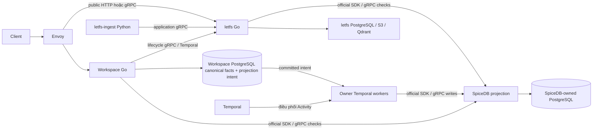

# Nền tảng Go, gRPC, filesystem và phân quyền trước AI agent

Final execution authority: [reviewed seven-phase plan](../261102-1059-go-grpc-filesystem-authorization/plan.md). Later user decisions supersede earlier suggestions below: no provision keys, no business-owner mapping or authorization projector inside letfs; callers persist stable storage IDs, and Workspace owns its storage inheritance projection. Shared code/contracts use `packages/go` and `packages/contracts`. The full ingest rename and consumer switch occur together in Phase 6.

Ngày: 2026-11-02, Asia/Ho_Chi_Minh. Trạng thái: brainstorm để review; chưa triển khai hoặc lập execution plan cuối. User đã xác nhận reset dev vì chưa có production data. Quyết định PostgreSQL là nguồn chuẩn thay thế đề xuất SpiceDB canonical trong [nghiên cứu trước](research-261101-2337-filesystem-platform-redesign.md).

## Outcome, constraints và acceptance

**Outcome:** Hoàn thành filesystem platform và phân quyền dùng chung trước plan AI agent: letfs Go; một thư viện Go chung; action/resource authorization qua SpiceDB; PostgreSQL canonical, projection qua Temporal; RPC nội bộ gRPC; public filesystem HTTP và gRPC trực tiếp, không còn Workspace file proxy; Python app/package thống nhất tên letfs-ingest (user đã chọn thay cho letfs-processing).

**Constraints đã được user chỉ định:**

- Chuyển toàn bộ code letfs Rust sang Go và xóa Rust source, manifests/lockfile, build/test/toolchain integration của dự án sau khi đạt parity.
- Được reset dev, không cần production data migration, API legacy adapters hoặc replay compatibility với histories Rust cũ. Backup vẫn bắt buộc trước reset/database mutation thật.
- Giữ object bytes qua signed S3 URLs; inline bytes trong PostgreSQL. Bỏ domain proxy, không đổi storage transport thành backend byte relay.
- Service check action trên resource, không tự quyết định allow/deny theo Owner/Editor/Viewer trong handlers hoặc repositories.
- PostgreSQL là nguồn chuẩn của các dữ liệu quyền; SpiceDB là derived projection có thể rebuild. Không chọn lại SpiceDB làm canonical.
- Đổi role không cần membership `status`, public operation resource hay polling UI. Đề xuất đang review: API chờ projection xong mới báo thành công; trước đó quyền cũ có thể còn hiệu lực. Không gate toàn workspace trong khi đổi một member.
- Hoàn tất nền tảng này trước triển khai Leti/agent. Quyết định `/chat` riêng mỗi conversation vẫn giữ cho plan sau.

**Non-goals:** AI runtime, Redis stream, agent tools/system prompt/evaluation; custom-role management UI; sharing UI; filesystem cá nhân thực tế; cross-filesystem copy/move; thay parser hoặc semantic pipeline; production compatibility.

**Acceptance criteria:**

1. Account, Workspace và letfs dùng chung Go module ở những phần hạ tầng thực sự trùng; generated contracts dùng được từ Go/Python. Không thêm Access service hoặc authorization proxy.
2. Toàn bộ hành vi letfs hiện có đạt kiểm chứng trên Go: tree/path/mount, revision, inline/object, uploads, quota, copy, ZIP, trash/restore/purge, cleanup, processing và hai loại search.
3. Không còn role-based allow/deny thủ công; permission matrix có action cụ thể và test với SpiceDB thật. Authentication và data invariants vẫn được bảo vệ.
4. Canonical change và durable projection intent commit cùng transaction. Crash/start gap, duplicate delivery, mất acknowledgment và stale retry không mất hoặc đảo ngược quyền.
5. Đổi quyền đã trả thành công phải được các admission sau thấy; authorization outage fail closed. Không hứa thu hồi request đang chạy hoặc signed URL đã cấp.
6. Client gọi letfs public API trực tiếp; không còn file/upload/download/search/archive/trash proxy ở Workspace. Leti sau này dùng cùng contract.
7. Không còn application-to-application internal HTTP; không thể bypass authorization qua public gRPC, HTTP, processing hoặc service identity.
8. Clean dev reset, boot/build/check/native integration/fresh workflow replay/system E2E đều chạy theo tooling mới; không còn Rust hoặc tên processor cũ trong active code/config/docs.

## Hiện trạng đã đối chiếu

- [Architecture](../../docs/architecture.md) và [workflows](../../docs/workflows.md): Go Account/Workspace, Rust letfs, Python CPU/I/O processing; DB riêng theo owner; Temporal điều phối. Đây là contract hiện tại, không phải target mới.
- [Workspace node handlers](../../apps/workspace/internal/http/nodes.go) authorize role rồi forward tới letfs. [Workspace store](../../apps/workspace/internal/workspace/store.go) còn check trong transaction, membership phục vụ cả list/count và business invariants. Cần thay đầy đủ, không chỉ middleware HTTP.
- [letfs auth/router](../../apps/letfs/src/http/mod.rs) chỉ phục vụ private service credentials; [node routes](../../apps/letfs/src/http/nodes.rs) còn `/drive`/workspace-role assumptions. Public generic filesystem API và SpiceDB chưa tồn tại.
- [Processor](../../apps/letfs-processing/src/openlet_processor/activity.py) gọi metadata/publication nội bộ bằng httpx, dùng HTTP riêng cho signed object bytes. Hai đường cần được phân biệt khi chuyển gRPC.
- [Processor manifest](../../apps/letfs-processing/pyproject.toml) còn distribution `openlet-processor`, import module `openlet_processor`; pnpm app đã tên `@openlet/letfs-processing`.
- [go.work](../../go.work) chỉ có Account/Workspace; grpc/protobuf/gateway hiện có chủ yếu từ dependencies của Temporal. Chưa có proto API/generation contract riêng của ứng dụng.
- CodeGraph đã được dùng trước code navigation. Chưa chạy runtime benchmark hoặc mutation nào trong brainstorm.

## Kiến trúc đề xuất để review

Không tạo `apps/access`. Các service gọi SpiceDB trực tiếp bằng SDK chính thức; shared library cung cấp cấu hình/client và contract action/resource, không có network hop hay policy evaluator riêng. Owner Temporal workers thực hiện projection từ PostgreSQL của owner.

SpiceDB chỉ nằm trong mạng nội bộ; client không nhận credential của nó. Service identity/actor propagation vẫn được xác thực trên các RPC ứng dụng. Credential SpiceDB chỉ cấp cho runtime cần dùng; không tuyên bố token read-only/domain-scoped nếu deployment chưa hỗ trợ. SpiceDB OSS không kèm [Restricted API Access](https://authzed.com/docs/authzed/concepts/restricted-api-access); library không phải boundary bảo mật giữa các holder có credential rộng.

### Trade-offs và lựa chọn boundary

| Cách | Giả định chính | Chi phí / điều kiện thất bại trước |
|---|---|---|
| Các app gọi SpiceDB trực tiếp qua SDK/library chung — hướng chọn | Các runtime có credential SpiceDB thuộc cùng trust boundary | Ít service và ít network hop; credential rộng không ngăn caller ghi quan hệ ngoài domain mình |
| Access service bọc SDK — đã loại khỏi thiết kế | Cần một boundary ghi graph độc lập đủ rõ để đáng thêm service | Thêm deployment, API và network hop; với scope hiện tại chủ yếu là proxy |

Better approaches: none — giữ hướng PostgreSQL canonical + Temporal + SpiceDB user đã chọn, gọi SDK trực tiếp để đáp ứng yêu cầu không thêm proxy không cần thiết. Đề xuất Access trước đó đã được rút lại sau user review.

### PostgreSQL canonical ở owner nào?

Giữ canonical facts ở đúng owner để giữ transaction nghiệp vụ: Workspace DB sở hữu built-in workspace role definitions/action sets, membership/role assignment, invitation và workspace lifecycle; letfs DB sở hữu FS/bucket binding, resource binding và lifecycle; Account DB sở hữu account state. Permission identifiers và graph schema là versioned contracts; workspace role-to-action records được seed/update qua migrations, không có custom-role UI trong scope này. Mỗi owner lưu projection intent/version/acknowledgment trong DB của mình. Không thêm authorization DB riêng hoặc sao chép membership sang một canonical store thứ hai.

Mỗi owner commit change + version + durable intent tại DB của mình; owner Temporal Activity dùng SDK ghi SpiceDB. File request không callback Workspace chỉ để hỏi role. Mỗi owner có thể rebuild phần projection của mình từ DB canonical; điều phối giữa các owner qua authenticated gRPC/Temporal, không cross-service SQL. Rebuild phải lấy snapshot/high-water và bắt kịp thay đổi phát sinh, rồi mới mở authorization readiness; không bỏ qua delete/revoke phát sinh giữa chừng.

Đây là ownership khác với nghiên cứu cũ vốn đề xuất graph canonical. Với user steering mới, không được dùng graph làm nguồn backfill ngược PostgreSQL.

### Self-host SpiceDB trên PostgreSQL hiện có

Đề xuất thêm container SpiceDB OSS vào Compose và dùng PostgreSQL instance hiện có với database/user riêng `openlet_spicedb`. Không thêm PostgreSQL server mới; các bảng của SpiceDB do SpiceDB quản lý, app không đọc/ghi SQL trực tiếp. Các database Account/Workspace/letfs vẫn là nguồn chuẩn; database SpiceDB chỉ lưu projection.

[Datastore docs](https://authzed.com/docs/spicedb/concepts/datastores#postgresql) hỗ trợ PostgreSQL cho self-host single-region và không cần extension riêng. [Compose hiện tại](../../infra/compose/dev.yaml) pin PostgreSQL 18.6; cần kiểm chứng cặp version SpiceDB/PostgreSQL trong integration trước khi chốt image. Chạy [datastore migrations](https://authzed.com/docs/spicedb/concepts/datastore-migrations) bằng cùng SpiceDB version trước khi serve, tích hợp database/credentials vào bootstrap và backup/recovery inventory. Nếu dùng Watch API, PostgreSQL cần `track_commit_timestamp=on`; chưa thêm Watch vào scope này. Chia sẻ instance tiết kiệm hạ tầng nhưng cũng chia sẻ CPU/I/O/connection budget và failure domain.

### Go library và generated contracts

Đề xuất một module `packages/go`, đăng ký trong `go.work`, chứa các package có nhu cầu thật: identity/service credentials, gRPC client/server interceptors, authz client/action types, common errors/HTTP mapping và telemetry/context propagation. Extract shared config/secret reading, database/Temporal connection setup khi có cùng contract ở callers hiện tại; không tạo generic repository hoặc app framework.

Membership, quota, filesystem tree và lifecycle application logic vẫn ở app owner. Không import app khác qua `internal/`. Python dùng generated protobuf stubs và cùng wire contract; không bắt Python dùng Go library.

Proto là owner của gRPC contracts. HTTP JSON mappings/OpenAPI và Go/Python stubs được generate, không duy trì một bộ DTO thủ công khác. Ưu tiên [gRPC-Gateway](https://grpc-ecosystem.github.io/grpc-gateway/) trong process letfs cho public HTTP; đây là transport adapter, không phục hồi Workspace proxy. Binary/range/ZIP behavior cần spike [HttpBody streaming](https://grpc-ecosystem.github.io/grpc-gateway/docs/mapping/httpbody_messages/) và headers/trailers; mọi adapter phải gọi cùng application authorization, không chỉ trông chờ interceptor có thể bị bypass.

### Role là tập action

Ví dụ matrix cần hoàn thiện theo toàn bộ public contract:

| Role | Các action minh họa |
|---|---|
| Viewer | `workspace.read`, `member.list`, `file.read`, `file.search`, `trash.read` |
| Editor | Các quyền đọc, `file.create`, `file.update`, `file.copy`, `file.trash`, `trash.restore`, `file.reprocess` |
| Owner | Các quyền Editor, `member.manage`, `invitation.manage`, `workspace.update`, `workspace.delete`, `workspace.transfer_owner`, `trash.purge` |

Role-to-action sets có canonical representation trong PostgreSQL và projection rõ sang graph. Dùng role/role-grant modeling của [AuthZed access-control management](https://authzed.com/docs/spicedb/modeling/access-control-management), không chỉ giấu chuỗi `if role == owner` trong thư viện. Tên dotted action public được map tường minh sang permission identifier hợp lệ của SpiceDB.

App gọi `Check(actor, action, typed_resource)` tại actual operation boundary. Role có thể trả về để hiển thị, không dùng để cấp quyền. Resource links giúp quyền FS kế thừa resource; thêm resource không cần file proxy. Owner-specific operation rules, như tự leave nhưng không bỏ workspace mất Owner, cần được tách: permission quyết định quyền thực hiện; SQL transaction bảo vệ tính hợp lệ của thay đổi.

Giữ checks về đúng một Owner, quota, revision, file scope/lifecycle, artifact immutability, generation/attempt fences, token/email validity và input validation. Đây không phải role-based authorization có thể xóa. Bootstrap identity trước khi account tồn tại và service/job authority cần contract riêng, không dùng cơ chế thiếu graph => allow.

## Projection thực tế với SpiceDB và Temporal

Nguồn chính thức cho thấy nhiều lựa chọn, không có một cách bắt buộc:

- [Writing relationships](https://authzed.com/blog/writing-relationships-to-spicedb) mô tả synchronous two-writes + commit và asynchronous projection. Bài 2022 coi orphan quan hệ ở một số resource-create cases có thể vô hại; không được suy rộng sang grant/revoke trên resource đang tồn tại.
- [Dual-write analysis](https://authzed.com/blog/the-dual-write-problem), 2025, nêu rõ crash vẫn làm hai hệ thống lệch, và liệt kê Temporal/durable execution lẫn transactional outbox. Hai cách hỗ trợ recovery, không tạo distributed transaction.
- [Read-after-write](https://authzed.com/docs/spicedb/concepts/read-after-write) khuyến nghị dùng write-returned ZedToken với `at_least_as_fresh`. Token chỉ có sau khi quan hệ tới SpiceDB; nó không phản ánh SQL change chưa project.
- [Frontier architecture](https://raystack-frontier.vercel.app/docs/concepts/architecture) là tham chiếu thực tế dùng Go, PostgreSQL riêng và SpiceDB với action/resource checks qua gRPC. Nguồn này không chứng minh Frontier dùng Temporal hoặc cung cấp consistency giống thiết kế Openlet; không đề xuất đưa cả platform auth/billing của nó vào repo.

### Luồng đề xuất, không thêm membership status

1. Authorize action thay đổi quyền bằng current graph; kiểm tra revision/invariants trong transaction owner.
2. PostgreSQL commit role mới và immutable projection intent/version cùng nhau. Đây là nguồn chuẩn, không chỉ để lưu command chưa có canonical effect.
3. Dispatch workflow ổn định. Nếu chết trước start, owner reconciliation tìm committed intent và dispatch lại. Outbox ở đây là durable DB intent, không yêu cầu Kafka/Debezium.
4. Owner Temporal Activity dùng SDK chính thức áp dụng change trực tiếp lên SpiceDB. Role swap dùng một atomic relationship write; return token/version sau khi commit. Không giữ SQL lock khi network I/O.
5. Lưu acknowledgment monotonic rồi trả API thành công. API không cần public job/poll endpoint. Nếu timeout, trả kết quả chưa xác nhận, không nói SQL đã rollback; retry dựa cùng request/revision identity không reapply intent cũ lên state mới.

Trong khoảng bước 2–4, role mới có thể hiện trong SQL response/list còn effective graph vẫn cũ. Không thêm gate chặn workspace. Nếu projection lỗi, quyền cũ có thể kéo dài; user chưa chốt một staleness SLA hoặc deadline bảo đảm revoke. Cần đo và hiển thị/log lỗi đồng bộ đủ để vận hành, không im lặng báo thành công.

Ban đầu có thể dùng explicit fully-consistent checks trên SpiceDB PostgreSQL để chứng minh “API thành công => admission sau thấy quyền mới” từ mọi client. Đây là lựa chọn implementation cần đo, không lời khuyên performance tổng quát. Tối ưu sang token-based consistency khi chứng minh mọi inherited-resource check lấy đúng freshness, không chỉ đưa token về client đã đổi role. Không dùng `minimize_latency` rồi hứa revoke thấy ngay sau success.

### Retry và rebuild bắt buộc chứng minh

Temporal Activity có thể chạy lại và stale attempt có thể kết thúc muộn. SQL version check trước RPC hoặc một workflow ID không đủ ngăn write cũ ghi đè revoke mới. Ưu tiên ordered changes theo source aggregate và native SpiceDB transactional preconditions/version marker để fence ở nơi write thực sự commit. [WriteRelationships](https://authzed.com/docs/spicedb/api/http-api) có atomic updates/preconditions; marker protocol vẫn là integration cần spike, chưa được xác minh.

Bookkeeping chỉ tăng tiến; không so sánh lexical ZedToken vì token opaque. Không purge intent cần thiết cho recovery/rebuild khi chưa có bằng chứng đã áp dụng. Full rebuild dùng canonical PostgreSQL và schema/catalog, không dựa giữ Temporal history vô hạn. Xóa SpiceDB projection rồi rebuild là một acceptance test thực, trên môi trường test cô lập.

## Filesystem và toàn bộ gRPC migration

Public letfs API có HTTP và native gRPC qua gateway public identity routing; endpoint filesystem-scoped, resource response trả stable IDs. Service caller phải có authenticated identity và actor/job scope tương ứng; truyền `actor_id` trong payload không đủ cấp quyền.

letfs sở hữu một API filesystem chung theo filesystem ID, node ID/path và các mount hiện có. `/drive` là mount của filesystem gắn với workspace; không hardcode mọi FS thuộc workspace hoặc mọi đường dẫn bắt đầu bằng `/drive`. Mount không cấp quyền: authorize trên target filesystem/resource sau khi resolve. SQL letfs lưu typed resource binding; SpiceDB projection biểu diễn kế thừa quyền từ resource đó. Binding/provisioning do authenticated owner service thực hiện, không cho client tự gắn FS vào resource tùy ý. Workspace chỉ cung cấp drive filesystem reference và điều phối lifecycle, không forward thao tác file. Đây là nền tảng dùng lại cho conversation `/chat` hoặc user FS sau này; chưa triển khai các resource tương lai đó.

Synchronous application calls chuyển hết sang gRPC, gồm Workspace→Account summaries/verified-email lookup, Workspace→letfs resource/lifecycle access và Python processing→letfs metadata/publication/inline transfer. Các app gọi SpiceDB qua SDK/gRPC trực tiếp. Temporal vẫn điều phối durable work qua SDK chính thức; nó không bị thay bằng synchronous RPC. App Activities gọi gRPC hoặc cùng owner application functions theo ownership, không bọc HTTP cũ.

Clerk/OpenRouter/S3 và các third-party provider dùng supported protocols của họ. Signed S3 transfers vẫn HTTP theo native contract; SQL không biến thành gRPC. Internal application HTTP routes/client wrappers bị xóa. Health ưu tiên standard gRPC health; public HTTP transport không bị gọi nhầm là internal API còn sót.

Các bề mặt phải đi cùng nhau: auth/identity và service credentials; application/proto contracts; Envoy native gRPC/public HTTP routes; Go/Python clients; config/secrets/bootstrap/Compose; task scripts/CI; errors/revisions/idempotency/pagination; streaming/range/cancellation/limits; test fixtures/contracts/docs.

Python rename trọn vẹn theo tên user đã chọn: app directory `apps/letfs-ingest`, distribution `letfs-ingest`, import module `letfs_ingest`, pnpm package `@openlet/letfs-ingest`, worker/subprocess module paths, imports/tests, wheel configuration, Docker build/model prefetch, uv lock bằng tooling, root/app scripts, Compose service/task queue references theo contract mới, fixtures và docs. Current paths ở phần evidence vẫn chỉ source hiện tại. Không chỉ đổi display name trong pyproject.

## Thứ tự phase đề xuất cho plan riêng

| Phase | Deliverable | Gate trước khi qua phase tiếp |
|---|---|---|
| 1. Contract và matrix | Inventory letfs behavior, action/resource matrix, ownership, protobuf contracts, failure semantics | Không thiếu endpoint/quyền; role sets và auth bootstrap rõ; signed/inline behavior giữ nguyên |
| 2. Go foundation và transport | `packages/go`, codegen, Account/Workspace/letfs gRPC foundation có behavior thật; caller auth/telemetry/errors | HTTP/native gRPC cùng enforcing boundary; generated code reproducible; không fake-success endpoints |
| 3. Authorization và projection | SQL canonical, catalog, SpiceDB schema, Temporal intent/retry/reconcile; chuyển checks ở mọi app | Real SpiceDB tests: role swap, inherited permission, revoke, timeout, duplicate/stale activity, outage, rebuild |
| 4. letfs Go parity | Port storage/application/workflows toàn bộ; Python gRPC + rename; fresh replay histories | Functional parity, concurrency/quota/fences, actual recovery, parser/search/archive suites; không cần Rust history compatibility |
| 5. Direct public file API | Frontend/E2E clients gọi letfs, resource FS references và generic provisioning, xóa Workspace proxy/internal HTTP | Không bypass trên bất kỳ protocol/path; upload/finalize/search/trash/mount đúng quyền |
| 6. Cleanup và acceptance | Xóa Rust/obsolete clients/contracts/build configs; reset dev, docs và CI thống nhất | Build/check/unit/integration/replay/system E2E thực pass; không skipped tests để gọi hoàn tất |

Các phase là dependency roadmap, chưa là execution instructions. Contract-first không cho phép để placeholder code chạy thành công; scaffolding chỉ hoàn tất khi đường API của phase có behavior được kiểm chứng. Có thể giữ Rust trong quá trình đối chiếu parity, nhưng target cuối không giữ dual implementation.

## Kiểm chứng, rủi ro và bước tiếp theo

Tiếp nối native integration + real Compose system E2E theo [testing](../../docs/testing.md); không yêu cầu viết lại toàn bộ test từ đầu như một kế hoạch cũ đã hoàn tất. Port scenarios/assertions cần thiết sang Go, đổi public routes và bổ sung real SpiceDB/gRPC boundary tests. Controlled providers vẫn hợp lệ cho AI processing; không cần LLM thật.

Rủi ro chính là mất behavior khi rewrite letfs, stale permission projection, actor/service impersonation, và khác semantics HTTP/gRPC streaming/errors. Reset chỉ giảm chi phí compatibility, không giảm requirement concurrency/recovery. Chưa có benchmark, runnable schema validation, stale-write spike hoặc test chứng minh target mới.

Bước tiếp theo: user review architecture/ownership và roadmap; sau đó viết plan riêng với phase execution, file ownership, commands và acceptance gates. AI plan tiếp tục sau khi plan này hoàn tất.

Điểm còn mở để kiểm chứng khi lập plan: matrix đầy đủ của built-in actions; consistency/token strategy sau spike; source-aggregate fencing protocol và HTTP binary mappings. Access service đã loại khỏi thiết kế; không cần hỏi lại reset, storage transport hoặc membership status.

## Layout and sequencing refinement

Later user steering adopts Turborepo layout: deployables under `apps/*`, shared Go module `openlet/packages/go` under `packages/go`, and root `contracts/` moved into `packages/contracts/`. Protobuf source is `packages/contracts/proto/openlet_api/{account,workspace,letfs}/v1/`, generated Go is `packages/go/gen/openlet_api/`, and Python packages the generated `openlet_api` namespace beside its application module. The detailed seven-phase plan supersedes the coarse phase table above: target gRPC activities are staged in the existing Python app, with the complete `letfs-ingest` rename, CI, Compose and recovery consumer switch together in Phase 6. See [the execution plan](../261102-1059-go-grpc-filesystem-authorization/plan.md).
