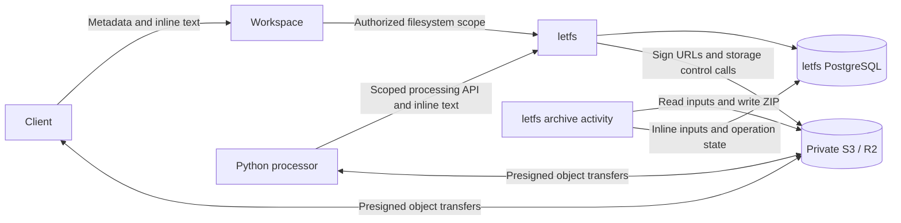

# Direct storage, upload, download and artifact architecture

Date: 2026-10-30, Asia/Ho_Chi_Minh. Status: architecture proposal for presentation, not an implemented contract. This replaces the recommendation in the 08:14 report to retain public object-byte proxying. Existing code, active plans and evergreen docs have not been changed.

## Delivery contract

Outcome: both clients and processors upload/download object-backed files directly with private S3-compatible storage. letfs owns metadata, inline text, upload sessions, quota, publication and storage cleanup. Include ordinary single/multiple files, multipart, original downloads, artifact downloads and ZIP exports.

Constraints: preserve Go/Chi Workspace authorization, Rust/Axum letfs, PostgreSQL, Temporal, Python Docling and Compose. Preserve the accepted hybrid source-file/children model, readonly artifacts and workspace-independent quota buckets. No DB or long-lived S3 credentials for the processor. No N+1 metadata access, speculative infrastructure or second storage engine.

Non-goals: billing, AI, frontend implementation, CDN/public sharing, content deduplication/reference counts, object-store version-history product, a custom resumable protocol or a generic distributed transaction framework.

Acceptance: packet/request evidence shows object bytes bypass Envoy/Workspace/letfs HTTP for both clients and Python; inline text uses bounded APIs; provider-backed tests prove signing, multipart, integrity and retry behavior; artifacts publish all-or-nothing; exports download from S3; quota/overwrite/cleanup remain correct.

## Evidence and design choices

| Primary source | Established behavior |
|---|---|
| [AWS direct presigned upload example](https://aws.amazon.com/blogs/compute/securing-amazon-s3-presigned-urls-for-serverless-applications/) | Backend returns a presigned URL; browser sends bytes directly to S3. Signed Content-MD5 can bind and verify upload integrity. |
| [Uppy S3](https://uppy.io/docs/aws-s3/) | Standard client uploaders support small-file single PUT, large-file multipart and bounded concurrency. Multipart has extra round trips; it need not be used for every tiny object. |
| [AWS multipart overview](https://docs.aws.amazon.com/AmazonS3/latest/userguide/mpuoverview.html) and [complete API](https://docs.aws.amazon.com/AmazonS3/latest/API/API_CompleteMultipartUpload.html) | Native create/parts/complete/abort semantics and ETag part receipts. Completion can return an error inside HTTP 200; use the SDK's parsed result. |
| [R2 S3 API](https://developers.cloudflare.com/r2/api/s3/api/) and [consistency](https://developers.cloudflare.com/r2/reference/consistency/) | R2 implements PUT conditional create atomically, Content-MD5, range GET and native multipart. Do not infer every AWS feature from S3 compatibility. |
| [AWS presigned URL lifecycle](https://docs.aws.amazon.com/AmazonS3/latest/userguide/using-presigned-url.html) | URLs are reusable bearer capabilities until expiry. A GET started before expiry can continue afterward. |
| [R2 CORS](https://developers.cloudflare.com/r2/buckets/cors/) | Browser uploads need allowed origins/methods/headers and exposed ETag. CORS is not authorization. |
| [OneDrive downloads](https://support.microsoft.com/en-gb/onedrive/download-files-and-folders-from-onedrive-or-sharepoint) and [Dropbox downloads](https://help.dropbox.com/sync/download-entire-folders) | Multiple-file/folder downloads produce ZIPs and have explicit count/size limits. |
| [Box ZIP API](https://developer.box.com/reference/post-zip-downloads) | Separate archive request, authorization, download/status URLs, expiry and name-conflict handling. This documents the API pattern, not Box's internal ZIP-generation/storage architecture. |

Recommendation: standard single PUT plus native multipart, with server-owned session/publication. Proxying all objects contradicts the requested data path and consumes backend bandwidth. Multipart for every tiny object is workable but adds request overhead without current benefit. Better approaches: none beyond the requested direct-transfer direction; the sources support it. ZIP generation to a temporary S3 object is Openlet's adaptation to direct delivery, not a claim about proprietary cloud-drive internals.

## Ownership and storage

One private physical bucket per environment is sufficient. Normal objects and object-backed artifacts share `objects/<quota-bucket-id>/<upload-id>`; temporary archives use `exports/<operation-id>/<attempt-id>.zip`. Keys use server-generated UUIDv7 and never encode mutable user paths. A file rename/move changes PostgreSQL only. Replacing bytes always uses a new object key. Independent file copies retain the existing independent-byte policy.

PostgreSQL is the filesystem authority. S3 is not used to list the user's tree, infer directories, decide authorization or calculate logical quota. Keep `nodes`, `file_data`, `uploads`, `operations` and `object_deletions`. No shared content registry or reference-count table.

`file_data` keeps its existing inline/object distinction. Binary and large text use objects. Small valid UTF-8 text without NUL may use inline bytes, preserving the current configured limit. Client filename/MIME is a hint, not proof: the inline API validates actual bytes. Noneligible text/binary uses a new object upload session; it is not silently proxied through a large-body fallback. A file may change storage kind on a later byte replacement through the same revision/quota transaction.

Workspace authorizes user metadata operations before delegating filesystem scope. letfs validates resource ownership, liveness and upload/operation scope. The Python processor gets only source/output capabilities bound to its operation/attempt, not a Workspace service credential permitting arbitrary operations.

## One upload subsystem

### Prepare

The same upload application code serves user and processor callers. Prepare accepts destination or overwrite identity, expected size/type, supported checksum information and an idempotency key. It resolves/pins the destination, checks current authorization/lifecycle and operational limits, and stores the upload record before issuing capabilities. Repeating the same key and parameters returns the existing session; changing parameters conflicts. This uses the upload record, not a generic replay-response table.

Session metadata contains its actor/filesystem/quota bucket, expected byte count, transfer mode, object key when applicable, provider multipart ID when applicable, integrity constraints, expiry, destination/precondition or processing owner, and terminal result. Inline sessions have no S3 key or multipart ID. The checksum received from the caller is not authoritative until validated by the byte receiver/provider.

Transfer mode is chosen by letfs: inline for eligible bounded text; single PUT for object files below the configured multipart threshold; native multipart above it. A proposed initial threshold is 100 MiB, compatible with the current 100 MiB maximum-file default and the platform's roughly 100 MB guidance. Threshold and file maximum remain operational configuration, not subscription rules. Do not silently raise the existing maximum. The object provider's single-PUT maximum is an additional enforced bound.

### Single PUT

letfs signs one exact key/method and required headers: `If-None-Match: *`, expected Content-Length and Content-MD5 (Base64) for the agreed R2-compatible integrity contract. Signature enforcement makes these mandatory, not worker conventions. Content type is signed when relevant. The browser supplies its own Content-Length; the service must not require JavaScript to set a forbidden header manually.

The client or Python worker uploads directly to S3. Completion uses HEAD/object evidence to verify the allocated object exists and has the expected length, relying on the provider's tested checksum validation. There is no second full download just to calculate an unnecessary SHA-256. MD5 is used for transfer corruption detection, not adversarial identity, deduplication or authenticity. A 412 after a lost acknowledgment triggers reconciliation of that exact session, not automatic success.

No PUT URL is issued for an existing file's current object key. No staging-to-final copy occurs. Upload abandonment still needs cleanup because a valid URL can create its object later.

### Multipart

letfs uses the installed SDK to create a native multipart upload at a fresh key and persists its provider upload ID. Clients receive presigned UploadPart URLs for bounded batches of valid part numbers. Part size/count derive from declared length and provider limits; every nonfinal part has the same size, at least 5 MiB. Each URL binds upload ID, part number, expected length and part checksum. Clients retry failed parts with the same binding and retain ETags.

Only letfs may call CompleteMultipartUpload or AbortMultipartUpload. Clients return the ordered part-number/ETag receipts. If resume/listing is needed within the session, a scoped signed ListParts request can be exposed using the same native protocol; no per-part database ledger is necessary. This does not promise cross-device session synchronization.

Before remote completion, freeze the intended part list in session state so concurrent retries cannot substitute a different completion. The SDK completes outside DB locks. Check parsed provider success and final size; then mark byte readiness or publish. Once completed, part URLs for that upload ID cannot rewrite the completed object. Each key has one owning session; do not create multiple authorized writers to the same final key.

A lost completion response is reconciled using the unique key, persisted multipart identity and saved completion intent. A temporary 404 does not prove an outstanding remote request can never commit. Abort and completion publication serialize on the same upload state; late remote success after terminal abort can only produce an orphan queued for cleanup, never a visible node.

Use SDK abort on handled failures and provider-native incomplete-multipart lifecycle for process death/unknown initialization outcomes. Do not implement custom chunk assembly or a multipart workflow.

### Publish and ordinary multi-file upload

Byte readiness and visibility are distinct. For an ordinary upload, completion verifies storage outside the transaction, then locks the existing upload/bucket/filesystem in the established order, rechecks destination and saved overwrite precondition, checks actual quota delta, publishes file_data/node changes and stores the result atomically. The same call may perform readiness plus publication; users do not need an extra ceremonial request. Retrying returns the saved result.

Overwrite preserves the old file until publication succeeds. The same transaction queues old object cleanup, invalidates old artifact children and records any new eligible processing intent. Quota remains commit-time hard logical quota: no reservation or soft cap. Refused publication leaves unreferenced bytes for cleanup.

Multiple ordinary user files are independent upload sessions, coordinated with bounded client concurrency and per-file results. Metadata preparation and URL signing may accept bounded lists with set-based DB lookup/insertion. Each file commits independently; one failure does not roll back siblings. An upload containing 100 files is not 100 Temporal workflows. Do not replace independent file commits with an unsolicited all-or-nothing user transaction.

## Artifact publication

Keep one Rust ProcessFile workflow and one Python process_file activity. Python owns download, Docling, local export, output transfer and completion for that invocation. It uses exactly the common upload transport above, including direct S3 and inline text APIs.

Output upload records are owned by the processing operation/attempt and relative path; preparation creates no visible nodes. Preparation is bounded/batched and idempotent for the same attempt/path/parameters. A new attempt gets its own output ownership; stale attempts cannot finalize, abort or delete the winner's data. An artifact set is one admitted processing job with explicit count/aggregate-byte bounds; its outputs do not each consume one of the current sixteen ordinary outstanding-job slots.

After all outputs are ready, one operation completion transaction validates source content identity, current operation/attempt, paths/collisions, complete output set, node count and aggregate quota. It creates all readonly children directly under the source, commits upload ownership and records success once. A failed commit exposes no partial artifact tree. No artifact folder node, filesystem-per-file, physical S3 directory, stored manifest or generation-history product is added.

The original payload and published artifacts are counted in the same generic quota bucket. Temporary candidates are operationally bounded, not charged as visible logical data. Processing source overwrite/trash and hybrid lifecycle continue to follow the accepted plan. A processing operation's captured source key is used for downloads and URL renewal; the worker must not silently switch to the node's latest replacement bytes.

## Single-file downloads

The caller asks Workspace for an authorized download descriptor by path/ID; Workspace calls letfs. For an object-backed file, letfs signs GET for its current immutable key and returns URL, expiry and metadata, or the public content endpoint returns a 307 to it. The browser/worker follows directly to S3. S3 serves ranges; the API does not relay object bytes. A metadata API offers descriptors rather than forcing redirect handling for SDK/agent callers.

For inline files, letfs serves the bounded bytes through Workspace, with existing range/attachment behavior. There is no S3 object to presign. The ordinary text-edit API remains bounded and revision-conditional. Large text reads use direct GET like any other object.

Use a short GET lifetime (proposed default five minutes), private/no-store metadata responses and signed safe attachment headers, with filename response overrides where supported. Test filename/header overrides on the exact provider. Keep logical node revision separate from S3's ETag. A client renewing a URL for a ranged resume must identify the same content/revision; an overwrite must not make it concatenate ranges from different contents.

Authorization is checked when issuing/renewing a URL. A previously issued bearer URL is not individually revoked by a membership change or trash operation; this bounded interval is inherent in the requested direct-presigned model. Do not add a proxy/lease platform to pretend otherwise. Do not log URL signatures or whole request URLs containing them.

## Multiple files, folders and artifact download

Default interactive multi-file/folder download is ZIP, following the cited cloud drives. A batch of authorized individual descriptors remains useful for SDK/agent callers; it does not replace the ZIP action. It is a bounded metadata response, not a new transfer subsystem.

Use a separate archive/export operation with a status endpoint. An existing Rust letfs I/O worker builds the archive with a maintained ZIP/ZIP64 library and writes the result directly into a temporary S3 multipart object with bounded buffering. Inputs are S3 objects plus bounded inline reads; no Python Docling worker or new service is required. The client receives a presigned GET only after the ZIP is complete. Client download bytes come from S3.

One ExportArchive workflow invoking one archive activity is appropriate for this long-running transformation and reuses the existing Temporal deployment. It is separate from processing. Ordinary upload/download/HEAD/signing has no workflow. Archive retries rebuild into a fresh attempt key; no per-file activities, durable per-entry progress ledger or archive-cache framework. Record the candidate key before writing and publish the winning key/result through the operation state. Cleanup loses abandoned keys normally.

Metadata enumeration is bounded/set-based and captures per-file immutable key or inline ID/revision. Inline reads are batched with byte bounds and verify the captured revision. If an input cannot be read consistently, fail the archive rather than silently omit it or substitute newer content. Retry can re-enumerate current authorized inputs; this is not a historical-folder-snapshot feature. An object removed before it can be read causes explicit failure; no new per-export reference-count system is introduced.

Bound selected count, expanded entries, total source bytes, resulting bytes, runtime and concurrent exports. ZIP names are sanitized relative paths, deduplicate overlapping selections, preserve selected ordinary directory structure and resolve top-level naming collisions deterministically without renaming source nodes. Fail the whole export if an expected entry is unavailable; do not include placeholder error files and claim success.

Hybrid mapping is an Openlet-specific rule because ZIP cannot represent a regular file and a same-named directory at the same path:

- Downloading `report.pdf` returns its original payload.
- Downloading a normal folder/selection includes original file payloads; it does not recursively inject generated children underneath file entries.
- Downloading a source's artifacts explicitly exports its child tree into `report.pdf-artifacts.zip`, with paths relative to that child tree.
- An artifact file selected directly downloads normally according to inline/object storage. An artifact directory selected for export includes its readonly subtree. The live filesystem model is unchanged.

Temporary exports are not filesystem nodes and do not consume logical workspace quota; otherwise a full workspace could not download itself. They have operational bounds and expiry (proposed retention twenty-four hours), a distinct prefix for native lifecycle cleanup, and no automatic permanent archive per source. Limit each issued URL to the export's remaining lifetime. Reauthorize access when issuing/renewing its URL.

## Cleanup, retention and infrastructure

Reuse existing maintenance, object deletion evidence and provider lifecycle. Do not apply age-based expiration to normal `objects/`: a once-unpublished key can later become live without moving. Apply native expiry to temporary `exports/` only, and native abort rules to incomplete multipart uploads.

Object GC must check live file_data, active uploads and operation-owned keys, serialize against publication, and retain evidence for ambiguous writes. Terminal multipart sessions call abort; terminal single-PUT sessions must account for all issued URL expiries and in-flight requests. A DELETE followed by HEAD 404 is not proof an earlier PUT cannot later appear. Existing conservative ambiguous-write cleanup can be reused/extended rather than adding a separate GC service.

The current proxy's 120-second deadline no longer bounds remote client transfers. Do not use it to justify a fifteen-minute unconditional GC assumption. Retain unreferenced objects for at least maximum issued GET lifetime plus a documented transfer grace, and retain failed-upload evidence until stale write capabilities/outcomes have been reconciled. This protects URL start validity; it does not promise unlimited-duration downloads survive physical deletion. Finite retention and best-effort in-flight completion must be an explicit contract, not a hidden claim of instant revocation or forever retention.

R2 production URLs use its reachable S3 API endpoint. Compose/Testcontainers must expose storage to the actual caller. Support internal storage control endpoint and caller-reachable signing endpoint where these differ; sign the exact host/path the recipient will request. Never replace the hostname after signing or proxy bytes just to mask an internal-only URL. Browser CORS allows exact application origins, required PUT/GET/HEAD and signed headers, and exposes ETag/range metadata. Multipart create/complete/abort remain backend calls.

Use private buckets, least-privilege letfs credentials and TLS outside explicit local mode. URL expiry, upload lifetime, maximum size, multipart threshold/part sizing, concurrency, output/export limits and GC grace are operational settings. No Redis, custom gateway, object-store notification dependency or distributed quota reservations are needed.

## Implementation impact

| Existing surface | Required redesign |
|---|---|
| `services/letfs/src/fs/uploads.rs` | Replace object-body receiving with shared inline/single/multipart sessions; keep destination/revision/quota publication invariants; add idempotent prepare/readiness/reconciliation and processing ownership. |
| `services/letfs/src/storage/mod.rs` | Expose installed signing/native multipart APIs through the concrete S3 client; separate control/public endpoint use where required. No hand-written SigV4 or part assembly. |
| `services/letfs/src/http/mod.rs:372` | Split inline body delivery from object redirect/descriptor; add scoped upload/status/part-signing/completion and export adapters. |
| `services/workspace/internal/http/files.go` | Keep authorization and metadata facade; remove object upload/download byte relaying. Forward only bounded inline content and metadata/redirects. |
| Upload schema and migrations | Make transfer mode, expected versus verified metadata, provider multipart ID, capability expiry, destination/processing ownership and terminal result explicit; do not allocate S3 keys for inline-only sessions. Back up before migration. |
| `fs/maintenance.rs`, lifecycle/deletion/copy/processing integration | Extend live-reference checks, native abort, expiry, publication races and direct-GET retention. Retain one maintenance owner. |
| Archive application/activity/workflow | Add the bounded ZIP transformation and temporary-result lifecycle; reuse operations/cleanup and existing Rust I/O worker. |
| Compose/storage setup | Reachable signed endpoints, CORS, exports expiry and incomplete-multipart lifecycle; no extra infrastructure service. |
| Public/internal contracts, docs, tests and caller examples | Replace proxy transport assumptions consistently. This is an intentional API transport change, not an additive hidden fallback. Existing clients must be updated together; preserve inline/revision/range/error behavior where applicable. |

The existing multipart cleanup defect remains real for any old proxy path retained during migration: `receive` can return/drop before `WriteMultipart::abort`; key deletion does not abort incomplete parts. Remove the object proxy receiver as part of this redesign instead of polishing a path that should disappear. If compatibility requires a temporary retained object receiver, fix its explicit abort handling and lifecycle rather than leaving a known defect.

## Validation and limits of this proposal

Implementation must verify both R2 and pinned SeaweedFS, including: external browser/worker-reachable endpoints; browser-style CORS; signed header removal/change; exact lengths and checksum mismatch; concurrent PUT replay; part retry/order/complete/abort and lost replies; orphan cleanup after death; unchanged file after stale overwrite/quota refusal; more than sixteen artifact outputs; stale processing attempts; readonly hybrid reads; direct range resume across URL expiry/overwrite; complete ZIP with inline/object inputs, duplicate names and hybrid mapping; temporary expiry; quota exactly once; metadata query counts; and no object bytes on Workspace/letfs HTTP. Keep existing Testcontainers tests and change meaningful E2E expectations from proxy bodies to direct storage transfers.

This was source/document research and architecture synthesis only. No code, migration, container, dependency install, live provider configuration or runtime test was changed/run. Free disk was approximately 507 MiB. Some web fetches failed; source pages successfully read elsewhere in this task/prior research supplied evidence. No failed skill script was modified.

## Unresolved decisions

No further preference question is needed to present this proposal: ZIP is the researched default. Hybrid ZIP mapping, default limits/retention and the Openlet worker allocation above are explicit proposals, not vendor guarantees. Exact R2/SeaweedFS enforcement, response-header overrides and numerical tuning remain implementation acceptance gates. User review precedes changing the active execution plan or code.
