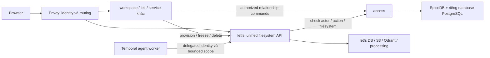

# Đề xuất redesign filesystem platform

Nghiên cứu: 2026-11-01, cập nhật 23:41 Asia/Ho_Chi_Minh. Trạng thái: đề xuất để review, chưa được chấp nhận hoặc triển khai. Tiếp nối [brainstorm Leti](brainstorm-261101-2224-leti-service.md).

**User steering mới 2026-11-02:** PostgreSQL giữ canonical authorization data, SpiceDB chỉ là projection qua Temporal; chuyển letfs sang Go và application RPC sang gRPC, bỏ Workspace file proxy trước AI agent. Đề xuất graph canonical và workspace freshness gate bên dưới không còn là hướng thực hiện. Xem [brainstorm nền tảng mới](brainstorm-261102-1032-go-grpc-filesystem-authorization.md).

## Kết luận và contract

Đề xuất một public filesystem API ở letfs, dùng chung cho browser và delegated worker; domain service provision filesystem cho resource, không proxy từng thao tác file. Tách authorization thành năng lực dùng chung: một app `access` kiểm soát các lệnh quyền và delegation, dùng engine ReBAC có sẵn. Ưu tiên thử SpiceDB với PostgreSQL; OpenFGA là phương án khả thi khác. Đây là khuyến nghị kiến trúc, chưa phải kết luận từ benchmark hoặc integration spike.

**Outcome:** Workspace Drive, conversation chat, personal storage và resource của service khác dùng cùng filesystem contract; thêm resource không phải sao chép upload/download/search handlers.

**Constraints:** Quyền hiện tại của người gọi; `/chat` riêng mỗi conversation; Viewer viết `/chat` của mình nhưng chỉ đọc Drive; database tách theo service; tái sử dụng letfs, Temporal, storage và processing. Không đặt workspace/conversation policy trong Rust storage hoặc callback từng domain trên đường file request.

**Non-goals:** Triển khai code/migration trong nghiên cứu này; thêm sharing UI, folder ACL, personal filesystem, cross-filesystem move hoặc thay storage engine. Không tự xây ReBAC evaluator, JWT format hay OAuth server.

**Acceptance:** Một contract file duy nhất; resource/bucket provisioning có owner và idempotency; client không tự cấp quyền; worker không dùng quyền admin thay actor; revoke hoàn tất chặn admission tiếp theo; thiếu auth không cho phép truy cập; upload completion/search/artifacts không bypass; thêm resource thay policy và provisioning của domain, không thay file handlers của domain.

## Bằng chứng và các hướng đã so sánh

Repo có generic quota bucket và `ensure_filesystem`, nhiều FS/bucket, mount context. Tuy nhiên [provisioning](../../apps/letfs/src/fs/provisioning.rs) và [Temporal activities](../../apps/letfs/src/temporal/provisioning.rs) còn workspace-specific; [Workspace client](../../apps/workspace/internal/letfs/client.go) gọi các operation đó. [Architecture hiện tại](../../docs/architecture.md) đặt authorization và public facade ở Workspace, letfs nhận scope nội bộ. CodeGraph đã được dùng để kiểm tra các boundary này. Mount không phải cơ chế cấp quyền; cross-filesystem copy/move chưa có.

| Hướng | Giả định / giới hạn đầu tiên | Đánh giá |
|---|---|---|
| Một API letfs, callback domain quyết định quyền | Mỗi owner cung cấp contract auth ổn định, luôn sẵn sàng. Mỗi loại resource vẫn cần integration runtime, callback outage chặn file API. | Là pattern hợp lệ, nhưng không ưu tiên cho mục tiêu platform mới. |
| Một API letfs với ACL user/group thuần | Mọi policy diễn tả bằng grant trực tiếp hoặc group. Gặp khó khi `/chat` cần đồng thời owner và membership workspace hiện tại; flatten quyền lại tạo bài toán đồng bộ/revoke. | Hợp khi policy đơn giản và độc lập; không đủ gọn cho tập yêu cầu này. |
| Một API letfs và shared ReBAC | Chấp nhận chuyển nguồn quyền sang hệ thống chung và vận hành nó. Chi phí đầu tiên là migration, lifecycle và bảo vệ quyền ghi graph. | Đề xuất cho scope redesign toàn hệ thống. |

[Appwrite](https://appwrite.io/docs/products/storage/permissions) là ví dụ storage có API và bucket/file grants dùng chung. [Supabase Storage](https://supabase.com/docs/guides/storage/security/access-control) dùng PostgreSQL RLS. Các sản phẩm này chứng minh bài toán đã tồn tại; không chứng minh có thể thay letfs mà giữ nguyên tree/artifacts/quota/processing. RLS đọc dữ liệu domain trực tiếp cũng không khớp boundary database riêng hiện tại nếu không redesign thêm.

ReBAC biểu diễn quan hệ và tính quyền kế thừa. [SpiceDB schema](https://authzed.com/docs/spicedb/concepts/schema) hỗ trợ union/intersection và duyệt parent; [OpenFGA](https://openfga.dev/docs) giải quyết cùng nhóm bài toán. Thêm domain có thể cần migration schema quyền; không có lời hứa “mọi policy tương lai chỉ thêm một dòng dữ liệu”.

**Better approaches:** Shared authorization tốt hơn giữ mỗi domain một facade trong scope mới: browser/worker có một đường file; storage không biết role nghiệp vụ; quan hệ workspace được kiểm tra trực tiếp thay flatten grant cho mọi conversation. Đổi lại phải chuyển ownership dữ liệu quyền và thêm dependency trên hot path.

## Ownership và luồng request



| Owner | Sở hữu |
|---|---|
| Domain service | Resource lifecycle, metadata, invitation/product rules; phát lệnh thay đổi quan hệ thuộc domain của mình. |
| `access` | Caller authority, resource namespace/tenant registration, serialized/idempotent relationship commands, delegation lifecycle; phiên bản policy trong repository. |
| SpiceDB | Quan hệ quyền canonical và evaluator. Không chứa file tree/content. |
| letfs | Filesystem/bucket/binding, tree/content/revision/upload/search/artifacts, lifecycle gates; map file operation sang generic permission và enforce quyết định. |
| Envoy | Xác minh user identity và routing; không phải nơi duy nhất bảo vệ thao tác storage. |

`access` là integration/control boundary, không phải engine quyền tự viết và không chuyển tiếp file bytes/CRUD. Với OSS, chỉ nó giữ credential tới SpiceDB. Domain không được gửi tùy ý bất kỳ tuple nào hoặc đổi policy runtime. Chính sách ghi kiểm tra service identity, tenant, registered resource ownership, relation và target hợp lệ; schema deployments đi qua maintainer workflow.

Lý do không bỏ qua boundary này: [Restricted API Access](https://authzed.com/docs/authzed/concepts/restricted-api-access) không đi kèm SpiceDB OSS. Tính năng quản lý quyền truy cập server của [OpenFGA](https://openfga.dev/docs/getting-started/setup-openfga/access-control) hiện vẫn được tài liệu đánh dấu experimental, không khuyến nghị production. Không nhầm khả năng engine kiểm tra quyền người dùng với khả năng giới hạn service nào được sửa graph.

## Filesystem, resource, bucket và mount

Một FS có stable `filesystem_id`, `owner_service`, `resource_ref`, `slot`, `quota_bucket_id`, lifecycle state. Ràng buộc duy nhất `(owner_service, resource_ref, slot)` giúp một resource có một hay nhiều FS có tên vai trò rõ ràng. ID/resource reference không tự cấp quyền.

Quota bucket là accounting record, độc lập physical S3 bucket và access boundary. Một workspace có thể trả storage cho cả Drive và nhiều `/chat` mà không làm `/chat` đọc được bởi mọi member. Service không được chỉ định bucket bất kỳ: provisioning cần quyền allocate vào bucket đó và binding tenant hợp lệ. Limit/quota management thuộc principal quản trị bucket, không phải mọi resource owner.

| Resource | Ví dụ binding | Quyền dự kiến |
|---|---|---|
| Workspace | workspace W, slot `drive` | Đọc theo member/role; ghi Editor/Owner; purge theo quyền hiện tại. |
| Conversation | conversation C, slot `files` | Owner conversation và còn thuộc workspace; Viewer vẫn ghi ở đây. |
| Personal space, tương lai | personal-space P, slot `files` | User owner; cần chốt personal scope toàn account hay theo workspace khi làm tính năng. |
| Resource khác | resource R, slot riêng | Policy của domain; thực thi qua cùng generic filesystem permissions. |

Mỗi permission model cung cấp nhóm quyền file cần thiết, gồm đọc, ghi, trash/restore và purge theo contract hiện tại; quyền provision/delete toàn FS tách khỏi quyền sửa file. Policy có thể dùng resource typed parent trong graph rồi ánh xạ `filesystem -> resource -> file permission`. letfs chỉ check `filesystem:id / permission / actor`, không switch theo conversation hoặc workspace. Đăng ký thêm resource type là schema integration có kiểm tra, không tải code callback vào letfs.

`/drive` và `/chat` là alias trong một view/runtime mount table:

```text
/drive -> filesystem D
/chat  -> filesystem C
```

Mount không phải physical directory hay quyền truy cập. Leti tạo mount context từ conversation đã authorize; agent không tự đưa thêm filesystem vào. Mỗi operation vẫn kiểm tra quyền hiện tại tại FS đích. Một frontend file browser có thể gọi trực tiếp theo filesystem/node ID; path API dùng cùng resolver/mount contract. Không bắt các service khác phải hiểu `/chat`.

## Một API, hai nhóm trách nhiệm

Các path dưới đây là minh họa đề xuất, chưa tồn tại trong OpenAPI hiện tại:

```text
PUBLIC:  /v1/filesystems/{filesystem_id}/...
         nodes, uploads, downloads, trash, search, artifacts
INTERNAL: generic provision / bind / freeze / delete filesystem
```

Public file contract được letfs sở hữu một lần: errors, preconditions, revisions, pagination, idempotency và job status. Client Go/Python/TypeScript dùng contract generation theo tooling repo; SDK không thay authorization. Workspace/Leti trả file-system references trong resource response, không chứa upload/download handler copies. Signed object transfer tiếp tục như hiện tại; admission và finalize/publication đều được authorize.

Search scope được authorize trước truy vấn và filter trong storage/index; không query mọi FS rồi gửi về client để lọc. Processing artifacts kế thừa scope nguồn. Background copy/processing giữ bounded job authority và generation fences; không cấp worker quyền toàn storage. Khi policy có ACL chi tiết hơn FS sau này, search filtering và node checks phải được mở rộng cùng lúc.

## Nguồn quyền và revocation

Đề xuất canonical access facts nằm trong shared graph: membership/role dùng cho access, owner/participant liên quan access, resource active gate. Workspace vẫn sở hữu API thay đổi membership và invitation; Leti sở hữu API thay đổi conversation. Domain metadata và membership-list projections không được dùng làm nguồn authorization thứ hai.

Đây là thay đổi đáng kể so với hiện tại, không phải chỉ thêm cache. [OpenFGA source-of-truth guidance](https://openfga.dev/docs/best-practices/source-of-truth) phân biệt permission/role membership có thể nằm ở engine với hierarchy/search data nên ở application DB. [Dual-write analysis](https://authzed.com/blog/the-dual-write-problem) xác nhận hai database không tự thành transaction; outbox chỉ đưa tới eventual consistency.

Contract đề xuất:

1. Membership/role command có operation ID, expected version và được serialize theo access aggregate. Graph cập nhật thành công mới báo permission change hoàn tất. Retry cũ không được TOUCH lại grant sau một revoke mới; `access` cần giữ command ordering/version và kết quả, không chỉ deduplicate HTTP request.
2. Domain DB có thể giữ projection để list/filter; projection chậm không được cấp quyền. Product actions cũng check graph; nếu vẫn authorize bằng membership table cũ, nguồn quyền chưa thực sự chuyển.
3. Ban đầu dùng SpiceDB PostgreSQL và explicit `fully_consistent` checks ở access boundary, không thêm allow cache ở app. Theo [consistency docs](https://authzed.com/docs/spicedb/concepts/consistency), default nhiều check API là `minimize_latency`; phải cấu hình tường minh. Tối ưu bằng ZedToken chỉ sau khi chứng minh freshness trên mọi đường, gồm worker và inherited membership changes.
4. Revoke acknowledged trước check mới thì admission mới phải bị chặn. Check/operation đang chạy trước revoke có thể hoàn tất; không tuyên bố atomic transaction giữa SpiceDB check và letfs mutation.
5. Signed URL đã phát có thể dùng tới expiry. Cần TTL phù hợp; muốn hủy ngay mọi byte transfer sẽ đổi data path, chưa thuộc quyết định hiện tại.

ZedToken từ lần tạo FS không tự phản ánh lần thu hồi workspace member về sau. Async outbox, Redis invalidation hoặc Temporal retry không được mô tả là bảo đảm immediate revocation.

## Provisioning, deletion và partial failure

Tái sử dụng Temporal cho orchestration nhưng không coi nó là distributed transaction:

- Domain lưu resource ở `provisioning`, gọi generic ensure FS bằng owner/resource/slot; FS ban đầu chưa public-accessible.
- Register/bind access resource bằng đúng caller authority; chỉ letfs được tạo/đổi mapping `filesystem -> resource` của FS nó sở hữu. Domain không tự rebind FS của service khác. Request có idempotency và immutable ownership; binding chỉ thành công khi resource và bucket cùng scope hợp lệ.
- Letfs active sau binding; domain active sau khi kiểm tra đủ điều kiện. Nếu crash ở giữa, mặc định deny/không expose resource và retry tiếp; cleanup FS mồ côi bằng reconciliation có lifecycle evidence.
- Delete chuyển resource access gate sang inactive và freeze FS trước khi trả trạng thái đã chặn access; sau đó xử lý cleanup bền vững. Không đợi purge object mới revoke.
- Giữ tombstone/generation để retry provision cũ không tạo lại resource đã xóa. Command version và gate inactive ngăn các quyền còn sót có tác dụng. Cleanup quan hệ/binding cần order và idempotency; không dựa vào xóa parent tuple là xóa tự động cả graph.

Không cần atomic commit domain DB + access + letfs. Cần trạng thái trung gian rõ, fail closed và thứ tự tiến một chiều. Lifecycle freeze trong letfs vẫn là gate cục bộ ở commit boundary; source metadata trong domain DB không đủ ngăn request tới direct API.

## Worker và current caller rights

Browser dùng trusted user identity qua Envoy. Worker cần authenticated service identity cùng delegation bị giới hạn theo actor, run, filesystem/actions và expiry; client/model không được tự chọn actor header. `access` kiểm tra cả delegation scope và quyền actor hiện tại, thay vì chụp quyền một lần khi start run. Credential admin của service không phải quyền thao tác file thay user.

Đề xuất delegation record được kiểm tra online, có revoke/expiry và bound service identity; có thể dùng opaque handle nội bộ, không cần tự thiết kế signed token. Handle tham chiếu do service cấp chỉ sau khi authenticate user và validate scope. Giữ credential ngoài prompt/log/Temporal history. Stop/deletion đóng delegation; expiry là lớp chặn còn lại khi cleanup bị gián đoạn. Retry chỉ phục hồi/renew trong giới hạn run lifecycle và recheck actor rights, không tự gia hạn sau Stop.

Đây là integration phải triển khai, không phải tính năng mặc định của Clerk, Temporal hoặc SpiceDB. RFC token exchange không chứng minh stack hiện có hỗ trợ. Chi tiết transport/renewal/fencing cần spike trước contract cuối; không cần thêm authorization server OAuth trong giai đoạn này.

## Chi phí chuyển đổi và kiểm chứng

Ưu tiên SpiceDB vì consistency contract có ZedToken và PostgreSQL phù hợp single-region đang có; không kết luận nó nhanh hơn OpenFGA. [OpenFGA consistency](https://openfga.dev/docs/interacting/consistency) có `HIGHER_CONSISTENCY` bỏ cache, vẫn là lựa chọn hợp lệ. [SpiceDB PostgreSQL](https://authzed.com/docs/spicedb/concepts/datastores) có vận hành/backup riêng; không dùng chung bảng domain hoặc giả PostgreSQL làm hai service atomic.

Các bề mặt migration: Workspace membership authorization và list projections; account onboarding; letfs public/internal contracts, auth and provisioning; Envoy routing; Go/Python/browser clients; processing/job scope; frontend/file attachments; integration/security fixtures; architecture/setup/lifecycle docs. Không cần rewrite tree/quota/parsing/search engine để đạt mục tiêu này.

Migration cần snapshot/backfill quyền, so sánh shadow checks, một lần cutover nguồn authorization có kiểm soát, rồi chuyển file clients và bỏ facade cũ. Không giữ hai nguồn cùng quyết định quyền vô thời hạn. Trước DB migration thật phải backup; chưa có mutation DB trong nghiên cứu.

Đã xem advisories chính thức. [SpiceDB GHSA-jf7w-wx43-32gc](https://github.com/authzed/spicedb/security/advisories/GHSA-jf7w-wx43-32gc) sửa từ 1.56.2 cho secret trong traces ở các điều kiện cụ thể. [OpenFGA GHSA-h7w8-xr72-cv4r](https://github.com/openfga/openfga/security/advisories/GHSA-h7w8-xr72-cv4r) sửa từ 1.20.0 cho ListUsers nested exclusion/wildcard. Đây không phải danh sách exhaustive hoặc lựa chọn version cuối; pin phải đối chiếu mọi advisory áp dụng khi triển khai.

Spike cần chứng minh: Viewer đọc Drive/ghi own chat, tenant isolation, revoke trong lúc worker chạy, finalize sau revoke, auth outage fail closed, stale grant retry sau revoke, resource delete/provision race, bucket allocation authority, delegation scope/expiry, search/artifact isolation. Dùng hạ tầng thật và deterministic inputs, không cần real LLM.

## Điểm còn mở và bước tiếp theo

Review trước kiến trúc một file API + shared access authority và chi phí chuyển nguồn quyền. Nếu chọn hướng này, bước tiếp theo là permission matrix/schema validation và các spike boundary ở trên, rồi mới lập implementation plan/migration có rollback. Chưa có benchmark, validated executable schema, delegation prototype hoặc integration chứng minh phương án. Personal scope và per-node sharing chỉ cần quyết định khi làm các tính năng đó.
