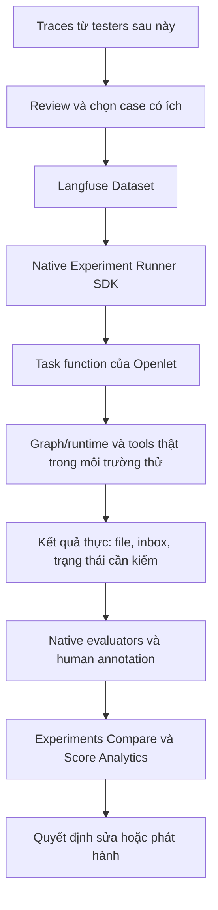

# Evaluation cho Openlet MVP: research và đề xuất

Ngày khảo sát: 2026-11-13. Trạng thái: **đề xuất để thảo luận, chưa phải thiết kế evaluation đã được người dùng duyệt**. Observability đã chốt trong [plan hiện tại](../261113-1335-system-observability/plan.md) giữ nguyên. Không sửa runtime, publish prompts, tạo Cloud resources hoặc chạy inference. Không dùng skill/subagent.

Yêu cầu: quy trình chuyên nghiệp, thực tế cho demo và 1–10 testers; tận dụng Langfuse Cloud Hobby; chỉ viết phần riêng khi có lý do nghiệp vụ. Không evaluation service/framework, orchestration mới hoặc paid-provider CI trên mọi PR.

## 1. Kết luận nghiên cứu

**Không cần có production data mới bắt đầu evaluation.** Langfuse tách hai việc: offline experiments trên dataset tự chuẩn bị và online evaluation trên traffic thực. Traces của những lần chạy development/experiment cũng là dữ liệu quan sát thực của ứng dụng, dù input do developer viết.

[AI Engineering Loop](https://langfuse.com/academy/ai-engineering-loop) nói rõ ứng dụng chưa production có thể bắt đầu từ datasets → experiments → evaluation. [Designing datasets](https://langfuse.com/academy/datasets/designing-great-datasets) khuyên bản đầu khoảng 15–30 rows và cho phép synthetic cases khi chưa có nguồn khác. [Error analysis](https://langfuse.com/academy/monitoring/error-analysis) dùng được cả với experiment outputs/local representative inputs. Không có yêu cầu phải đợi một lượng người dùng hoặc traces tối thiểu.

[Anthropic](https://www.anthropic.com/research/demystifying-evals-for-ai-agents) cũng khuyên chuyển product requirements/manual checks thành agent tasks ngay từ đầu; ưu tiên kết quả trong môi trường thực hơn lời agent tự nhận. [OpenAI](https://developers.openai.com/api/docs/guides/evaluation-best-practices) liệt kê synthetic/human-curated/domain data bên cạnh production data, không coi production là điều kiện tiên quyết.

Một số cookbook mô tả tracing → first users → scaling/offline như câu chuyện trưởng thành sản phẩm. Đó không phải thứ tự bắt buộc. Khi triển khai API, ưu tiên current Evaluation docs/SDK thay các đoạn notebook cũ.

## 2. Các khái niệm cần dùng

| Khái niệm | Nghĩa cụ thể trong Openlet |
|---|---|
| Dataset | Tập tình huống lặp lại để kiểm tra một thay đổi có tốt hơn không |
| Dataset item | Một công việc hoặc tình huống có điểm kiểm tra kết quả xác định |
| Expected output | Facts, hiệu ứng hoặc tiêu chí cần đạt; không nhất thiết một câu trả lời mẫu |
| Task | Function mà native Experiment Runner gọi để chạy ứng dụng cho một item |
| Evaluator | Người, code hoặc LLM quyết định kết quả có đạt tiêu chí không |
| Score | Kết quả chấm lưu trong Langfuse; có thể kèm lý do |
| Experiment | Chạy một phiên bản ứng dụng trên dataset để xem/so sánh kết quả |
| Offline | Chạy trên bộ case kiểm soát; vẫn có thể gọi model và services qua network |

Evaluation không phải training/fine-tuning. Dataset nhỏ vẫn hữu ích cho kiểm tra yêu cầu và phát hiện regressions; chưa đại diện cho tỷ lệ thành công trên người dùng thực.

## 3. Đơn vị đánh giá phù hợp Openlet

Giữ `session_id = agent_id` và production graph invocation → trace như observability đã chốt. **Không chấm toàn bộ session sống lâu của agent như một cuộc hội thoại phải kết thúc.**

Một item thường là một task ngắn qua một graph invocation. Nếu hành vi cần nhiều lượt, item có một kịch bản hữu hạn: nhận yêu cầu → tạo HITL và chờ → fixture cung cấp câu trả lời → agent tiếp tục → kiểm kết quả. Case kết thúc ở mốc nghiệp vụ đã định, không chờ agent lifetime/session kết thúc.

Chờ đúng cũng là kết quả hợp lệ. Case kiểm việc hỏi một member có thể pass khi request đúng người đã được tạo và agent kết thúc lượt mà chưa tự đoán câu trả lời. Case kiểm hoàn thành sau HITL chỉ pass sau khi nhận câu trả lời và làm xong. Không đánh đồng activity/graph kết thúc với task hoàn thành.

Root và Leti giữ sessions/traces riêng. Một experiment item có thể bao quát kết quả phối hợp hữu hạn; task trả evidence và liên kết các executions thực nếu cần. Không merge production traces hoặc xây multi-agent trace registry để chấm.

## 4. Dataset đầu tiên khi chưa có user data

Đề xuất bắt đầu **một dataset `openlet/agent-tasks`, khoảng 15–25 items**. Khoảng này là lựa chọn MVP, không hard requirement của SDK. Có thể chạy bản đầu ít hơn để kiểm tra cách dựng case trước khi bổ sung đủ phạm vi.

Nguồn sẵn có là [12 behavior cases trong prompting draft](../261111-2010-leta-rewrite/prompting.md#9-các-tình-huống-phải-dùng-để-đánh-giá-draft), [tools](../261111-2010-leta-rewrite/tools.md), inbox/HITL/Box/compaction đã chốt và vài tài liệu thử nhỏ. Các cases thể hiện business rules đã duyệt; wording của system prompt vẫn draft, chưa coi như đáp án chuẩn.

| Nhóm case | Kết quả thực cần kiểm tra |
|---|---|
| Đọc/sửa tài liệu chung | Đúng thay đổi được lưu; phần ngoài yêu cầu được giữ; có thông báo kết quả nếu task yêu cầu |
| Root nhận notification | Đọc detail cần thiết trước khi hành động; không bỏ điều kiện quan trọng chỉ vì preview thiếu |
| Người yêu cầu khác creator | Làm theo yêu cầu/quyền hiện tại và gửi đúng permitted recipient; không tự gửi cho creator |
| Giao việc cho Box/Leti | Task được gửi sau khi Box sẵn sàng; kết quả được chuyển qua inbox; create ACK không được coi là đã hoàn thành công việc |
| Thiếu quyết định, cần HITL | Hỏi đúng addressed workspace member; pending không được coi là đã trả lời hoặc đã được cấp quyền |
| Không còn việc làm được | Kết thúc lượt/chờ đúng; không sleep/status spam hoặc tự lập lịch để polling |
| RAG trên tài liệu thử | Tìm được nguồn hỗ trợ cần thiết và câu trả lời dựa trên nguồn đó; không tìm thấy thì không bịa |
| Lịch đơn giản | Schedule lưu đúng thời gian/timezone và instruction đủ nghĩa, gồm gửi kết quả nếu đã yêu cầu |
| Tiếp tục sau compaction | Giữ quyết định, người nhận, paths và commitments cần cho việc tiếp theo; không lặp một việc đã làm |
| Một vài lỗi ảnh hưởng lớn | Không gửi dữ liệu sai người hoặc phá nội dung ngoài yêu cầu; file/tool content không tự trở thành instruction có quyền cao hơn |

Ưu tiên việc thường gặp; chỉ thêm vài ca rủi ro thật. Không tạo hàng trăm permutations, test từng câu prompt hoặc bắt 28 tools đều phải có một paid-model test riêng. Case nên có cả tình huống cần dùng một hành vi và tình huống không cần dùng, ví dụ hỏi HITL khi thiếu quyết định nhưng tự làm khi thông tin đã đủ.

Mỗi item dùng các fields native:

- `input`: instruction/message hoặc state cần cho boundary đang kiểm, giữ input shape thống nhất trong dataset.
- `expectedOutput`: facts/effects/tiêu chí để reviewer hoặc code chấm. Không đưa field này vào agent input.
- `metadata`: chỉ scenario và fixture khi cần chuẩn bị môi trường. Không lặp mọi domain ID hoặc thêm evaluation schema framework.

Fixtures là tài liệu/state thử nhỏ trong repo; Langfuse quản lý cases và kỳ vọng. App commit xác định revision fixtures. Không tạo dataset SQL tables hoặc một kho metadata thứ hai.

Có thể nhờ LLM gợi ý cách diễn đạt/thêm vài case, nhưng developer phải kiểm input, facts và tiêu chí. Output của model được thử không tự trở thành ground truth, kể cả khi UI “Add to dataset” điền sẵn output đó.

## 5. Cách thực thi: native Langfuse làm phần lớn

Native SDK quản lý iteration, task tracing, concurrency, error isolation và experiment association. **Không viết runner thay Langfuse.** Full agent dùng Experiments via SDK; UI Prompt Experiments dùng cho prompt/model calls riêng, không thay việc thực thi Openlet graph/tools/services.

Phần task function cần làm:

1. Chuẩn bị fixture trong workspace thử, với agent/checkpoint và tài liệu ở trạng thái ban đầu tương đương giữa hai phiên bản. Dùng existing app functions/API và môi trường integration; không sửa workspace người dùng thật.
2. Chạy cùng graph, middleware, prompt composition và tools sẽ dùng trong sản phẩm. Không tạo agent “rút gọn cho eval” hoặc dùng fake tool successes để tuyên bố end-to-end pass.
3. Với case nhiều lượt, đưa vào các messages/responses thử đã định qua boundary tương ứng và kiểm đúng mốc. Chỉ vài case cần điều này; không xây scenario DSL hoặc simulator agent.
4. Đọc lại output/effects thật cần cho case: nội dung file liên quan, inbox delivery/recipient, request hoặc schedule state. Trả evidence nhỏ đủ để chấm; không dump toàn DB/checkpoint hoặc cả đời history.

Bắt đầu concurrency thấp, có thể `max_concurrency=1`. Case không dùng lại kết quả đã sửa/checkpoint của case trước. Native test setup/reset và fresh agent IDs đủ cho MVP; không snapshot infrastructure hoặc dựng environment orchestration mới.

### Tracing của experiment

Runner SDK đã tạo experiment-item task root và link dataset. Khi trực tiếp gọi graph trong process evaluation, dùng native callback trong context đó; không ép một random TraceID khác như production activity cần tách Temporal parent. Production vẫn giữ thiết kế đã chốt. Đây là cách dùng context của native runner, không đổi trace/session model của sản phẩm.

Các kiểm tra qua workers/API thật vẫn có production traces độc lập; experiment lưu result/evidence và references hữu ích. Không giả định callback tự nối được mọi async workflow hoặc cross-process execution vào một trace.

## 6. Chấm gì và bằng cách nào

MVP bắt đầu bằng **`task_success` Boolean và comment giải thích** cho manual review. Tiêu chí là đáp ứng yêu cầu tại điểm kết thúc của case, gồm kết quả thực và delivery bắt buộc. Khi facts/effects kiểm được chính xác bằng code, thêm **`required_effects` Boolean** cho phần đó; không coi code check một phần là đã chứng minh toàn bộ chất lượng nội dung.

| Cách chấm | Dùng ở đâu |
|---|---|
| Human annotation native | Chấm tất cả case của những lượt đầu, phân biệt lỗi agent, lỗi fixture và lỗi grader; ghi pass/fail kèm lý do |
| Native hosted code evaluator | So output/evidence với expected fields, recipient, trạng thái, facts hoặc retrieved source đã biết; standard-library checks đủ dùng |
| SDK evaluator function | Chỉ dùng khi cần tái sử dụng assertion sẵn có hoặc check cần chạy trong process ứng dụng; không viết lại cùng logic thêm ở Cloud |
| Managed LLM-as-a-Judge | Thêm khi đã thấy một failure mode cần chấm ý nghĩa lặp lại, ví dụ báo cáo bịa thông tin không có trong nguồn |

Không cần một score cho mọi thuộc tính trừu tượng như helpfulness/toxicity/style ngay ngày đầu. Cost, latency, token usage đã có native telemetry; không viết lại thành judge scores.

### Hai giới hạn native cần hiểu đúng

1. **Hosted code evaluator không có network egress**, chỉ standard libraries, runtime tối đa 2 giây. Nó không thể gọi LetFS/SQL để xác minh file. Task đọc kết quả thực rồi trả evidence để Cloud chấm, hoặc dùng native SDK evaluator trong process có quyền đọc môi trường thử.
2. **Observation-level LLM judge chỉ thấy observation được chọn**, không tự lấy siblings/children hoặc full agent session. Dataset reference/metadata phải map đúng experiment fields. Không kỳ vọng một judge trên final assistant text biết những effects chưa được ghi trong input/output nó nhận.

Vì vậy phần riêng Openlet chủ yếu là fixture/task adapter và các tiêu chí nghiệp vụ. Việc này là phần function mà docs native yêu cầu, không phải một nền tảng evaluation tự chế.

Đối với hosted evaluator, chọn đúng experiment task observation/dataset, tránh chấm lại graph root và từng generation bên trong như các task độc lập. Không bật rule cho mọi model/tool observation.

### Ví dụ một case có thể kiểm ngay khi runtime sẵn sàng

Fixture: một bảng giá thử có ba sản phẩm. User yêu cầu “Đổi giá sản phẩm A từ 100.000 thành 120.000, giữ các sản phẩm khác và gửi tôi kết quả.”

- Input là yêu cầu cùng context định danh như sản phẩm thực nhận; bảng giá được seed qua fixture.
- Expected output là giá A mới, hai dòng khác giữ nguyên và message gửi đúng người yêu cầu. Không yêu cầu một câu trả lời đúng từng chữ.
- Agent chạy tools thật; task đọc lại bảng giá và inbox sau execution.
- Code evaluator so ba giá trị và recipient; reviewer kiểm lời báo cáo đúng với kết quả, không tuyên bố làm thêm việc chưa thực hiện.
- Agent nói “done” nhưng file cũ hoặc chỉ có assistant text mà chưa gửi inbox: fail.

Không ép một thứ tự tools cố định nếu có nhiều đường hợp lệ. Chỉ kiểm actions/ordering khi chính ordering đó là yêu cầu nghiệp vụ, ví dụ chưa gửi task vào Box trước khi nó sẵn sàng.

## 7. Quy trình làm việc đề xuất

1. Viết vài case rõ ràng, chạy thử để kiểm fixture và cách lấy evidence. Mở rộng thành khoảng 15–25 cases với phạm vi ở trên.
2. Chạy implementation đầu tiên làm baseline; reviewer xem kết quả trong Langfuse. Baseline không mặc nhiên được duyệt chỉ vì đó là lần chạy đầu. Không cần phục dựng archive để có baseline.
3. Thử một thay đổi prompt/model/runtime trên cùng dataset version và fixture ban đầu. Ghi app commit, exact prompt/model config và evaluator version khi có; dùng metadata native, không release registry mới.
4. Dùng Experiments Compare xem từng case và aggregate. Đọc các trường hợp tốt lên/xấu đi cùng cost/latency. Average tăng không bù cho gửi sai người hoặc mất dữ liệu.
5. Sửa cause thật. Case mơ hồ/grader sai thì sửa case/grader và so lại hai phiên bản theo cùng tiêu chí. Thay đổi hệ thống thì chạy lại nhóm bị tác động và các case nghiệp vụ quan trọng.
6. Chỉ phát hành khi các yêu cầu bắt buộc được kiểm đủ, không còn regression nghiêm trọng chưa xử lý. Case thiếu kết quả hoặc evaluator lỗi là chưa kết luận, không tính pass. Không đặt ngưỡng 95% tùy tiện để thay review trên dataset nhỏ.

LLM có biến thiên: case quan trọng hoặc chênh lệch đáng nghi có thể chạy lại vài lần, lưu thành các experiment runs khác nhau và giữ mọi kết quả. Không retry đến khi xanh, không mặc định mọi item chạy hàng chục lần. SDK hiện không biểu diễn nhiều repetitions của một dataset item trong cùng experiment như các items độc lập.

Chạy từ máy developer hoặc job on-demand khi đổi prompt/model/hành vi agent đáng kể. Không paid-provider eval cho mọi PR, không nightly job mặc định. Sau này nếu cần CI gate thì dùng official `langfuse/experiment-action`; không làm gate framework trước khi rubric và chi phí ổn định.

## 8. Khi nào dùng LLM judge và online evaluation

Sau những lượt review đầu tiên, chọn một lỗi có ý nghĩa và xuất hiện lặp lại. Nếu code có thể chấm chắc chắn thì dùng code. Nếu cần hiểu ngôn ngữ:

- Lấy khoảng 10–20 outputs thực từ các lần chạy development/experiment, chấm tay cả pass và fail, ghi lý do. Đây đã là dữ liệu của ứng dụng, không cần production traffic.
- Viết một rubric hẹp, chỉ rõ nguồn/đầu ra cần xem và điều phải bỏ qua. Ví dụ “Báo cáo có phát biểu thực tế không được nguồn cung cấp hỗ trợ không?”
- Dùng managed LLM-as-a-Judge trong Langfuse; không thêm judge service/LLM proxy/library evaluation khác.
- Thử trên các ví dụ đã chấm, giữ một phần không dùng để chỉnh rubric. Dùng native Score Analytics xem cả lỗi bỏ sót lẫn báo sai; tỷ lệ đồng ý chung cao trên toàn case pass chưa chứng minh judge tốt.
- Thiếu evidence thì để chưa kết luận hoặc đưa review; không ép thành pass/fail đoán. Vẫn kiểm thủ công các ca quan trọng và bất đồng.

Không yêu cầu multi-judge consensus, một model family khác bằng mọi giá hoặc approval committee cho MVP. Judge phải được kiểm tra, không mặc nhiên đúng chỉ vì dùng model mạnh.

Với 1–10 testers, bước đầu review bằng UI hoặc **một annotation queue native** và chuyển các ca hữu ích thành dataset. Thêm cả một số ca thành công/bình thường để không chỉ nhìn thất bại. Không tự lấy model output lỗi làm expected output; reviewer viết facts/behavior đúng.

Online judge chưa cần bật ngay. Khi đã có rubric đáng tin và observation đủ context, dùng native rule trên đúng operation cần chấm. Sampling của evaluator là lựa chọn riêng với trace sampling; không giảm OTel/Langfuse tracing ratio 1.0 đã chốt chỉ vì muốn chấm ít hơn. Không chấm từng token, từng tool hoặc toàn agent lifetime.

Không thêm feedback endpoint/UI chỉ để có data cho eval. Nếu sản phẩm thêm rating sau này thì gửi native score gắn đúng result/observation bằng cơ chế được duyệt lúc đó. HITL approved hoặc user không phản đối không tự là quality pass.

## 9. RAG, compaction và processing trong phạm vi MVP

| Phần | Cách bắt đầu vừa đủ |
|---|---|
| Agent dùng RAG | Một số questions trên corpus thử với supporting documents/facts đã biết. Kiểm final authorized hits có nguồn cần thiết; review câu trả lời có dùng đúng nguồn không |
| Retrieval tuning riêng | Khi thật sự đổi search/rerank, tách dataset có queries và relevant source labels; dùng code scores phù hợp như hit/recall ở top-k cần dùng. Không bật toàn bộ metric catalog RAGAS từ đầu |
| Compaction | Có case giữ decision/pending work và tiếp tục làm đúng sau summary + tail. Khi chỉnh prompt compaction riêng, dùng dataset nhỏ riêng đúng input boundary; summary ngắn hoặc giống reference chưa đủ chứng minh continuity |
| Enrichment | Với các files mẫu, kiểm các facts/sections cần có và nội dung không bịa. Chỉ tạo dataset prompt riêng khi chuẩn bị thay enrichment |
| Parsing, Temporal, permissions, cache | Focused ordinary tests/integration checks theo plan owning; không thêm LLM judge cho logic xác định hoặc dùng evaluation làm cơ chế bảo vệ runtime |

Không tạo tất cả datasets chuyên biệt ngay lúc bắt đầu. Dataset khác chỉ có lý do khi input boundary, cách chấm hoặc quyết định thay đổi khác nhau. UI Prompt Experiments hữu ích cho compaction/enrichment calls riêng nếu input/prompt mapping khớp; full agent vẫn chạy SDK với thực thi thật.

## 10. Cloud Free và thay đổi hạ tầng

[Pricing](https://langfuse.com/pricing) tại ngày research: Hobby có datasets, SDK/UI experiments, custom scores, LLM judge, human annotations; **một annotation queue**, hai dashboard seats, 50k units/tháng và 30 ngày data access. [Code evaluator docs](https://langfuse.com/docs/evaluation/evaluation-methods/code-evaluators) ghi khả dụng trên Hobby.

Model calls của agent và judge vẫn tính ở provider. [Units](https://langfuse.com/docs/administration/billable-units) gồm traces + observations + scores; experiments và managed evaluators cũng tạo units. Không coi code evaluator là không tốn quota chỉ vì không gọi LLM. Free đủ tính năng cho thiết kế này; lượng chạy vừa quota phải đo thực tế.

Không thêm container/service, Temporal workflow/activity, database, evaluation queue tự quản, bespoke exporter hoặc Grafana evaluation dashboard. Reuse Langfuse project/environments hiện tại; SDK runner đã đánh dấu environment experiment để không trộn production metrics. Một script gọi runner native và fixtures/checks nghiệp vụ là đủ phía repo.

## 11. Phạm vi tài liệu đã rà soát

Đã đọc nội dung 22/22 pages trong `/docs/evaluation/` theo [live docs index](https://langfuse.com/llms-docs.txt). Các code examples được đọc chọn lọc khi cần xác nhận Python SDK/task contract, không chạy examples hoặc cài skills do external docs gợi ý.

| Nhóm | Các trang và quyết định áp dụng |
|---|---|
| Tổng quan, concepts, bắt đầu (4) | [Overview](https://langfuse.com/docs/evaluation/overview), [Concepts](https://langfuse.com/docs/evaluation/core-concepts), [Offline](https://langfuse.com/docs/evaluation/get-started/offline), [Online](https://langfuse.com/docs/evaluation/get-started/online): offline trước production, online bổ sung sau |
| Evaluation methods (6) | [LLM judge](https://langfuse.com/docs/evaluation/evaluation-methods/llm-as-a-judge), [decision models](https://langfuse.com/docs/evaluation/evaluation-methods/decision-models), [code](https://langfuse.com/docs/evaluation/evaluation-methods/code-evaluators), [annotation queues](https://langfuse.com/docs/evaluation/evaluation-methods/annotation-queues), [UI scores](https://langfuse.com/docs/evaluation/evaluation-methods/scores-via-ui), [SDK scores](https://langfuse.com/docs/evaluation/evaluation-methods/scores-via-sdk): native manual/code trước; narrow judge khi đủ labels; decision models chưa có nhu cầu riêng |
| Experiments (7) | [Datasets](https://langfuse.com/docs/evaluation/experiments/datasets), [data model](https://langfuse.com/docs/evaluation/experiments/data-model), [SDK](https://langfuse.com/docs/evaluation/experiments/experiments-via-sdk), [UI](https://langfuse.com/docs/evaluation/experiments/experiments-via-ui), [OTel](https://langfuse.com/docs/evaluation/experiments/experiments-via-opentelemetry), [comparison](https://langfuse.com/docs/evaluation/experiments/compare-experiments), [CI](https://langfuse.com/docs/evaluation/experiments/experiments-ci-cd): hosted dataset/versions + SDK runner + native compare; chưa webhook/direct OTel experiments/CI gate |
| Scores (3) | [Overview](https://langfuse.com/docs/evaluation/scores/overview), [data model](https://langfuse.com/docs/evaluation/scores/data-model), [analytics](https://langfuse.com/docs/evaluation/scores/score-analytics): Boolean/comment đầu tiên; native agreement khi calibration; không cộng chung score semantics khác nhau |
| More (2) | [Agentic access](https://langfuse.com/docs/evaluation/more/agentic-access), [FAQ](https://langfuse.com/docs/evaluation/more/troubleshooting-and-faq): không cấp evaluation admin tools cho Leta/Leti, không custom management UI |

Nguồn bổ sung đã đối chiếu:

- Academy: [AI loop](https://langfuse.com/academy/ai-engineering-loop), [datasets](https://langfuse.com/academy/datasets), [dataset design](https://langfuse.com/academy/datasets/designing-great-datasets), [experiments](https://langfuse.com/academy/experiments), [evaluation](https://langfuse.com/academy/evaluate), [choosing metrics](https://langfuse.com/academy/evaluate/choosing-what-to-evaluate), [writing evaluators](https://langfuse.com/academy/evaluate/writing-evaluators), [monitoring](https://langfuse.com/academy/monitoring), [error analysis](https://langfuse.com/academy/monitoring/error-analysis), [signals](https://langfuse.com/academy/monitoring/capturing-signals).
- Guides: [LangGraph](https://langfuse.com/guides/cookbook/example_langgraph_agents), [agent evaluation](https://langfuse.com/guides/cookbook/example_pydantic_ai_mcp_agent_evaluation), [N+1](https://langfuse.com/guides/cookbook/example_evaluating_multi_turn_conversations), [simulation](https://langfuse.com/guides/cookbook/example_simulated_multi_turn_conversations), [synthetic datasets](https://langfuse.com/guides/cookbook/example_synthetic_datasets), [error-analysis walkthrough](https://langfuse.com/guides/cookbook/error-analysis-llm-applications).
- Native constraints: [hosted evaluators on SDK runs](https://langfuse.com/faq/all/langfuse-evaluators-on-dataset-runs), [sessions](https://langfuse.com/resources/engineering/evaluating-sessions-conversations), [OTel experiment contract](https://langfuse.com/integrations/native/opentelemetry/experiments), [feedback](https://langfuse.com/docs/observability/features/user-feedback), [corrections](https://langfuse.com/docs/observability/features/corrections).
- Public Python SDK 5.2.0 source: `Langfuse._process_experiment_item` tạo task root, ghi actual output và experiment context; `CallbackHandler._take_root_trace_context` dùng active parent khi không ép trace_context. Đây là kiểm source, chưa là integration proof của Openlet.

Current API lưu scores trên trace/observation vẫn hợp lệ, nhưng **managed trace-level evaluators là legacy**, Cloud dừng chúng ở cutover 2026-11-16. New setup dùng observation-level/experiment targets; không copy trace-level evaluator configuration từ notebook cũ. Text scores hữu ích cho review observations, nhưng không là metric trong experiments/Score Analytics; MVP dùng Boolean + comment.

## 12. Giới hạn và việc còn lại

Leta mới chưa implementation; chưa tạo dataset trên Cloud, chạy graph/provider/judge hoặc đo quota/cost. Có thể viết cases và rubric trước; chạy full agent experiments khi runtime có đường thực thi thật. Pure prompt experiment không chứng minh inbox/file/Temporal integration.

Không còn câu hỏi hạ tầng bắt buộc để trình bày đề xuất này. Người dùng chưa duyệt evaluation design hoặc initial dataset; exact cases, references và reviewer labels là deliverables tiếp theo nếu chọn hướng này. Dữ liệu thật sau demo sẽ kiểm tra lại mức độ đại diện của bộ case khởi đầu.
